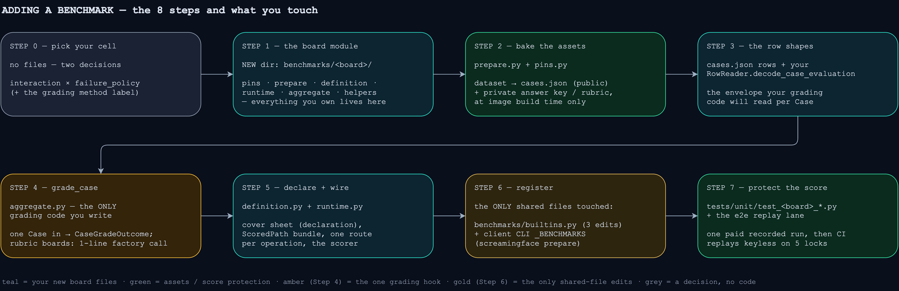
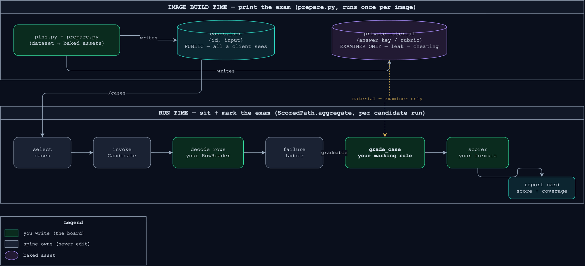
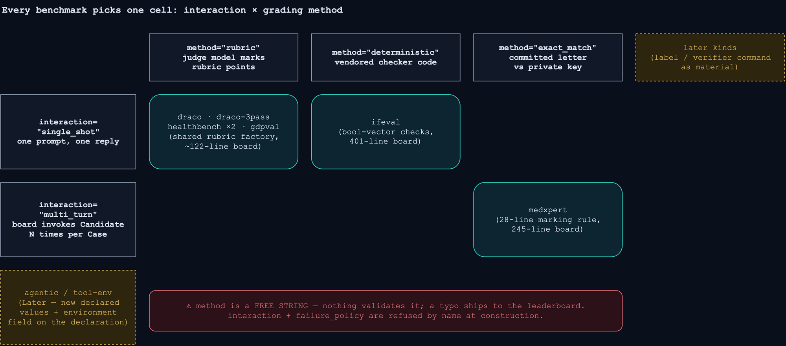
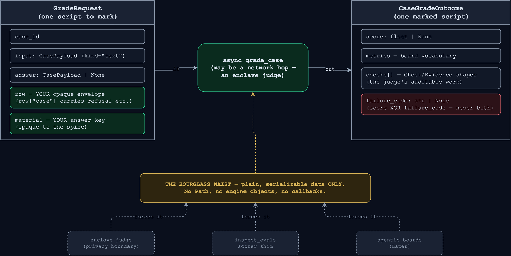
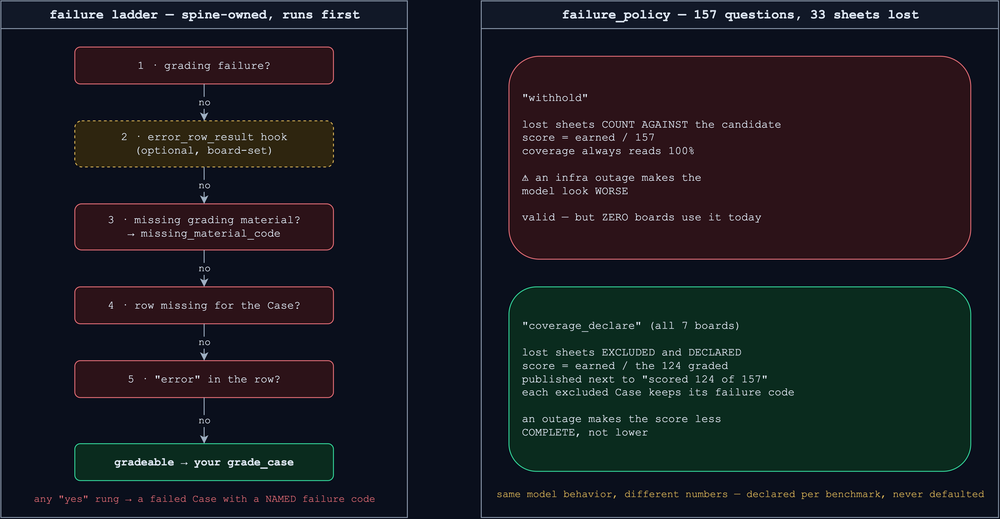

# Adding a benchmark manually

> **Read this first — the lane rule (OME-1513).** A new Benchmark is a **local inspect
> Task** — one file in inspect's shape (dataset loader, scorer, `@task`) under
> `src/screamingface_engine_inspect/local_tasks/<name>/`, fed to the same importer that
> imports inspect_evals — **unless a later Candidate call's prompt depends on an earlier reply**
> (medxpert's reason-then-commit exchange). Only that case is a hand-built
> folder, and only that case is what this guide is for. Everything else, whether or not it
> exists in inspect_evals, goes through
> [`adding-an-imported-benchmark.md`](adding-an-imported-benchmark.md) ("Importing a local
> Task"). MuSiQue-Ans (`local_tasks/musique/`) is the worked example: 180 lines, three Named
> Scores, no routes, no envelope, no revision function. Several *independent* Attempts per Case
> (pass@k, inspect's `epochs`) are not the exception: they arrive on both lanes with `OME-1458`.
>
> **Importing an existing inspect_evals benchmark?** Same doc — that is a data operation,
> not an authoring project.
>
> **Who is still on this lane (OME-1527).** MedXpertQA is the one Benchmark the lane exists
> for. IFEval still lives here until its own move to a local Task lands (OME-1527, Work order
> row 15). Every judged rubric Benchmark moved out: ContractEval, GDPval-text, DRACO and,
> last, HealthBench (worst-30 and professional) are local Tasks under `local_tasks/`, so a new
> rubric Benchmark copies `local_tasks/healthbench/` or `local_tasks/gdpval/`, never a folder
> here.

**TLDR: a benchmark is an exam, and you only author the exam-specific parts. You bring
the question paper (dataset mapping), the rule for grading one answer (`grade_case`),
and the cover sheet stating how the exam is run and scored (declaration). Everything
every exam does the same way — seating the candidate, collecting the answers, filing
results, totalling the score — is the exam hall, run by the shared grading code
(`benchmarks/shared_grading/`).** You never edit another benchmark or a shared grading file — if you
have to, the shared grading code failed its deletion test and that is a bug to file, not a pattern to
copy.

The whole journey at a glance — each box is one step below, stating what you change
there:



And the seam that journey stays inside — what a benchmark author owns vs what the shared grading code
runs:



Realistic size, from the benchmarks in production: a novel grading mode is
`medxpert/aggregate.py` (245 lines; ifeval's `grade.py` was 401 before it became a local Task)
plus its protocol/runtime modules.
Everything below is walked against MedXpertQA (`benchmarks/medxpert/`), the newest benchmark
— when a step says "copy the shape", that is the module to open.

## Step 0 — pick your cell on the two axes



`interaction` and `failure_policy` live on `BenchmarkDeclaration`
(`benchmarks/definition.py`) — both **required, no defaults**: a defaulted policy is a
policy nobody can approve, and the declaration is splatted unconditionally into the
manifest so reviewers approve it by reading the manifest, never engine source. The
grading `method` is the informal third axis: a free string on `BenchmarkAggregation`, published as
`CaseGrade.method` — reuse an existing value unless your grading genuinely is a new kind.

## Step 1 — the benchmark module

One directory: `src/screamingface_engine/benchmarks/<benchmark>/`. MedXpertQA's layout:

| File | Role (exam terms) |
|---|---|
| `pins.py` | which printing of the question paper — dataset id, config, revision, split, `PREPARER_REVISION` / `PROTOCOL_REVISION` |
| `prepare.py` | prints the paper — dataset → prepared assets, at image build time |
| `definition.py` | the exam's public listing — the `Benchmark` record, `compute_revision()`, the url4 protocol template, the declaration |
| `runtime.py` | the exam hall's doors — the benchmark's FastAPI routes |
| `aggregate.py` | the marking room — `grade_case`, the `BenchmarkAggregation` wiring, the scorer |
| `case_grade.py` | the benchmark's answer-sheet format — schema-validated per-Case evaluation envelopes |
| `grading.py` / `answering.py` / `prompts.py` | benchmark-private marking and prompting helpers |

Unit tests go to `tests/unit/test_<benchmark>_*.py` (medxpert ships seven). Spine tests
(`test_spine_*.py`) are not yours to touch.

## Step 2 — prepare the assets

`prepare.py` exposes `def prepare(out: Path) -> dict[str, Any]` (an audit summary) plus
an argparse `main()` with `--out`. It runs at **image build time only**
(`Dockerfile.benchmark`), never at request time:

```sh
uv run --with datasets python -m screamingface_engine.benchmarks.medxpert.prepare \
    --out /opt/benchmarks/medxpert
```

- **Split public from private on disk** (see the build-time lane above): `cases.json` is
  all a client sees; the answer key / rubric is read only by `runtime.py` and
  `aggregate.py`.
- Heavy dataset deps (`datasets`) are **not** engine dependencies — import lazily inside
  `prepare` (`importlib.import_module`).
- Dataset drift raises a `BenchmarkAssetPreparationError` subclass (reported without a
  traceback); `TypeError`-family stays reserved for programming defects
  (`benchmarks/deployment.py`).
- Pin everything in `pins.py`, fold it into `compute_revision()` — the revision is in
  every route path, so a re-print of the paper is a new, distinguishable exam.
- Assets land under `$URL4_BENCHMARK_ASSETS` (default `/opt/benchmarks`), one directory
  per bundle id; two benchmarks may share one bundle (hand-built healthbench-worst30 and
  healthbench-professional did, before they became local Tasks).

## Step 3 — the case-row shapes

Two row shapes, one public, one benchmark-owned:

- **The prepared dataset row** (`cases.json`): a JSON array of objects with an `int` `id`
  and a non-blank `str` `input`; every other key rides through as Case metadata. The
  shared grading decodes it into `SelectedCase` (`benchmarks/aggregation.py`).
- **The evaluation row** your `grade_case` receives: an **opaque, benchmark-owned envelope**
  (`benchmarks/shared_grading/case_grades.py` files it and never looks inside). Your
  `CaseGradeReader.decode_case_grade` shapes it; the one sub-key the shared grading code reads is
  `row["case"]` — the candidate fields (`status`, `output`, `finish_reason`, `refusal`,
  `execution`, `operations`, `metadata`) — so your decode must hoist that mapping (copy
  `medxpert/aggregate.py`).

Inputs and answers cross the seam as kind-tagged payloads (`benchmarks/shared_grading/payloads.py`);
`TextPayload` (`kind="text"`) is the only kind implemented — `text+attachments` and
`environment` arrive as new dataclasses, never as a shared-grading rewrite.

## Step 4 — write `grade_case`, the marking rule



```python
type GradeCase = Callable[[GradeRequest], Awaitable[CaseGradeOutcome]]
```

The worked example — MedXpertQA's whole marking rule, 28 lines
(`medxpert/aggregate.py`):

```python
async def _grade_case(request: GradeRequest) -> CaseGradeOutcome:
    """Exact-match one committed letter against the private key — the whole exam rule."""
    attempt: Mapping[str, Any] = request.row["attempt"]
    material = request.material
    assert isinstance(material, Mapping)  # the ladder already rejected unusable assets
    label: str = str(material["label"])
    committed: str = str(attempt.get("answer") or "")
    answered: bool = bool(committed)
    correct: bool = answered and committed == label
    return CaseGradeOutcome(
        score=1.0 if correct else 0.0,  # unanswered scores 0.0, not None —
        metrics={"answered": answered},  # the official empty-prediction verdict
        checks=[
            {
                "type": "choice",
                "id": "1",
                "label": "committed choice matches the published key",
                "outcome": "MET" if correct else "UNMET",
                "evidence": [_match_evidence(committed, label, correct)],
                "metadata": {"committed": committed, "expected": label},
            }
        ],
    )
```

Read the example's grammar: `material` is the answer key your benchmark prepared in Step 2;
`row` is your own envelope from Step 3; the returned `checks` are
`Check`/`Evidence`-shaped dicts (`benchmarks/contract.py`) so the judge's work is
auditable per Case.

**A judged rubric Benchmark does not belong here.** It is a local inspect Task: its scorer
asks the judge one rubric line at a time through `judge_until_parsed`
(`screamingface_engine_inspect/judge_redraw.py`) and parses each reply with the one shared
parser (`benchmarks/shared_grading/judge_evidence.py`) — never write your own. Copy
`local_tasks/healthbench/` (points rubric, one judge pass) or `local_tasks/draco/` (weighted
rubric, several passes).

## Step 5 — declare the cover sheet and wire the path

```python
declaration = BenchmarkDeclaration(
    failure_policy="withhold",  # or "coverage_declare"; see below
    interaction="multi_turn",  # medxpert; single_shot for most benchmarks
)
```



`failure_policy` is **required**: there is no default, so you must choose. It says what a Case
with no numeric grade (a failed Case) does to the score:

- `withhold` — the failed Case counts 0 and stays in the denominator. The score is the mean
  over EVERY selected Case. Coverage still shows graded / selected beside it. MedXpertQA
  declares this.
- `coverage_declare` — the failed Case leaves the score. The score is the mean over the graded
  Cases only, and coverage is the only place the failed Case shows.

Under both, a run with no graded Case at all publishes no score. A `withhold` scorer must
divide by every Case it receives (`Scorer` in `benchmarks/aggregation.py`), and the policy is
Benchmark identity: changing it moves the revision. Pass the same value to the
`BenchmarkAggregation` below (`failure_policy=`, also required), so the hooks and the
declaration cannot disagree.

Bundle the hooks into a `BenchmarkAggregation` (`benchmarks/shared_grading/benchmark_aggregation.py`) — MedXpertQA's is the smallest
complete registration of the whole surface (`medxpert/aggregate.py`):

```python
_PATH = BenchmarkAggregation(
    reader=CaseGradeReader(...),  # your decode from Step 3
    grade_case=_grade_case,  # your marking rule from Step 4
    failure_messages=...,  # your benchmark's wording per failure code
    method="exact_match",
    grading_failure_code=...,
    grading_failure_message=...,
    missing_material_code="missing_answer_asset",  # default: "missing_rubric_asset"
    failure_policy=declaration.failure_policy,  # required; the same value as the declaration
)
```

then call `_PATH.aggregate(raw_case_grades, benchmark_id=..., benchmark_revision=...,
selected_cases=..., grading_material=..., scorer=..., case_metadata=...)`. Four optional
hooks let a benchmark reshape a ladder rung's result (ifeval set `missing_case_result` and draco
set all four until they became local Tasks); don't set any until a golden or a spec
forces you to. For the
scorer, pass your own function (medxpert's `_accuracy`).

The protocol surface — the url4 template in `definition.py` (`build`) plus the FastAPI
routes in `runtime.py` (`install`) — follows one rule: **one explicit route per
operation, revision in the path**. Registration refuses a benchmark whose rendered
protocol references a route `install` never registered, so a missing route fails at
startup, not mid-run. Copy `medxpert/definition.py` + `medxpert/runtime.py`; the shapes
are not summarized here on purpose — those two files are the source of truth.

The expression follows URL4 Parts A–C (spec
`docs/spec/2026-10-20-url4-benchmark-expression-spec.md`): the case set is a data reference,
each deterministic step is a code mount, and the Candidate call is LLM mode. Build it with
`benchmarks/protocol.py` (`evaluation_protocol`, `attempt_steps`) and
`definition.candidate_invocation`:

- **Cases** — shared `install_cases` (`benchmarks/case_selection.py`) registers
  `/benchmarks/<id>/<revision>/cases` as a data route. It refuses a booklet with fewer rows
  than the Benchmark declares, or a row that is not an object, before inference. The
  expression selects with `;iteration.slice`.
- **Candidate** — `candidate_invocation(prompt, case_count=N, …)`: the prompt is the quoted
  intent (`'$item.input'`); the Case facts (`case_id`, `case_index`, `case_count`) and the
  Recipe (`recipe`, last) are unweighted sources, outside model input. The adapter converts
  the index to the one-based activity position. Do not add synthetic fields to dataset rows.
- **Per-Case and per-run steps** — code mounts (`node.code(path)`) that read named sources:
  `case_evaluation_code` (`case`, `attempt_1..N`) and `aggregate_code` (`evaluations`,
  `selected`) in `benchmarks/case_evaluation.py`. A failure inside a code step is url4's
  `intent_error`; the handler's own code and retryability travel as its `cause`, and that is
  what the report shows.

### Live activity: what the benchmark owns

Use the same four stages for every benchmark: `ActivityKind.CASE_LOADING`, `ANSWERING`,
`GRADING` and `AGGREGATION`. `MODEL_CALL` is call detail, not another benchmark stage.
Do not introduce benchmark-specific stage names or infer activity from endpoint names.

Shared implementations already observe their work:

| Implementation | Activity supplied |
| --- | --- |
| `benchmarks/shared_grading/serving.py` cases handler | Loading cases |
| `world/candidate_adapter.py` | Answering, within the candidate's decoded case scope |
| `benchmarks/grading_endpoints.py` case/attempt reduction factories | Grading |
| `benchmarks/grading_endpoints.py` sync and async aggregation factories | Aggregating |

Do not decorate these handlers again at registration. For a benchmark-owned loader, checker
or task preparer, decorate the function that actually performs the work:

```python
from screamingface_engine.activity_kinds import ActivityKind
from screamingface_engine.benchmarks.phases import observe_phase


@observe_phase(ActivityKind.GRADING)
async def check(request):
    return await check_answer(request)
```

Here `check_answer` represents your benchmark's implementation. Use `def` for synchronous
work or `async def` for awaited work; a synchronous function returning an awaitable is
not supported by this decorator. Async stages include heartbeats and cleanup. The
optional observer owns log formatting and delivery; benchmark code uses these ports,
not the concrete activity plugin. With observation disabled, results must be unchanged.

### One grading line per case

A handler's stage completion does not mean the entire case has been graded. For native
benchmarks, call `report_case_grading(case_id, "started")` from
`benchmarks/case_grading_report.py` after decoding the authoritative Case ID at the first
benchmark grading handoff (checker or task preparer). Follow `medxpert/runtime.py` (a
direct checker). Keep the shared `case_evaluation_code`: it reports `"completed"` or
`"failed"` per Attempt. Do not emit completion at every intermediate checker.

These are discrete handoff/outcome facts, not a continuous grading span or a claim that
the answer passed. Candidate-internal corrective checks are suppressed by the helper;
they must not mark benchmark grading as started. A custom path bypassing shared case
execution must supply equivalent explicit terminal facts at its actual outcome boundary.

Keep case metadata outside model input as described above. The Client joins case
numbering by explicit identity, not event order. Do not put prompts, answers, private
benchmark material or raw exception text into logs. Activity is best-effort and bounded;
scores and reports must never depend on its delivery.

For model judges, register each exact request with `register_grading_request` before
executing it. The shared connector observation uses that Engine-owned request-to-Case
binding for judge activity as well as accounting. Do not infer identity from a model
name or call order: ambiguous ownership remains unattributed. Imperative scorers can
instead establish `grading_call_scope(case_id)` around their awaited judge calls.
Candidate execution cannot borrow the registered judge identity.

Exercise the complete installed recipe with a real connector and a simulated Gateway,
including solo and fusion candidates. Check each model call's Case identity, terminal
outcome, and the ordering of judge completion before the Case verdict. The shared
catalogue audit is in `tests/unit/test_builtin_judge_activity.py` and
`tests/unit/inspect/test_imported_catalogue_activity.py`.

## Step 6 — register

A flat, hand-edited list — no entry points, no discovery. Three edits in
`benchmarks/builtins.py`:

1. Import your `Benchmark` and `ASSET_BUNDLE_ID`.
2. Add a lazy prepare shim + bundle:
   `MEDXPERT_ASSETS = BenchmarkAssetBundle(id=MEDXPERT_ASSET_BUNDLE_ID, prepare=_prepare_medxpert)`.
3. One line in `BUILTIN_DEPLOYMENT`:
   `BenchmarkRegistration(benchmark=MEDXPERT, asset_bundle=MEDXPERT_ASSETS)`.

And one edit outside the engine: add the benchmark id to `_BENCHMARKS` in
`packages/screamingface/src/screamingface/_runtime/cli.py`, which backs
`screamingface prepare <benchmark>` on the client.

## Step 7 — protect the score

Unit tests first: the marking rule's happy path, boundaries, and every failure code you
can produce. Then the e2e replay lane — the recorded tape that locks your published score
against refactors:
[`packages/screamingface/tests/e2e/README.md`](../../../packages/screamingface/tests/e2e/README.md).
Short shape: wire the benchmark into the lane (it SKIPs loudly until fixtures exist), the
owner pays for exactly one recorded run, a dev blesses it with `just e2e-bless`, and CI
thereafter replays with zero API keys, going red on any of five locks — expression sha,
case statuses, failure codes, coverage, score.

For activity coverage, follow `tests/unit/test_benchmark_stage_installation.py`
(all registered built-ins), `test_benchmark_stage_parity.py` (observation on/off), and
`test_case_grading_signals.py`. Verify loading, answering, grading and aggregation;
case identity/numbering; success and failure; and unchanged model requests and results
when observation is disabled. Exercise the installed URL4 route, not only a directly
called helper, so execution-context boundaries are covered. A new bespoke execution
path needs its own coverage; registration alone does not add observations.

## Decision — `grade_case` reviewed as a public seam (2026-09-14, OME-1102)

The hook was extracted by the team that built the shared grading code; before calling it a contract we
checked it against two external shapes.

**Shape 1 — the MedXpertQA row mapping** (now merged): needed no sibling handler and no
shared-grading edit. It exercised the seam's least-used corners — a non-rubric method, `multi_turn`
interaction, a benchmark-named `missing_material_code`, `case_metadata` — all through
declared extension points. Pass.

**Shape 2 — an in-enclave refusal judge (Crucible-shaped): pass, with one recorded
caveat.** The checks:

- The request is plain serializable data (the hourglass invariant) — it can cross a
  privacy boundary as-is. The hook is async, so the enclave hop fits the signature.
- Judge configuration rides in `material` (opaque to the shared grading code) — no signature change
  needed to point a Case at an external judge.
- A refusal's text does **not** ride on `GradeRequest.answer` (that is `None` when no
  usable answer exists); it is reachable through the benchmark-owned `row` envelope, whose
  `row["case"]` mapping carries `refusal`. A refusal judge therefore grades from the
  envelope, which the benchmark controls end-to-end. No sibling handler needed.
- The judge's own words come back inside `checks[].evidence[]`
  (`Evidence.explanation` / `raw_output`), so an external judge's audit trail fits the
  existing result shape.

**Caveat:** this review ran against the shape described in the epic (an in-enclave judge
whose owners approve eval code before running it), not against a contract document from
that judge's owners. If their real interface needs anything beyond an async call with
serializable data in and `CaseGradeOutcome` out, that is a new ticket against
`BenchmarkDeclaration` or the payload union — not a quiet widening of `grade_case`.

## Gotchas — the steps people miss

- **`asset_bundle` has no default** on `BenchmarkRegistration` — a benchmark with no assets
  still decides that explicitly.
- **Case statuses are two:** `scored` | `failed`. A graded refusal is an ordinary scored
  Case carrying `refusal` text; an ungradeable one is a failed Case with the
  `provider_refusal` failure code (OME-1037).
- The five-stage marking-room narrative at the top of `benchmarks/shared_grading/benchmark_aggregation.py` is the best
  30-line orientation in the codebase — read it before your first benchmark.

## Related docs

- [`execution-flow-diagrams.md`](execution-flow-diagrams.md) — where your benchmark's
  aggregate gets called from.
- [`request-workflow.md`](request-workflow.md) — the k8s request trace.
- [`packages/screamingface/tests/e2e/README.md`](../../../packages/screamingface/tests/e2e/README.md)
  — the record/bless/replay lane (Step 7).
- Diagram sources: `diagrams/*.drawio` (draw.io, `sf-dark` palette) next to their PNGs.

## Running scores

The notebook Score cell can update as canonical case grades become available. Keep the
scoring formula in the benchmark: the client receives a scalar snapshot and never averages
case scores itself (a dataset-level F1, for example, is not a mean of case scores).

For built-in protocols that finish judging each case before starting the next, bind the
existing `BenchmarkAggregation`, selection, private material loader and scorer in
`shared_grading.incremental.Scoring`. Make the iteration body's intent the
`/aggregate/case-result` code (`case_result_code`, reading `execution`, `case_index` and
`case_count`) and the run terminal `/aggregate/graded` (`graded_result_code`). The first grades
once and carries a versioned typed result; the second validates those results and performs
authoritative reduction and accounting. `ServedBenchmark.scoring` mounts both for
deterministic benchmarks (see `medxpert/definition.py`). Do not reconstruct grades from log
text or grade again in an observer. When old/new protocol comparisons prove unchanged
requests, scoring and complete results, preserve the semantic benchmark revision; a transport
change alone does not require a leaderboard revision reset. Deploy the Engine routes before
publishing expressions that use them.

An async aggregate that performs its judging there already publishes completed grades through
`BenchmarkAggregation.aggregate_async`. Such a benchmark updates scores during judging, after answering;
answer completion alone is not a grade. Snapshots are optional and may be coalesced or lost.
The final CandidateResult always remains authoritative, including failures and coverage.

Test early availability with the next case or judge held open, solo and fusion candidates,
unchanged prompts and call counts, failure handling, and equality with the final native score.
