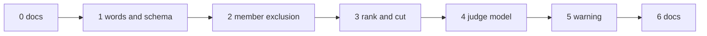

# Plan: E4b part 2 — evidence completeness

Spec: [docs/spec/2026-10-15-e4b-evidence-completeness/](../spec/2026-10-15-e4b-evidence-completeness/00-overview.md).
Ledger: created at the build start, `docs/work/<date>-e4b-evidence-completeness.md`.

## 1. Approach

- Base: branch `OME-1601-e4b-combine-extensions` (E4b part 1, PR #1409) at `0f4b9e292`. When PR
  #1409 merges, rebase onto `origin/main`. When it changes before merge, rebase onto its new tip.
- One branch, `e4b-evidence-completeness`, with one commit group per unit, in the order of §2. The
  units share `E/combine/evidence.py`, `E/combine/endpoint.py`, the SDK evidence modules and the v1
  snapshots, so a linear order avoids conflicts.
- Each unit: a full unit spec (files, signatures, data shapes, exemplar, edge cases), then the
  build, then a design review against the PRD as the rubric, then one fix round. A structural
  finding means a re-spec, not a second fix round.
- TDD inside each unit follows the PRD §7 order: CHAR rows first, then RED → GREEN → REFACTOR.
- Part 3 (signal sources) is planned on its own branch from the same base. It touches the same
  evidence files. The part that merges second rebases.

## 2. Units

| # | Unit | PRD rows | Main files |
|---|---|---|---|
| 0 | docs | — | this plan, the spec |
| 1 | words and schema | ES#1–4, ES#6–9, ES#11, ES#13 | `E/combine/ports.py` (`RecordStatus`, `ExcludeReason`, `CutRecord` type), `E/combine/evidence.py` (validators, `rank`, `cut`, `judge_model`); `S/answer.py`, `S/combine_evidence.py` (`CombineAnswerRow.rank`, `CombineCut`, `CombineEvidence.cut/judge_model`), `S/_evaluation/combine_evidence.py` (key sets), `S/report.py` (export); snapshots |
| 2 | member exclusion | EX#1–18, ES#5, ES#10, ES#12, ES#14 | `E/combine/ports.py` (`OperatorDescriptor.reads_weights`), `E/combine/operators/reduce.py` (flag on the three weighted ops), `E/combine/endpoint.py` (`_Plan.excludes`, `_member_record`); `ET/data/combine_contract/evidence_cases.json` |
| 3 | rank and cut | RK#1–13 | `E/combine/ports.py` (`ranks`, `cut` hooks), `E/combine/operators/selection.py` (shared `_ranked`, hooks on `top_k@1`), `E/combine/endpoint.py` (`_evidence`); `evidence_cases.json` |
| 4 | judge model | JM#1–12 | `S/_evaluation/combine_spec.py`, `E/combine/spec.py` (`judge_model`), `E/combine/endpoint.py` (check, copy); the 7 judge url4 fixtures |
| 5 | judge-writer warning | JW#1–11 | `S/warnings.py`, `S/_evaluation/candidate.py` (`_pipeline`, `_warned_pipelines`), `S/url4.py` (silence on rebuild), `S/__init__.py` |
| 6 | docs | — | `packages/screamingface/README.md` (evidence fields, the warning), `CHANGELOG.md`, the owner approval manifest |

68 TDD rows in total.

## 3. Order and dependencies

- Unit 1 comes first: units 2–4 write values that unit 1 defines.
- Unit 2 comes before unit 3, because the rank skips excluded members (RK-E2).
- Unit 5 depends only on unit 0. It stays late so that the public surface snapshot changes in as
  few commits as possible.

## 4. Gates per unit

- Engine: a `uv sync --dev` venv (do not install the `inspect` extra), then
  `uv run .claude/scripts/run_gates.py screamingface-engine --base <parent>`.
- SDK: `uv sync --extra notebook` (as CI does), then
  `uv run .claude/scripts/run_gates.py screamingface --base <parent>`.
- Repo: `uv run .claude/scripts/run_gates.py repo --base <parent>`.
- Append-only: the edited pinned files are listed in the owner approval manifest (§6). No
  `--skip-append-only` without it.

## 5. Exit criteria

| Criterion | Closed by |
|---|---|
| No Case answer changes (record-only part) | EX#3, RK#9, JM#1 |
| A member left out for a missing signal or weight shows `"excluded"` with its reason, also on an abstain | EX#4–9 |
| A failure is never shown as an exclusion | EX#10 |
| `chosen` always equals the members ranked within `cut.k` | RK#5 |
| Every judge step names its judge model; a judge url4 from before part 2 still runs | JM#2–3, JM#7 |
| The SDK warns when the writer uses the judge's model, and never fails | JW#1, JW#5 |
| Engine and SDK words stay equal | ES#5, ES#10, ES#14 |
| Each user decision with a testable effect is pinned by a test | test-plan §2 |

## 6. User actions

1. Approve the spec and this plan (plain words), including the proposed items P1–P12, the scope
   notes N1–N2, and the default for D1 (accept the url4 byte change of judge recipes).
2. Approve the edits to pinned files when each unit asks for them:
   - unit 1: `ET/data/combine_contract/schemas/screamingface.combine-evidence.v1.json`,
     `ST/data/schemas/screamingface.answer.v1.json`, `ST/public_surface_snapshot.json`;
   - unit 2: `ET/data/combine_contract/evidence_cases.json`, and every existing test that pins
     `status: "answered"` or `reason: null` for a member that the rule now excludes (the
     append-only gate lists them);
   - unit 3: `ET/data/combine_contract/evidence_cases.json`;
   - unit 4: `ET/data/combine_contract/schemas/screamingface.combine-spec.v1.json`; the judge url4
     fixtures `corrective_vote_candidate.url4`, `filter_judge_candidate.url4`,
     `judge_order_min_candidate.url4`, `judge_vote_candidate.url4`,
     `quorum_judge_vote_candidate.url4`, `recipe_s10.url4`, `recipe_s11_max.url4` (all in
     `ET/data/combine_contract/`); and the SDK tests that pin the bytes of a judge spec (the
     candidates are `ST/test_judge_reducer.py`, `ST/test_judge_order.py`, `ST/test_filter_judge.py`,
     `ST/test_rank_concat_reducers.py`, `ST/test_judge_weighted_vote.py`,
     `ST/test_engine_url4_contract_fixtures.py`, `ST/test_quorum_url4_contract_fixtures.py`; the
     append-only gate gives the final list);
   - unit 5: `ST/public_surface_snapshot.json`.
3. At PR-open: file the leaf under the E4b epic OME-1290.
