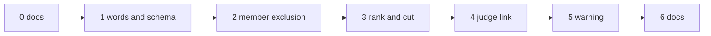

# Plan: E4b part 2 — evidence completeness

Spec: [docs/spec/2026-10-15-e4b-evidence-completeness/](../spec/2026-10-15-e4b-evidence-completeness/00-overview.md).
Ledger: created at the build start, `docs/work/<date>-e4b-evidence-completeness.md`.

## 1. Approach

- Base: branch `OME-1601-e4b-combine-extensions` (E4b part 1, PR #1409) at `0f4b9e292`. When PR
  #1409 merges, rebase onto `origin/main`. When it changes before merge, rebase onto its new tip.
- One branch, `e4b-evidence-completeness`, with one commit group per unit, in the order of §2. The
  units share `E/combine/evidence.py`, `E/combine/endpoint.py`, the SDK evidence modules and the v1
  snapshots, so a linear order avoids conflicts.
- Each unit: a full unit spec (files, signatures, data shapes, exemplar, edge cases), then the
  build, then a design review against the PRD as the rubric, then one fix round. A structural
  finding means a re-spec, not a second fix round.
- TDD inside each unit follows the PRD §7 order: CHAR rows first, then RED → GREEN → REFACTOR.
- Part 3 (signal sources) is planned on its own branch from the same base. It touches the same
  evidence files. The part that merges second rebases.
- No unit changes the combine spec or a url4 file (ans:Q4). The fixture drift guard must stay green
  with no regenerated url4.

## 2. Units

| # | Unit | PRD rows | Main files |
|---|---|---|---|
| 0 | docs | — | this plan, the spec |
| 1 | words and schema | ES#1–4, ES#6–9, ES#11, ES#13, ES#14 | `E/combine/ports.py` (`RecordStatus`, `ExcludeReason`, `Cut`), `E/combine/evidence.py` (validators, `rank`, `CutRecord`, `cut`); `S/answer.py` (words, docstring mapping), `S/combine_evidence.py` (`CombineAnswerRow.rank`, `CombineCut`, `CombineEvidence.cut`), `S/_evaluation/combine_evidence.py` (key sets), `S/report.py` (export); the v1 snapshots (ES#14 lives here, where they change) |
| 2 | member exclusion | EX#1–18, ES#5, ES#10, ES#12 | `E/combine/ports.py` (`OperatorDescriptor.reads_weights`), `E/combine/operators/reduce.py` (flag on the three weighted ops), `E/combine/endpoint.py` (`_Exclusion`, `_exclusion`, `_Plan.excludes`, `_member_record`); `evidence_cases.json` and its scenario lists |
| 3 | rank and cut | RK#1–13 | `E/combine/ports.py` (`ranks`, `cut` hooks), `E/combine/operators/selection.py` (shared `_ranked`, hooks on `top_k@1`), `E/combine/endpoint.py` (`_evidence`); `evidence_cases.json` |
| 4 | judge link (SDK view) | JM#1–12 | `S/_case_views.py` (reduce entry: rule J1–J3, the `"judge"` dependency, `request_model`), `S/report_trace.py` (`TRACE_FIELDS["reduce"]`); `report-trace.v1.json` |
| 5 | judge-writer warning | JW#1–11 | `S/warnings.py`, `S/_evaluation/candidate.py` (`_pipeline`, `_warned_pipelines`, `_canonical_model` on both sides), `S/url4.py` (silence on rebuild), `S/__init__.py` |
| 6 | docs | — | `packages/screamingface/README.md` (evidence fields, the trace link, the warning), `CHANGELOG.md`, the owner approval manifest |

68 TDD rows in total.

## 3. Order and dependencies

- Unit 1 comes first: units 2 and 3 write values that unit 1 defines.
- Unit 2 comes before unit 3, because the rank skips excluded members (RK-E2).
- Units 4 and 5 are SDK-only. They depend only on unit 0, and they stay late so that the public
  surface snapshot changes in as few commits as possible.

## 4. Gates per unit

- Engine: a `uv sync --dev` venv (do not install the `inspect` extra), then
  `uv run .claude/scripts/run_gates.py screamingface-engine --base <parent>`.
- SDK: `uv sync --extra notebook` (as CI does), then
  `uv run .claude/scripts/run_gates.py screamingface --base <parent>`.
- Repo: `uv run .claude/scripts/run_gates.py repo --base <parent>`.
- Append-only: the edited pinned files are listed in the owner approval manifest (§6). No
  `--skip-append-only` without it.

## 5. Exit criteria

| Criterion | Closed by |
|---|---|
| No Case answer changes (record-only part) | EX#3, RK#9 |
| No url4 changes; old url4, judge recipes included, still rebuild | JM#1, JM#9 |
| A member left out for a missing signal or weight shows `"excluded"` with its reason, also on an abstain | EX#4–9 |
| A failure is never shown as an exclusion | EX#10 |
| `chosen` always equals the members ranked within `cut.k` | RK#5 |
| Every judge step's trace names its judge operation and model; nothing is guessed | JM#3–8 |
| The SDK warns when the writer uses the judge's model, and never fails | JW#1, JW#5 |
| Engine and SDK words stay equal (by the stated mapping) | ES#5, ES#8, ES#10, ES#14 |
| Each user decision with a testable effect is pinned by a test | test-plan §2 |

## 6. User actions

1. Approve the spec and this plan (plain words), including the proposed items P1–P14 and the scope
   notes N1–N2.
2. Approve the edits to pinned files when each unit asks for them. No `.url4` file is on the list
   (review M5): the combine spec does not change, so the drift guard regenerates the same bytes.
   - unit 1: `apps/screamingface-engine/tests/unit/data/combine_contract/schemas/screamingface.combine-evidence.v1.json`,
     `packages/screamingface/tests/data/schemas/screamingface.answer.v1.json`,
     `packages/screamingface/tests/public_surface_snapshot.json`;
   - unit 2: `apps/screamingface-engine/tests/unit/data/combine_contract/evidence_cases.json`
     (two existing cases change: `rank_cut_not_met`, member_2 becomes `excluded` / `no_signal`;
     `mean_weighted_value`, member_2 becomes `excluded` / `no_weight`; plus new X1 and X2 cases),
     `apps/screamingface-engine/tests/unit/test_combine_evidence_contract_fixture.py` (the
     module-level `SCENARIOS`), `packages/screamingface/tests/test_combine_evidence_contract.py`
     (`_EXPECTED_NAMES`), and any other existing test that pins `status: "answered"` for a member
     that the rule now excludes (the append-only gate gives the final list);
   - unit 3: `evidence_cases.json` again (`rank_cut_not_met` gains ranks for member_3 and member_1
     and a `cut`; new rank cases), and the two scenario lists above when a rank case is added;
   - unit 4: `packages/screamingface/tests/data/schemas/screamingface.report-trace.v1.json`
     (`reduce` gets `judge_operation_id`, `judge_model`), and any test that compares a whole trace
     `reduce` entry (the append-only gate gives the list; the evidence wire dicts in
     `ST/test_mean.py` and `ST/_reducer_fixtures.py` do not change, because the new evidence keys
     are optional);
   - unit 5: `packages/screamingface/tests/public_surface_snapshot.json`.
3. At PR-open: file the leaf under the E4b epic OME-1290.
