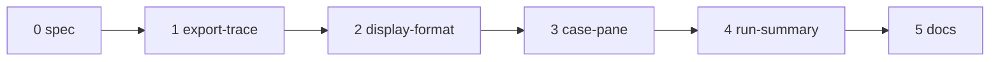

# Plan: E4b part 4 — show signals

Spec: [docs/spec/2026-10-15-e4b-show-signals/](../spec/2026-10-15-e4b-show-signals/00-overview.md).
Ledger: [docs/work/2026-10-15-e4b-show-signals.md](../work/2026-10-15-e4b-show-signals.md).

## 1. Approach

- Base: branch `e4b-signal-sources` (part 3, restacked on part 2) at `9f42391eb`. Branch
  `e4b-show-signals`, worktree `.claude/worktrees/e4b-show-signals`. When part 3 changes before
  merge, rebase onto its new tip.
- One branch, one commit group per unit, in the order of §2. Units 2, 3 and 4 share
  `S/_ui/combine_view.py` and `S/_ui/report_view.py`, so the order is linear.
- SDK only. No unit changes an Engine file, the combine spec, a url4, a wire record or a schema
  snapshot. No unit adds a public name (ans:Q1).
- Each unit: a full unit spec (files, signatures, data shapes, exemplar, edge cases), then the
  build, then a design review against the PRD as the rubric, then one fix round. A structural
  finding means a re-spec, not a second fix round.
- TDD inside each unit follows the PRD §7 order: CHAR rows first, then RED → GREEN → REFACTOR. A PIN
  row is the owner-approved golden edit.
- No live provider call, no paid test, no eval run. All test data is local (fixtures and wires in
  the new test files).

## 2. Units

| # | Unit | PRD rows | Main files | Pinned files |
|---|---|---|---|---|
| 0 | docs (spec) | — | this plan, the spec, the ledger | none |
| 1 | export-trace | XT#1–13 | `S/report.py` (`CandidateResult._export_cases`, `to_dict`, the `trace_dict` docstring), `S/_report_export.py` (`iter_report_json`); new `ST/test_export_trace.py` | `ST/data/report_v1_combine_report.json`, `ST/data/report_v1_vote_median_report.json`, `ST/test_e4b_schema_pins.py` (lines 29 and 33 only) |
| 2 | display-format | DF#1–11 | new `S/_ui/combine_view.py` (`COMBINE_CSS`, `number_html`, `dash_html`, `text_html`, `missing_reason`), `S/_ui/report_view.py` (`{COMBINE_CSS}` in `_STYLE`); new `ST/test_combine_display_format.py` | none |
| 3 | case-pane | CP#1–17 | `S/_ui/combine_view.py` (`combine_sections_html`, `_section`), `S/_ui/report_view.py` (`_pane_html` body); new `ST/test_combine_case_pane.py` | none |
| 4 | run-summary | RS#1–11 | `S/_ui/combine_view.py` (`combine_summary_html`, `_StepSummary`, `_summary_html`), `S/_ui/report_view.py` (`_card_html`); new `ST/test_combine_run_summary.py` | none |
| 5 | docs | DC#1–5 | `packages/screamingface/README.md`, `packages/screamingface/CHANGELOG.md`; new `ST/test_show_signals_docs.py` | none |

57 TDD rows in total.

## 3. Order and dependencies

- Unit 1 comes first: it is independent of the HTML, and it holds all the pinned edits, so the
  owner approval covers one commit group.
- Unit 2 comes before units 3 and 4: both use its helpers and its style rules.
- Unit 3 comes before unit 4: unit 4 reuses the label rule and the table markup of unit 3.
- Unit 5 is last: it describes what units 1–4 built.

## 4. Gates per unit

Run one stack at a time, from the worktree root. Never run two gate stacks at the same time.

- SDK venv: `cd packages/screamingface && uv sync --extra notebook`.
- `uv run .claude/scripts/run_gates.py screamingface --base 9f42391eb`
- `uv run .claude/scripts/run_gates.py repo --base 9f42391eb`
- The Engine stack is not run: no unit touches `apps/screamingface-engine`.
- Append-only: unit 1 edits three pinned files. If the append-only check is the only red result,
  list the files, then rerun the stack with `--skip-append-only` to prove the rest is green. The
  approval manifest under `.claude/test-change-approvals/` is not edited by the build; the owner
  approves after the build (§6).
- Known flaky tests (OME-1619): rerun a failing one alone; if it passes alone, record it as a flake.

## 5. Exit criteria

| Criterion | Closed by |
|---|---|
| Each exported Case with a combine step has `trace`; every other key and Case is unchanged | XT#4, XT#7, XT#11 |
| The two export paths give the same bytes | XT#2, XT#6 |
| Every reducer step of a Case has a Combine section, a plain vote included (ans:Q2) | CP#3, CP#13 |
| Numbers: 4 significant digits, the exact value on hover, a missing value is an em dash with its reason (ans:Q3) | DF#3, DF#4, CP#4, RS#4 |
| Excluded members, rank, cut, judge model and declared sources are visible | CP#6, CP#7, CP#9 |
| The card summary counts chosen and excluded and means the declared signals | RS#3, RS#6 |
| No data text reaches the page unescaped | DF#5, DF#7, CP#12, RS#7 |
| No public API change (ans:Q1) | DF#11, `ST/test_public_surface.py` |
| No existing HTML test changes; only the listed goldens change | CP#1, RS#1, the gates |
| Each user decision with a testable effect is pinned by a test | test-plan §2 |

## 6. User actions

1. Approve the spec and this plan, including the proposed items P1–P18 and the scope notes N1–N5.
2. Approve the edits to pinned files after the build. Only unit 1 has them:
   - `packages/screamingface/tests/data/report_v1_combine_report.json` (regenerated: a `trace` key
     at the end of Case 3);
   - `packages/screamingface/tests/data/report_v1_vote_median_report.json` (regenerated with
     `write_golden()`: a `trace` key at the end of Case 1 of `vote` and of `median`);
   - `packages/screamingface/tests/test_e4b_schema_pins.py` (the two SHA-256 values of those
     goldens, lines 29 and 33; the report-trace.v1 line stays).
   Units 2–5: no pinned file. If the append-only gate names another file, the build stops that
   unit and records it in the ledger.
3. Optional: approve a later docstring edit of `ST/test_report_v1_identity.py` and
   `ST/test_e4b_schema_pins.py`, which say that E4b does not change report.v1 (N5).
4. At PR-open: file the leaf under the E4b epic OME-1290.
