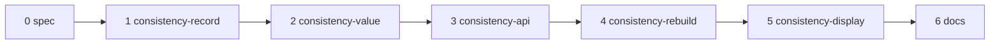

# Plan: E4b part 7 — consistency@N

Spec: [docs/spec/2026-10-16-e4b-consistency/](../spec/2026-10-16-e4b-consistency/00-overview.md).
Ledger: [docs/work/2026-10-16-e4b-consistency.md](../work/2026-10-16-e4b-consistency.md).

## 1. Approach

- Base: branch `e4b-gate-record` (part 5, on parts 4, 3 and 2) at `633fec3a1`. Branch
  `e4b-consistency`, worktree `.claude/worktrees/e4b-consistency`. Part 6 builds in parallel from
  the same base in another worktree; this part never touches that worktree. The later rebase
  follows contracts C8.
- One branch, one commit group per unit, in the order of §2. The units share
  `E/combine/endpoint.py`, `S/_evaluation/candidate.py`, `S/_evaluation/topology.py`, the v1 schema
  snapshots and the public surface snapshot, so the order is linear.
- Each unit: a full unit spec (files, signatures, data shapes, exemplar, edge cases, what not to do,
  verification), then RED, then GREEN, then a design review against the PRD as the rubric, then one
  fix round. A structural finding means a re-spec, not a second fix round.
- TDD inside each unit follows the PRD §7 order: CHAR rows first, then RED → GREEN → REFACTOR. A PIN
  row is the edit of a pinned file that the owner approves after the build.
- One ledger for the part (`docs/work/2026-10-16-e4b-consistency.md`), one section per unit.
- No live provider call, no paid test, no eval run. Engine runs use a mocked gateway
  (`httpx.MockTransport`). Commit messages end with the line `Refs: E4b part 7 (unfiled)`, with no
  `Co-Authored-By` trailer.

## 2. Units

| # | Unit | PRD rows | Main files | Stacks | Pinned files |
|---|---|---|---|---|---|
| 0 | docs (spec) | — | this plan, the spec, the ledger | repo | none |
| 1 | consistency-record | CR#1–15 | `E/combine/spec.py` (`ConsistencyMatch`, `ConsistencySource`, the `DeclaredSource` union, `_check_signals` one-consistency rule, `declares_consistency`, `CombineContext.samples`, `parse_context(samples_expected=)`, `_CONTEXT_KEYS`), `E/combine/evidence.py` (`SampleCountRecord`, `CombineEvidence.consistency`, `_check_consistency`); `S/combine_evidence.py` (`CombineSampleCount`, `CombineEvidence.consistency`, CS-I1..I5), `S/_evaluation/combine_evidence.py` (`_OPTIONAL_EVIDENCE_KEYS`, `_consistency`), `S/report.py` (export); new `ET/test_combine_consistency_words.py`, `ST/test_consistency_words.py` | screamingface-engine, screamingface, repo | `apps/screamingface-engine/tests/unit/data/combine_contract/schemas/screamingface.combine-spec.v1.json`, `apps/screamingface-engine/tests/unit/data/combine_contract/schemas/screamingface.combine-evidence.v1.json`, `packages/screamingface/tests/public_surface_snapshot.json` |
| 2 | consistency-value | CV#1–15 | new `E/combine/consistency.py` (`SampleCount`, `sample_texts`, `count_samples`), `E/combine/endpoint.py` (`_SampleDeclared`, `_declared`, `_combine`, `_sample_counts`, `_column`, the `samples=` keyword through `_decide`, `_choose`, `_gated`, `_fallback`, `_abstain`, `_evidence`; the module INVARIANT); new `ET/test_combine_consistency.py`, `ET/test_combine_consistency_contract.py`, `ET/data/combine_contract/consistency_evidence_cases.json`, `ST/test_consistency_evidence_contract.py` | screamingface-engine, screamingface, repo | none |
| 3 | consistency-api | CA#1–14 | `S/signal_sources.py` (`Consistency`, `consistency_seed`, `__all__`), `S/__init__.py`, `S/fusion.py` (`_check_consistency_source`), `S/_evaluation/combine_spec.py` (`match` in `combine_spec_text`), `S/_evaluation/candidate.py` (`input_dependencies` threading, `_sample_panels`, `_fusion_context(samples=)`, combine `depends_on`, the reducer node `samples`), `S/_evaluation/topology.py` (encode only: `_SampleTopology`, `_RecipeTopology.samples`, role `sample`, `_encode_reducer`, `_operation_shape`), `S/_evaluation/corrective.py` (refusal), `S/accounting.py` (`_ACCOUNTED_STAGES`), `S/_evaluation/runner.py` (`_own_seed_calls`); new `ST/test_consistency_api.py`, `ST/test_consistency_contract_fixtures.py`, `ET/data/combine_contract/consistency_pick_candidate.url4`, `ET/data/combine_contract/consistency_median_candidate.url4`, `ET/test_combine_consistency_run.py` | screamingface-engine, screamingface, repo | `packages/screamingface/tests/public_surface_snapshot.json` |
| 4 | consistency-rebuild | CB#1–9 | `S/_evaluation/topology.py` (`_decode_synthesizer`, `_decode_samples`, the walker), `S/url4.py` (`_require_call_kind`), `S/signal_sources.py` (`Consistency._from_spec`, `_SOURCES`), `S/_evaluation/combine_spec.py` (`spec_operator_pairs`), `S/_evaluation/url4.py` (`seeded` leaves out `sample`); new `ST/test_consistency_rebuild.py` | screamingface, repo | none |
| 5 | consistency-display | CD#1–7 | `S/_ui/combine_view.py` (`_chips`, `_member_row`, `_StepSummary`, `_summary_html`); new `ST/test_consistency_display.py` (reads `COMBINE_CONTRACT / "consistency_evidence_cases.json"`, hand-built Case) | screamingface, repo | none |
| 6 | docs | DC#1–5 | `packages/screamingface/README.md` (`### Consistency samples` before `## Install`; the `**Consistency.**` paragraph), `packages/screamingface/CHANGELOG.md`; new `ST/test_consistency_docs.py` | screamingface, repo | none |

65 TDD rows in total (CR 15, CV 15, CA 14, CB 9, CD 7, DC 5).

## 3. Order and dependencies

- Unit 1 comes first: every other unit uses its words, its context key and its records.
- Unit 2 before unit 3: the Engine must compute the value before the SDK fixture of unit 3 can run
  in the Engine world (CA#7). Unit 2 also writes the contract cases that unit 5 reads.
- Unit 3 before unit 4: unit 4 decodes the topology that unit 3 encodes, and reads the unit 3
  fixtures through their builders.
- Unit 5 after unit 2 (the contract cases); it is placed after unit 4 to keep one linear order.
- Unit 6 is last: its code block compiles to the two fixtures of unit 3.

## 4. Gates per unit

Run one stack at a time, from the worktree root. Never run two gate stacks at the same time in this
worktree.

- Engine venv: `cd apps/screamingface-engine && uv sync --dev` (no `inspect` extra).
- SDK venv: `cd packages/screamingface && uv sync --extra notebook`.
- `uv run .claude/scripts/run_gates.py screamingface-engine --base 633fec3a1` (units 1, 2, 3)
- `uv run .claude/scripts/run_gates.py screamingface --base 633fec3a1` (every unit)
- `uv run .claude/scripts/run_gates.py repo --base 633fec3a1` (every unit)
- Append-only: units 1 and 3 edit pinned files. If the append-only check is the only red result,
  list every offending file, then rerun that stack with `--skip-append-only` to prove the rest is
  green. The build never writes or edits `.claude/test-change-approvals/`; the owner approves after
  the build (§6).
- A suite with no progress for 15 minutes is stopped and run once more.
- Known timing flakes (OME-1619 and candidates):
  `test_combine_inspect_rules.py::test_inspect_rules_stay_linear_on_hostile_input`, the `test_ws.py`
  nack tests, `test_evaluation_outcome.py::test_a_callback_exception_aborts_the_evaluation_and_is_re_raised`,
  `test_connection_panel.py::test_panel_starts_oauth_and_polls_without_blocking_the_notebook`,
  `test_model_call_lifecycle_logging.py::test_a_slow_call_heartbeats_until_it_resolves`. Rerun a
  failing one alone; if it passes alone, record it as a flake. Part 6 builds on this machine at the
  same time, so the load is higher.

## 5. Exit criteria

| Criterion | Closed by |
|---|---|
| Each member makes n extra calls with distinct seeds and the stated temperature, its other params unchanged (ans:Q3) | CA#4, CA#7 |
| The value is matched / successful samples; the failed count is recorded; all failed → missing → a rule excludes the member (ans:Q4) | CV#2, CV#4, CR#7 |
| A failed extra call does not fail the Case (ans:Q4) | CA#7, CV#4 |
| The match uses the step's own extract and normalize, or `last_line` and `text` | CV#2, CV#3, CA#5 |
| The extra answers never vote | CV#8 |
| A model without `seed` or `temperature` fails before any spend | CA#10 |
| A sample never shares a fingerprint with a member call | CA#11 |
| A consistency recipe rebuilds from its url4 and the replay shows the same operations; a hand edit does not rebuild | CB#2, CB#3, CB#5 |
| The Case pane, the run summary and the export show the value and the failed count | CD#2–CD#6 |
| No byte change for a recipe, spec, evidence, url4 or report without consistency | CR#1, CV#1, CA#1, CB#1, CD#1 |
| Only the listed pinned files change | the append-only gate, §6 |
| Each owner decision with a testable effect is pinned by a test | test-plan §2 |

## 6. User actions

1. Approve the spec and this plan, including the proposed items P1–P22 and the scope notes N1–N6.
   These items need an explicit decision:
   - P2: `n` from 1 to 32 with no default; `temperature >= 0`, default 1.0.
   - P3: the match operators are written in the spec entry; a step with no extract compares the
     last line with the `text` normalizer.
   - P4: one `sf.Consistency` per Fusion; each member one `sf.Model`; at most 1024 extra calls per
     Fusion.
   - P5: the seed formula, and the extra calls do not carry the `logprobs` params.
   - P7: the new operation kind `sample`, accounted as `generation`.
   - P10: a sample with nothing extracted is a successful sample that does not match (it is in the
     denominator). The other choice: count it as a failed sample.
   - P11: the value is also missing when the member itself has no answer to compare.
   - P13: the failed count lives in a new optional evidence record `consistency`, not in the member
     record.
   - P18: the sample seeds do not follow the run seed, and the fixed-seed warning leaves them out.
   - P19: `sf.Consistency` is refused inside a corrective loop in this version.
   - P20: the contract cases go into a new file, not into `evidence_cases.json`.
2. Approve the edits to pinned files after the build (exact list; each is the smallest edit):
   - unit 1:
     - `apps/screamingface-engine/tests/unit/data/combine_contract/schemas/screamingface.combine-spec.v1.json` (regenerated: the `ConsistencySource` and `ConsistencyMatch` defs in the `signals` union);
     - `apps/screamingface-engine/tests/unit/data/combine_contract/schemas/screamingface.combine-evidence.v1.json` (regenerated: the optional `consistency` property, the `SampleCountRecord` def);
     - `packages/screamingface/tests/public_surface_snapshot.json` (regenerated: `CombineSampleCount`, `CombineEvidence.consistency`, the `CombineEvidence.__init__` keyword).
   - unit 3:
     - `packages/screamingface/tests/public_surface_snapshot.json` (regenerated again: `Consistency`, its `__init__` and fields).
   - units 2, 4, 5, 6: no pinned file. If the append-only gate names another file, the build stops
     that unit and records it in the ledger.
   - How to regenerate: delete a schema snapshot, run its freeze test once with
     `UPDATE_SCHEMA_SNAPSHOT=1` (it writes the missing file and fails), then run it plainly. The
     public surface snapshot: run `UPDATE_SURFACE_SNAPSHOT=1 uv run pytest
     tests/test_public_surface.py` (it rewrites and fails), then run it plainly (test-plan §2).
3. After part 6 lands: rebase (contracts C8) and approve the regenerated merged snapshots.
4. At PR-open: file the leaf under the E4b epic OME-1290, and the approval manifest for the pinned
   edits above.
