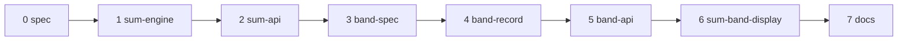

# Plan: E4b part 6 — signal sums and the abstain band

Spec: [docs/spec/2026-10-16-e4b-signal-sums/](../spec/2026-10-16-e4b-signal-sums/00-overview.md).
Ledger: [docs/work/2026-10-16-e4b-signal-sums.md](../work/2026-10-16-e4b-signal-sums.md).

## 1. Approach

- Base: branch `e4b-gate-record` (part 5, on parts 2–4) at `633fec3a1`. Branch `e4b-signal-sums`,
  worktree `.claude/worktrees/e4b-signal-sums`. When part 5 changes before merge, rebase onto its
  new tip.
- Part 7 (`consistency@N`) is built in parallel in its own worktree from the same base. This part
  never touches that worktree or branch. Its edits to the shared files are additive (contracts C10),
  and the part that is stacked second regenerates the generated files.
- One branch, one commit group per unit, in the order of §2. The units share `E/combine/spec.py`,
  `E/combine/endpoint.py`, the v1 schema snapshots, `evidence_cases.json` and the public surface
  snapshot, so the order is linear.
- Each unit: a full unit spec (files, signatures, data shapes, exemplar, edge cases, what not to do,
  verification), then RED, then GREEN, then a design review against the PRD as the rubric, then one
  fix round. A structural finding means a re-spec, not a second fix round.
- TDD inside each unit follows the PRD §7 order: CHAR rows first, then RED → GREEN → REFACTOR. A
  PIN row is the owner-approved edit of a pinned file.
- One ledger for the part (`docs/work/2026-10-16-e4b-signal-sums.md`), one section per unit. The
  loop rules of `.claude/skills/sdlc-python/SKILL.md` apply (ledger first, RED first, gates, wisdom
  check); the spec is the answer to every question, so the build never asks the user.
- No live provider call, no paid test, no eval run. Engine runs use the Engine-world fake gateway.

## 2. Units

| # | Unit | PRD rows | Main files | Stacks | Pinned files |
|---|---|---|---|---|---|
| 0 | docs (spec) | — | this plan, the spec, the ledger | repo | none |
| 1 | sum-engine | SM#1–14 | `E/combine/spec.py` (`SumSource`, union, `_check_sum`), new `E/combine/signal_sum.py` (`sum_value`), `E/combine/endpoint.py` (`_Summed`, `_declared` branch, two-pass `_signal_values`); new `ET/test_combine_signal_sum.py`, `ET/test_combine_signal_sum_words.py`; the `pick_sum_min` block INSERTED into `ET/test_combine_evidence_contract_fixture.py` after line 418 and before `def canonical_evidence` (spec §8), one line appended to `ST/test_combine_evidence_contract.py` after line 61 | screamingface-engine, screamingface, repo | `ET/data/combine_contract/schemas/screamingface.combine-spec.v1.json`, `ET/data/combine_contract/evidence_cases.json`, `ST/test_frozen_record_fields.py` (:184, 37 → 38) |
| 2 | sum-api | SA#1–14 | `S/signal_sources.py` (`Sum`, `_SOURCES`, `__all__`), `S/fusion.py` (`_check_sums`, `_check_weight_source`, docstring), `S/__init__.py` (`Sum`); new `ST/test_signal_sum_api.py`, `ST/test_sum_contract_fixtures.py`, `ET/test_combine_sum_run.py`, `ET/data/combine_contract/sum_pick_candidate.url4` | screamingface-engine, screamingface, repo | `ST/public_surface_snapshot.json` |
| 3 | band-spec | AB#1–3, AB#15 (spec v1 half: `spec_schema_snapshot_holds_the_band`) | `E/combine/spec.py` (`GateSpec.abstain_band`, `_check_band`); new `ET/test_combine_band.py` | screamingface-engine, screamingface, repo | `ET/data/combine_contract/schemas/screamingface.combine-spec.v1.json` |
| 4 | band-record | AB#4–14, AB#15 (evidence v1 and answer.v1 half: `evidence_and_answer_snapshots_hold_the_band`), AB#16–18 | `E/combine/ports.py` (`in_band`, `band`), `E/combine/gate.py` (`in_band`), `E/combine/endpoint.py` (`_gated` band check, `_gate_record(gate, observed, passed, branch)`, `_not_run`, docstrings), `E/combine/evidence.py` (`GateRecord.abstain_band`, `_check_band_record`, `_band_reason_holds`, GR-I1', GR-I4', GB-I1–I4); `S/answer.py`, `S/combine_evidence.py` (`GateBranch`, `CombineGate.abstain_band`, `_check_band_gate`, `_gate_reason` GB-I4 first), `S/_evaluation/combine_evidence.py` (`_gate`); appends to `ET/test_combine_band.py`; new `ST/test_band_words.py`; the `vote_gate_band` block INSERTED into `ET/test_combine_evidence_contract_fixture.py` after the unit 1 block and before `def canonical_evidence`, one line appended to `ST/test_combine_evidence_contract.py` | screamingface-engine, screamingface, repo | `ET/data/combine_contract/schemas/screamingface.combine-evidence.v1.json`, `ST/data/schemas/screamingface.answer.v1.json`, `ET/test_combine_gate_words.py` (:645, :761, :765), `ET/test_combine_pick_output.py` (:341-343, :352), `ET/test_combine_evidence_words.py` (:310-322), `ST/test_gate_words.py` (:524, :567, :582-589), `ST/test_evidence_words.py` (:373, :460-475), `ST/test_pick_output.py` (:250-265), `ET/data/combine_contract/evidence_cases.json`, `ST/test_frozen_record_fields.py` (:184, 38 → 39), `ST/public_surface_snapshot.json` |
| 5 | band-api | BA#1–9 | `S/gate.py` (`abstain_band`, `_band`, `_spec`, `_render`), `S/reducer.py` (`_rebuilt_gate`); new `ST/test_band_api.py`; appends to `ST/test_sum_contract_fixtures.py` and `ET/test_combine_sum_run.py`; `ET/data/combine_contract/gate_band_vote_candidate.url4` | screamingface-engine, screamingface, repo | `ST/public_surface_snapshot.json`, `ST/test_gate_api.py` (:472) |
| 6 | sum-band-display | SD#1–10 | `S/_ui/combine_view.py` (`_source_text`, `_signal_head`, `_gate_chip`, `_gate_verdict`, `_StepSummary.band`, `_add_gate`, `_gate_line`, `_mean_cell`); new `ST/test_sum_band_display.py` | screamingface, repo | none |
| 7 | docs | DC#1–5 | `packages/screamingface/README.md` (`### Sum signals and the abstain band` after `### Fusion as a named recipe`; the `**Sums and the band.**` paragraph), `packages/screamingface/CHANGELOG.md` (bullet 3); new `ST/test_sum_band_docs.py` | screamingface, repo | none |

70 TDD rows in total (SM 14, SA 14, AB 18, BA 9, SD 10, DC 5). AB#15 is two test functions, one
in unit 3 and one in unit 4.

WHY the band is two units (spec review): the old unit 3 had 18 rows, about 10 source files in two
packages and 12 pinned files, too much for one implementer spec. Unit 3 is the spec key only. Unit
4 keeps the words, the decision, the record, the SDK mirror and the contract case together,
because the SDK tests loop over every Engine contract case, and the `in_band` word must come with
the case that uses it (part 5 lesson).

## 3. Order and dependencies

- Unit 1 before unit 2: the Engine must parse and compute a sum before the SDK fixture of unit 2
  can run in the Engine world (SA#13).
- Unit 2 before unit 3: units 3 and 4 are independent of the SDK sum, but the band fixture of unit
  5 uses `sf.Sum`, and the order keeps one public surface regeneration per unit.
- Unit 3 before unit 4: the Engine must parse the band before it can decide on it.
- Unit 4 before unit 5: the Engine must decide and record the band before the SDK band fixture
  can run (BA#8). Unit 4 also adds `in_band`, together with the contract case that uses it.
- Unit 6 after units 1 and 4: the display tests read the contract cases `pick_sum_min` and
  `vote_gate_band`.
- Unit 7 is last: its code block compiles to the fixtures of units 2 and 5.

## 4. Gates per unit

Run one stack at a time, from the worktree root. Never run two gate stacks at the same time in this
worktree. Part 7 builds in parallel on this machine, so the load is higher.

- Engine venv: `cd /Users/junior/workspace/screamingface/.claude/worktrees/e4b-signal-sums/apps/screamingface-engine && uv sync --dev` (no `inspect` extra).
- SDK venv: `cd /Users/junior/workspace/screamingface/.claude/worktrees/e4b-signal-sums/packages/screamingface && uv sync --extra notebook`.
- `uv run .claude/scripts/run_gates.py screamingface-engine --base 633fec3a1` (units 1, 2, 3, 4, 5)
- `uv run .claude/scripts/run_gates.py screamingface --base 633fec3a1` (every unit)
- `uv run .claude/scripts/run_gates.py repo --base 633fec3a1` (every unit)
- Append-only: units 1–5 edit pinned files. If the append-only check is the only red result, list
  every offending file, then rerun that stack with `--skip-append-only` to prove the rest is green.
  The build never writes or edits `.claude/test-change-approvals/`; the owner approves after the
  build (§6).
- A suite with no progress for 15 minutes is stopped and run once more.
- Known timing flakes (OME-1619 and candidates):
  `test_combine_inspect_rules.py::test_inspect_rules_stay_linear_on_hostile_input`, the
  `test_ws.py` nack tests,
  `test_evaluation_outcome.py::test_a_callback_exception_aborts_the_evaluation_and_is_re_raised`,
  `test_connection_panel.py::test_panel_starts_oauth_and_polls_without_blocking_the_notebook`,
  `test_model_call_lifecycle_logging.py::test_a_slow_call_heartbeats_until_it_resolves`. Rerun a
  failing one alone; if it passes alone, record it as a flake.
- Never run a test under a `paid` folder or marker.

## 5. Exit criteria

| Criterion | Closed by |
|---|---|
| Each member gets `risk = Σ coefficient × component` as a declared signal, missing when a component is missing (ans:Q1) | SM#4–6 |
| A vote weight, Pick, Rank, Filter and a gate `chosen:` / `mean:` read a sum by name (ans:Q1) | SM#7 (Pick, and Rank and Filter in the Engine: SM-2b), SM#8, SM#9, SA#7 |
| The evidence records the sum like any declared signal (ans:Q1) | SM#10, SM#12 |
| An undeclared component, a sum of a sum and a raw-logprob or entropy sum as a weight fail before any call | SA#4–6, SM#3 |
| Inside the closed band the Case abstains with `in_band`; outside it the gate compares as in part 5 (ans:Q2) | AB#4–6, BA#8 |
| The gate record holds the band and the branch `band` (ans:Q2) | AB#4, AB#12, AB#16 |
| The band branch never reads a fallback reply (E4c adds the skip with no wire change) | AB#7 |
| `in_band` is an abstain, counted with the other abstains, never a failure code | AB#11, AB#14 |
| A sum and a band rebuild from their url4; a hand edit does not | SA#10, SA#11, BA#5, BA#6 |
| The Case pane, the run summary and the export show the sum and the band | SD#2–7 |
| No byte change for a spec, evidence, url4, gate record or report without a sum or a band | SM#1, SA#1, AB#1, AB#17, BA#1, SD#1 |
| Only the listed pinned files change | the append-only gate, §6 |
| Each user decision with a testable effect is pinned by a test | test-plan §2 |

## 6. User actions

1. Approve the spec and this plan, including the proposed items P1–P19 and the scope notes N1–N5.
   These items need an explicit decision:
   - P3: a sum component is a declared non-sum name of the same Fusion only; E4a keys and the
     panel agreement are not components (D1); a sum of sums is refused (D3).
   - P5: the sum is the exact rational sum rounded once (not `math.fsum` of the float products);
     an exact sum outside the float range is missing, not a failure.
   - P8: the band is closed, is checked before the comparison, and has no rule that ties it to the
     threshold.
   - P9: inside the band the Case abstains for every `otherwise`, also a judge or a writer.
   - P10: the record of the band branch has `branch: "band"` and `passed: null`.
   - P12: the new abstain reason is named `in_band` (the other choice: `gate_in_band`).
   - P13: a sum with an `sf.Logprob("mean")`, `sf.Logprob("sum")` or `sf.Entropy` component cannot
     be a vote weight; other sums can.
   - N1 / D2: a sum adds the signals of ONE member (ans:Q1). CodeX-Verify's sum across four
     specialists with a coefficient per specialist is not in this part; `mean:<name>` gives one
     shared coefficient. Say if the across-member form is wanted later.
2. Approve the edits to pinned files after the build (exact list; each is the smallest edit):
   - unit 1:
     - `apps/screamingface-engine/tests/unit/data/combine_contract/schemas/screamingface.combine-spec.v1.json` (regenerated: the `SumSource` union member);
     - `apps/screamingface-engine/tests/unit/data/combine_contract/evidence_cases.json` (regenerated: the new case `pick_sum_min`; the 37 existing cases keep their bytes);
     - `packages/screamingface/tests/test_frozen_record_fields.py` (line 184: 37 → 38).
     - Append-only, not flagged by the gate (no approval needed unless the gate names them):
       `apps/screamingface-engine/tests/unit/test_combine_evidence_contract_fixture.py` (one
       builder and one `SCENARIOS[...]` line, INSERTED after line 418 and before
       `def canonical_evidence`, never after the `__main__` block; spec §8) and
       `packages/screamingface/tests/test_combine_evidence_contract.py` (one
       `_EXPECTED_NAMES |= {...}` line, appended after line 61).
   - unit 2:
     - `packages/screamingface/tests/public_surface_snapshot.json` (regenerated: `Sum`).
   - unit 3:
     - `apps/screamingface-engine/tests/unit/data/combine_contract/schemas/screamingface.combine-spec.v1.json` (regenerated again: `GateSpec.abstain_band`).
   - unit 4:
     - `apps/screamingface-engine/tests/unit/data/combine_contract/schemas/screamingface.combine-evidence.v1.json` (regenerated: `GateRecord.abstain_band`, the branch word `band`, `in_band` in the two reason enums, and the `GateRecord` docstring text in `description`);
     - `packages/screamingface/tests/data/schemas/screamingface.answer.v1.json` (regenerated: `in_band`);
     - `apps/screamingface-engine/tests/unit/test_combine_gate.py` (line 566: `"vote_gate_band"` added to the sorted case set; line 567 is unit 1's `[32:37]`; not in §8 or this list when the spec was written, see overview E1 and E7);
     - `apps/screamingface-engine/tests/unit/test_combine_gate_words.py` (line 645: `"band"` after `"fallback"` in the branch enum; line 761: `"in_band"` at the end of the words tuple; line 765: `get_args(AnswerReason)[-1] == "gate_not_met"` → `get_args(AnswerReason)[-2:] == ("gate_not_met", "in_band")`);
     - `apps/screamingface-engine/tests/unit/test_combine_pick_output.py` (lines 341-342: `"in_band"` at the end of the two tuples; line 343: `[-1] == "gate_not_met"` → `[-2:] == ("gate_not_met", "in_band")`; line 352: `items[-1] == "gate_not_met"` → `items[-1] == "in_band"`);
     - `apps/screamingface-engine/tests/unit/test_combine_evidence_words.py` (one line `"in_band",` after line 321);
     - `packages/screamingface/tests/test_gate_words.py` (line 524: `"in_band"` in the set; line 567: 13 → 14; line 582: `answer_reason[-2:] == ["output_missing", "gate_not_met"]` → `answer_reason[-3:] == ["output_missing", "gate_not_met", "in_band"]`; line 583: `"in_band"` at the end; lines 584-589: `"in_band"` after `"gate_not_met"`);
     - `packages/screamingface/tests/test_gate_words.py` (line 326: `"Combine gate branch must be one of band, fallback, majority"`; not in §8 or this list when the spec was written, see overview E6);
     - `packages/screamingface/tests/test_evidence_words.py` (line 373: 13 → 14; line 460: `"in_band"` after `"gate_not_met"`; one line `"in_band",` after line 467);
     - `packages/screamingface/tests/test_pick_output.py` (line 250: `"in_band"` after `"gate_not_met"`; one line `"in_band",` after line 255);
     - `apps/screamingface-engine/tests/unit/data/combine_contract/evidence_cases.json` (regenerated: the new case `vote_gate_band`; the 38 cases keep their bytes);
     - `packages/screamingface/tests/test_frozen_record_fields.py` (line 184: 38 → 39);
     - `packages/screamingface/tests/public_surface_snapshot.json` (regenerated: `CombineGate` field and keyword `abstain_band`).
     - Append-only, not flagged: the same two contract test files as unit 1 (one more builder and
       `SCENARIOS` line, inserted after the unit 1 block and before `def canonical_evidence`; one
       more `_EXPECTED_NAMES |=` line).
     - If `ruff format` wraps an edited tuple line, the wrap is part of the same smallest edit.
   - unit 5:
     - `packages/screamingface/tests/public_surface_snapshot.json` (regenerated: `Gate` field and `__init__` keyword `abstain_band`);
     - `packages/screamingface/tests/test_gate_api.py` (line 472: `["observe", "cmp", "threshold", "otherwise"]` → `["observe", "cmp", "threshold", "otherwise", "abstain_band"]`; the keyword kind and default are asserted in the new BA#2 test, not in this file).
   - units 6–7: no pinned file. If the append-only gate names another file, the build stops that
     unit and records it in the ledger.
   - How to regenerate: test-plan §2.
3. At PR-open: file the leaf under the E4b epic OME-1290, and the approval manifest for the pinned
   edits above.
4. After part 6 and part 7 are both built: choose the stack order. The part that goes second
   rebases, regenerates the schema snapshots, the public surface snapshot and `evidence_cases.json`,
   adds the case counts, and orders the two CHANGELOG bullets (contracts C10).
