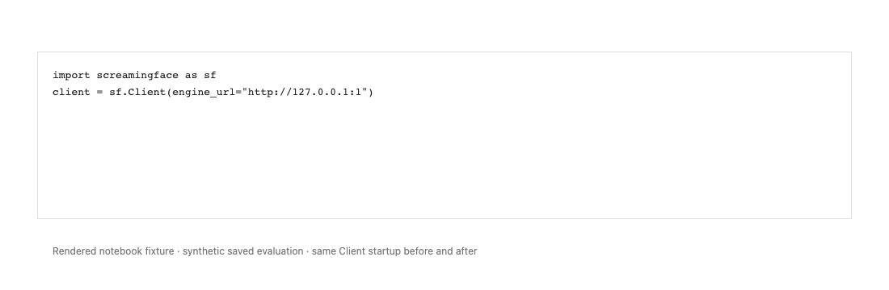
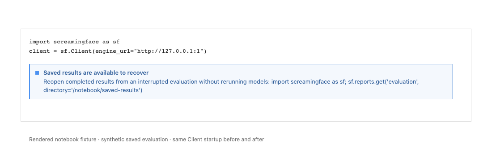
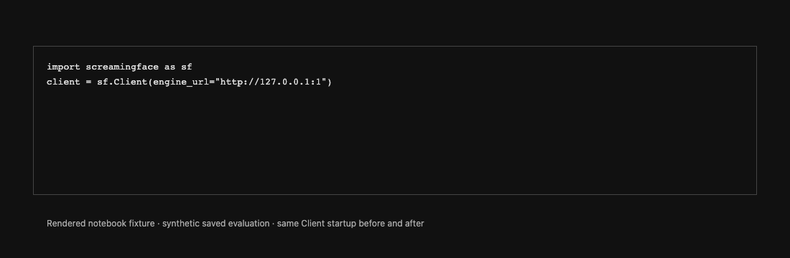
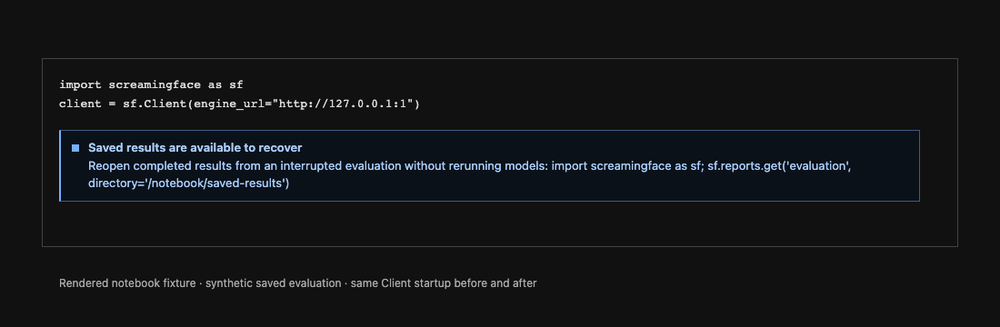

# Notebook recovery notice comparison

The same synthetic saved evaluation is owned by a subprocess that exited during export. Before uses main 8e0c0a29; after uses this slice. Both instantiate a persisted Client for the fixture Engine with no model calls. The notebook fixture displays the actual startup HTML, with a stable example results path. It is a renderer fixture, not a live Colab screenshot.

| Theme | Before | After |
|---|---|---|
| Light |  |  |
| Dark |  |  |

After emits one shared informational notice; repeated startup does not duplicate it. Explicit recovery reconstructs identical full report JSON from retained local results and settles the marker ready. Healthy/headless/legacy/active-owner/other-Engine silence and optional display failures are covered by regressions.
