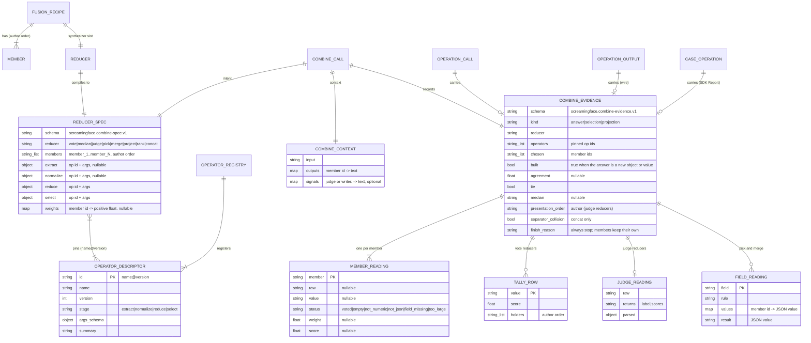

# ERD — E4a deterministic combine (OME-1289)

E4a adds no database tables. All its data is **wire records and in-process records**. Each
record below has a key, attributes, a version id, and invariants. Interview answers
(`ans:Qn`) resolve in [00-overview.md](00-overview.md#interview-ledger).

## Diagram



## 1. Recipe side (SDK, in memory)

### FUSION_RECIPE, MEMBER, REDUCER
- **Purpose.** The author's candidate. `Fusion(members, synthesizer=…)` is the existing type
  `[existing packages/screamingface/src/screamingface/fusion.py:20]`. E4a lets the synthesizer
  slot hold a `Reducer` `[stated ans:Q2]`.
- **Key.** The member position in author order (1-based). The compiler names member contexts
  `member_1 … member_N` `[existing packages/screamingface/src/screamingface/_evaluation/candidate.py:394]`.
- **Reducer kinds.** `Vote`, `Median`, `Judge`, `Pick`, `Merge`, `Rank`, `Concat` `[stated prompt]`.
  Weighted vote is `Vote(weights=[…])` `[proposed]`.
- **Invariants.**
  - The member order is fixed and is the tie-break order `[stated prompt]`.
  - `weights`, when present, has one positive number for each member. A missing weight is an
    error before any call `[stated prompt]`.
  - A reducer with `kind = selection` (Rank, Concat) is never the last step of a candidate
    `[stated prompt]` (Concat by `[proposed]`, see prd/rank-keep-k.md).

## 2. REDUCER_SPEC (wire: url4 `intent` text of the combine call)

- **Purpose.** All the rules of one reducer, as data. The combine endpoint runs it.
- **Schema id.** `screamingface.combine-spec.v1` `[proposed]`.
- **Shape.**

```json
{
  "schema": "screamingface.combine-spec.v1",
  "reducer": "vote",
  "members": ["member_1", "member_2", "member_3"],
  "extract":   {"op": "last_number@1", "args": {}},
  "normalize": {"op": "numeric@1",     "args": {}},
  "reduce":    {"op": "mode@1",        "args": {}},
  "select":    {"op": "first_holder@1","args": {}},
  "weights": null
}
```

- **Invariants.**
  - Each `op` is an exact `name@version`. The SDK pins the version at compile time, so a
    replay uses the same operators `[proposed]`.
  - `members` equals the key set of `CombineContext.outputs`, in author order `[implied]`.
  - The spec is canonical JSON (sorted keys, no spaces), so the same recipe always gives the same
    url4 text `[proposed]`.
- **Size.** At most 64 KiB `[proposed]`.

## 3. OPERATOR_DESCRIPTOR and OPERATOR_REGISTRY (engine, in memory; wire: `GET /v1/operators`)

- **Purpose.** One registered pure function. The registry is built at process start from the
  built-in registration list, like `BUILTIN_REGISTRATIONS` for benchmarks
  `[existing apps/screamingface-engine/src/screamingface_engine/benchmarks/builtins.py:98]`.
- **Key.** `id = name@version` `[proposed]`.
- **Invariants.**
  - An `id` is registered once. A duplicate stops the process at start `[proposed]`.
  - A registered version never changes behavior. A behavior change needs a new version. Golden
    tests pin this `[proposed]`.
  - `stage` is one of `extract`, `normalize`, `reduce`, `select` `[proposed]`.
- **Lifetime.** The process lifetime. No persistence.

## 4. COMBINE_CONTEXT (wire: url4 `context` text of the combine call)

- **Shape.** `{"input": …, "outputs": {"member_1": …}}` is today's Fusion context
  `[existing packages/screamingface/src/screamingface/_evaluation/candidate.py:394]`. E4a adds an
  optional `signals` map for judge output and field-writer output `[proposed]`.
- **Trust.** Every value is model output, so it is untrusted input `[implied]`.
- **Caps.** At most 256 members; each output is read up to 1 MiB; a larger output gets the status
  `too_large` and does not vote `[proposed]`.

## 5. COMBINE_EVIDENCE (wire and SDK Report)

- **Purpose.** What the combine step saw and decided, for each case `[stated prompt]`. It goes to
  the SDK Report only, not to the scoreboard `[stated ans:Q6]`.
- **Schema id.** `screamingface.combine-evidence.v1` `[proposed]`.
- **Does not hold the answer text.** The answer text is already the `output` of the operation
  `[existing apps/screamingface-engine/src/screamingface_engine/benchmarks/contract.py:292]`.
  This keeps the payload small `[proposed]`.
- **Children.**
  - `MEMBER_READING`: one row for each member, in author order, also for members that did not vote.
  - `TALLY_ROW`: vote reducers only. Rows sort by score (high first), then by the position of the
    first holder.
  - `JUDGE_READING`: judge reducers only. It keeps the raw judge text and the parsed label or
    scores `[stated prompt]`.
  - `FIELD_READING`: pick and merge only.
- **Invariants.**
  - `chosen` ids are a subset of `members` `[implied]`.
  - If `kind = answer` and `built = false`, the operation output is byte-identical to the
    output of the one chosen member `[stated prompt]`.
  - `agreement = winner score / sum of scores of all voters`. It is null when no tally exists
    `[stated prompt]` (formula for weights `[proposed]`).
  - No field depends on dict or set iteration order. All lists have a defined order `[proposed]`.

## 6. OPERATION_CALL, OPERATION_OUTPUT, CASE_OPERATION (existing records, new optional field)

- **Today.** `OperationCall(path, params, output, finish_reason, accounting)`
  `[existing apps/screamingface-engine/src/screamingface_engine/operation_calls.py]`;
  `OperationOutput(operation_id, output, finish_reason, accounting)`
  `[existing apps/screamingface-engine/src/screamingface_engine/benchmarks/contract.py:292]`;
  `CaseOperation(operation_id, output, finish_reason, accounting)`
  `[existing packages/screamingface/src/screamingface/case_result.py:262]`.
- **Delta.** Each gets `combine: CombineEvidence | None`. On the wire the key is left out when the
  value is null, so an envelope with no reducer stays byte-identical to today `[proposed]`. This
  follows the rule that `operations` uses today
  `[existing apps/screamingface-engine/src/screamingface_engine/benchmarks/contract.py:333]`.
- **Attribution key.** `operation_id = "op_" + binding`. Bindings match
  `^(?:model|synthesis)_\d+$` today
  `[existing apps/screamingface-engine/src/screamingface_engine/benchmarks/operation_outputs.py:45]`.
  E4a widens the pattern to `^(?:model|synthesis|judge|writer)_\d+$` on the SDK and the engine
  in the same change `[proposed]`.

## 7. Sample members (SDK, in memory)

- `samples(model, n)` returns `n` `Model` members with `params["seed"] = "0" … "n-1"`
  `[stated prompt]`. Only models whose parameter contract supports `seed` are allowed
  `[stated ans:Q13]`.

## 8. Migrations and versioning

- New fields are optional and left out when null, so old envelopes still decode `[proposed]`.
- Each record has a schema id with a version suffix (`.v1`). A breaking change adds `.v2`, and the
  decoder accepts both for one release `[proposed]`.
- Operator behavior changes only through a new `@version`. Old specs keep their old operator
  `[proposed]`.
- An old SDK cannot compile a reducer, so it never receives `combine` evidence `[implied]`.
