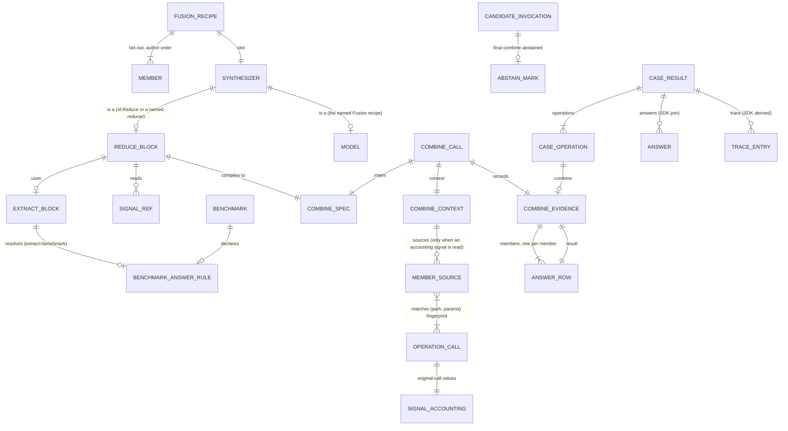

# ERD — E4a gap closure (OME-1289)

E4a gap closure adds no database tables. Every record below is a **wire record** (JSON that
crosses the engine–SDK boundary or travels in a url4 call) or an **in-process record** (a frozen
dataclass in the engine combine core, the engine world layer, or the SDK). Each record has a key,
typed attributes, a schema id where it is versioned, and invariants. Interview answers (`ans:Qn`)
resolve in [00-overview.md](00-overview.md#5-interview-ledger). The base model is the E4a ERD
([../2026-09-30-e4a-deterministic-combine/erd.md](../2026-09-30-e4a-deterministic-combine/erd.md));
this file gives only the new records and the changes.

Paths: `E/` = `apps/screamingface-engine/src/screamingface_engine/`,
`EI/` = `apps/screamingface-engine/src/screamingface_engine_inspect/`,
`S/` = `packages/screamingface/src/screamingface/`, `ET/` = `apps/screamingface-engine/tests/unit/`,
`ST/` = `packages/screamingface/tests/`, `SP/` = the engine venv `site-packages/` (locked
`inspect-ai 0.3.263`, `inspect-evals 0.20.0`).

**Version rule.** No E4a record is released: every E4a branch is local and unmerged. So the fold
edits the `v1` schemas in place `[stated ans:Q8]`. After the fold the ids in §10 are **frozen**: a
later change gets a new schema id, never an edit `[implied]`.

## 1. Diagram

## 2. Answer (`screamingface.answer.v1`) — new, SDK record

**Purpose.** The PRD's one data type: what one member, or one combine step, answered
`[stated prompt]`. url4 stage hand-offs stay text `[stated ans:Q2]`. So the Answer is a **typed
record on the evidence and on the SDK Report**, not a runtime value between url4 nodes.

**Key.** (`case_id`, `combine_operation_id`, `member_id`). `member_id` is `None` for the computed
Answer of a combine step `[stated prompt]`.

| Attribute | Type | Source | Rule |
|---|---|---|---|
| `member_id` | `str \| None` | [stated prompt] | `member_[1-9][0-9]*`, author order; `None` for a computed Answer |
| `text` | `str \| None` | [stated prompt] | the original output, byte for byte, joined in the SDK from the member's operation (§2.2). `None` when the join is ambiguous. Evidence never carries text (I-E1) |
| `raw` | `str \| None` | [existing E/combine/ports.py:122] | the extract result before normalize |
| `value` | `str \| None` | [stated prompt] | canonical value after normalize. `None` exactly when `status != "answered"` |
| `status` | `"answered" \| "abstain" \| "fail"` | [stated prompt] | §2.1 |
| `reason` | `str \| None` | [proposed] | why there is no value (§2.1). `None` exactly when `status == "answered"` |
| `signals` | `map[str, float \| None]` | [stated ans:Q4] | §4. `None` is the PRD's `missing` `[stated prompt]` |

`screamingface.answer.v1` is an **SDK** schema: the SDK pins its field set with a snapshot test
`[proposed]`. On the engine wire, the same fields (minus `text`) are the evidence **Answer row**,
which is part of `screamingface.combine-evidence.v1` (§3).

### 2.1 Status and reason

The old reading status `[existing E/combine/ports.py:40]` splits into the PRD status plus a reason
`[proposed]`:

| Old `ReadingStatus` / cause | `status` | `reason` |
|---|---|---|
| `voted` | `answered` | `None` |
| `empty` | `fail` | `empty` |
| `not_numeric` | `fail` | `not_numeric` |
| `not_json` | `fail` | `not_json` |
| `field_missing` | `fail` | `field_missing` |
| `too_large` | `fail` | `too_large` |
| (new) `regex@1` finds no match | `fail` | `no_match` |
| (computed) nothing usable | `abstain` | `no_votes` |
| (computed) a cut cannot be met | `abstain` | `cut_not_met` |

A member with a missing **signal** is still `answered`; the signal value is `None` (§4).

**Invariants.**
- I-A1: `value is None` ⇔ `status != "answered"` `[proposed]`.
- I-A2: `reason is None` ⇔ `status == "answered"` `[proposed]`.
- I-A3: a member Answer has `status` in {`answered`, `fail`}; only a computed Answer can be
  `abstain` `[proposed]`.
- I-A4: every `signals` key is written once, by the core (§4). The PRD suffix rule is E4b
  `[implied]`.

### 2.2 How the SDK joins `text`

The combine operation's Report entry lists its member operation ids in `depends_on`, in author
order, then its judge/writer operation ids `[existing S/operation.py:16]`. The SDK takes
`depends_on[k-1]` as the producer of `member_k` and reads its `CaseOperation.output`. When the
producer is not attributed — two calls share a fingerprint **and** their outputs differ
`[existing E/benchmarks/operation_outputs.py:83]` — `text` is `None` `[proposed]`. (When the outputs
are equal, the engine gives both claimants that output, and `text` is set.)

## 3. Changes to `CombineEvidence` (`screamingface.combine-evidence.v1`, edited in place)

**Current.** One evidence object per combine operation; `members[]` rows have `member`, `raw`,
`value`, `status`, `weight`, `score` `[existing E/combine/evidence.py:33]`.

**Delta** `[proposed]`:

| Field | Change |
|---|---|
| `members[]` | Each row becomes an **Answer row**: `member_id` (renamed from `member`), `raw`, `value`, `status` (PRD), `reason`, `signals`, and the existing `weight`, `score`. No `text`. |
| `result` | **New.** The computed Answer: `member_id` (the chosen member for a one-member select, else `None`), `value`, `status` (`answered` \| `abstain`), `reason`. |
| `dropped` | **New** `int`: the count of member rows with `status == "fail"` (the PRD asks that a tally record how many it dropped `[stated prompt]`). |
| `signal` | **New, nullable** `{"key": str, "order": "max" \| "min" \| null}`: the signal the reduce step read `[stated prompt]`. Values are in `members[].signals`. |
| all other fields | unchanged |

**Invariants.**
- I-E1: evidence never carries member, judge or writer text `[existing E/combine/evidence.py:33]`.
- I-E2: `result.status == "abstain"` ⇒ the combine output is `""` with `finish_reason: "stop"`.
  The reverse does not hold (a Concat of empty texts also outputs `""`), so abstain is detected
  **only** from `result.status` `[proposed]`.
- I-E3: `len(members) == len(spec.members)`, in spec order `[existing E/combine/evidence.py:69]`.
- I-E4: `dropped == count(members where status == "fail")` `[proposed]`.
- I-E5: the shared fixture `ET/data/combine_contract/evidence_cases.json` is regenerated from real
  engine output and pins the engine encoder and the SDK decoder to one shape
  `[existing ET/test_combine_evidence_contract_fixture.py:1]`.

## 4. Signals

### 4.1 `SIGNAL_VALUE` — one key and number on an Answer row

| Key | Source | Missing (`None`) when |
|---|---|---|
| `cost_usd` | `SIGNAL_ACCOUNTING.cost_usd` (§4.3) of every model call of the member, summed | any of those calls has `None` (absence is contagious, as in `combine_operation_accounting` `[existing E/operation_accounting.py:73]`) |
| `latency_ms` | `SIGNAL_ACCOUNTING.latency_ms`, summed | same |
| `tokens_in` | `SIGNAL_ACCOUNTING.tokens_in`, summed | same |
| `tokens_out` | `SIGNAL_ACCOUNTING.tokens_out`, summed | same |
| `field:<path>` | the member's JSON reply at `<path>` (the `json_field@1` path grammar), when the value is a finite number or a bool (`true` = 1.0, `false` = 0.0) | not JSON, path absent, not a number or bool |
| `score:judge` | the judge reading of this combine call, one score per member (the `scores@1` parse) | the reducer has no judge |

Sources `[stated ans:Q4]`. **Who computes them** `[proposed]`: the **core**, before the reduce
step, for exactly the keys the spec reads. The core cannot import a plugin
`[existing .claude/scripts/check_layering.py:102]`, so two pure parsers move into `combine/ports.py`:
the field-path walk now in `combine/operators/extract.py:43`, and `parse_scores` now in
`combine/operators/judge.py:80`. The plugins then import them from `ports`. Accounting numbers come
from the adapter (§6).

**Invariants.**
- I-S1: a key is one of `cost_usd`, `latency_ms`, `tokens_in`, `tokens_out`, `score:judge`, or
  `field:<path>` where `<path>` matches the `_PATH` grammar of `json_field@1`; the SDK and the
  engine validate with one pattern (copied, with a conformance test) `[proposed]`.
- I-S2: a value is finite or `None`; `NaN` and `±inf` become `None` `[proposed]`.
- I-S3: the core writes only the keys the spec reads; otherwise `signals: {}` `[proposed]`.

### 4.2 `SIGNAL_REF`

SDK: `sf.signal("cost_usd")`, `sf.signal("field:confidence")`, `sf.signal("score:judge")`
`[stated ans:Q4]`. Wire: the key string in the spec (§5).

### 4.3 `SIGNAL_ACCOUNTING` — new, engine in-process record on `OperationCall`

**Purpose.** The **original call's** numbers, so a cached replay gives the same signals as the
first run `[stated ans:Q9]`. Today a cache hit records cost `"0"`, 0 tokens and 0 latency
`[existing E/world/accounting.py:431]`; that stays true for accounting, and is not used for signals.

| Attribute | On a cache miss | On a cache hit |
|---|---|---|
| `cost_usd: float \| None` | the **final successful attempt's** cost | `_aigw.usage_accounting.cache.reference.direct_cost`, priced by the saved-cost rule (`_saved_cost_usd`); unpriced → `None` `[existing E/world/accounting.py:235]` |
| `latency_ms: float \| None` | the final successful attempt's provider latency | `cache.reference.latency.provider_latency_ms` |
| `tokens_in: float \| None` | the final successful attempt's input tokens | `cache.reference.usage.input.total` |
| `tokens_out: float \| None` | the final successful attempt's output tokens | `cache.reference.usage.output.total` |

**Why the final attempt on a miss.** The cache reference covers `final_successful_response_only`
`[existing apps/aigateway/src/aigateway/plugins/taxonomy/usage_accounting.schema.json:252]`, while live
accounting sums every attempt, failed ones too. Taking the final successful attempt on a miss makes a
first run and its cached replay give the same numbers after a retry `[proposed]`.

**Where it is computed** `[proposed]`: in `_observed_round_trip`, where the `aigw` envelope is
available `[existing E/world/connector.py:170]`. Each round's value goes in a list beside the
existing per-round `operation_accounting`, and the two `record_operation_call` sites combine it: the
completed path `[existing E/world/connector.py:879]` and the refusal path
`[existing E/world/connector.py:932]`. A multi-round (tool-call) model call sums its rounds, absence
contagious.

The gateway's `cache_reference` carries `usage`, `direct_cost` and `latency`
`[existing apps/aigateway/src/aigateway/plugins/taxonomy/usage_accounting.schema.json:246]`, so this
needs no gateway change. A bypass or an absent reference → `None`. `SIGNAL_ACCOUNTING` is never on
the wire and never changes `OperationAccounting` `[proposed]`.

## 5. Changes to `CombineSpec` (`screamingface.combine-spec.v1`, edited in place)

| Field | Change | Source |
|---|---|---|
| `reducer` | adds `filter` | [stated prompt] |
| `weights` | `map[member_id, float] \| {"signal": key} \| null` | [stated ans:Q4] |
| `extract.op` | adds `regex@1`, `inspect_number@1`, `inspect_aime@1` | [stated prompt], [stated ans:Q5] |
| `normalize.op` | adds `set@1`, `inspect_numeric@1` | [stated prompt], [stated ans:Q5] |
| `reduce.op` | adds `by_signal@1` (`key`, `order`), `filter@1` | [stated prompt] |
| `select.op` | adds `best_holder@1` (`order`; one member's text, like `max_score@1`), `kept@1` (filter envelope); `top_k@1` gains arg `order` | [proposed] |

Every key stays always present; unknown keys are rejected `[existing E/combine/spec.py:186]`.

## 6. Changes to `CombineContext` (url4 `context` of the combine call)

| Field | Change | Source |
|---|---|---|
| `sources` | **New, optional.** Present only when the spec reads an accounting signal (`cost_usd`, `latency_ms`, `tokens_in`, `tokens_out`), like `signals` `[existing E/combine/spec.py:195]`. Shape: `{member_id: {"<call key>": {"path": str, "params": "<canonical params>"}}}` — one entry per **model call** in the member's subtree (combine, judge and writer calls left out). `params` is one string: the call's string params sorted by key, each `key=value` percent-encoded, joined by `&` (url4 struct keys allow only `[A-Za-z0-9_]`, and param keys may hold `.` `[existing packages/url4/src/url4/core/_annotations.py:63]`). A member whose every call is ambiguous (I-C2) has `{}`. | [proposed] |
| `input`, `outputs`, `signals` | unchanged | [existing E/combine/spec.py:186] |

**Why this shape.** Member model calls carry no `binding` param; only combine, judge and writer
calls do `[existing S/_operation_bindings.py:17]`. The engine already matches a call by its
`(path, params)` fingerprint, with a one-claimant rule for duplicates
`[existing E/benchmarks/operation_outputs.py:83]`. A url4 struct cannot hold a list
`[existing packages/url4/src/url4/core/builders.py:125]`, so `sources` is a nested struct keyed by
the SDK's call key (`model_3`).

**Invariants.**
- I-C1: when present, `sources.keys() == outputs.keys()` `[proposed]`.
- I-C2: **claimants are counted over the whole compiled expression, in the SDK** `[proposed]`. A
  fingerprint that two or more model calls anywhere in the candidate claim (duplicate members, or one
  model reused in two nested Fusions) is left out of `sources`, and that member's accounting signals
  are `None`. The engine-side one-claimant rule `[existing E/benchmarks/operation_outputs.py:61]`
  counts over the whole expression for the same reason; a per-combine count would race with calls
  recorded by other branches and break replay.
- I-C2b: the adapter needs **exactly one** recorded call per `sources` fingerprint in the current
  Case recorder; zero or several → `None`, plus one warning event with the count only. No active
  recorder (a direct `/ensemble/combine` call, the sync surface) → every accounting signal `None`
  and one warning `[proposed]`.
- I-C3: member calls are recorded before the combine node resolves `[existing E/world/combine.py:45]`.
- I-C4: a spec that reads no accounting signal compiles **without** `sources`, so every existing
  reducer golden and engine fixture stays byte-identical `[proposed]`.

## 7. `BENCHMARK_ANSWER_RULE` — new, engine catalog field

**Purpose.** A benchmark declares how its grader reads an answer, as pinned combine operator ids,
so `extract="benchmark"` groups answers the way the grade does `[stated ans:Q5]`.

| Attribute | Type | Rule |
|---|---|---|
| `extract` | `{"op": "<name>@<v>", "args": {}}` | a registered extract operator |
| `normalize` | `{"op": "<name>@<v>", "args": {}} \| null` | a registered normalize operator |
| `grader` | `str` | the grader this rule copies, pinned, e.g. `inspect_ai.scorer:match(numeric=True)@0.3.263` |

| Benchmark id | Grader | `extract` | `normalize` |
|---|---|---|---|
| `inspect-gsm8k` | `inspect_ai.scorer:match(numeric=True)` `[existing EI/benchmarks.py:93]` | `inspect_number@1` | `inspect_numeric@1` |
| `inspect-aime24` | `inspect_evals.aime2024.aime2024:aime_scorer` | `inspect_aime@1` | `inspect_numeric@1` |
| `inspect-aime25` | `inspect_evals.aime2025.aime2025:aime_scorer` `[existing EI/benchmarks.py:345]` | `inspect_aime@1` | `inspect_numeric@1` |
| every other benchmark | — | field absent | — |

Placement: optional `answer_rule` on `BenchmarkSpec` `[existing EI/benchmarks.py:47]` and on
`Benchmark` `[existing E/benchmarks/definition.py:176]`, emitted in the catalog entry only when set,
like `focus` and `dataset_url` `[existing E/benchmarks/definition.py:270]`.

## 8. `TRACE_ENTRY` (`screamingface.report-trace.v1`) — new, SDK derived record

**Purpose.** The PRD Report: one entry per block execution, in execution order `[stated prompt]`.
The SDK derives it from data the Case already carries (operations and evidence). It is exported
**beside** the Report: `Report.trace_dict()` emits a `screamingface.report-trace.v1` document (one
entry list per Case, keyed by candidate and `case_id`). `Report.to_dict()` and
`screamingface.report.v1` stay byte-identical, because `report.v1` is released (SDK
`v0.1.1.post9`) and pinned by tests on `main` `[existing ST/test_report.py:446]` `[stated ans:Q13]`.
E14 pins both documents with a submission.

| `kind` | Attributes | Derived from |
|---|---|---|
| `model_call` | `operation_id`, `member_id \| None`, `provider`, `model`, `cache`, `cost_usd`, `latency_ms`, `tokens_in`, `tokens_out`, `status` | `CaseOperation` + `OperationAccounting` |
| `extract` | `operation_id` (the combine op), `member_id`, `rule` (op ids), `raw`, `value`, `status`, `reason` | evidence `members[]` + `operators` |
| `reduce` | `operation_id`, `op`, `mode` (`select` \| `compute`), `tally`, `chosen`, `signal`, `result`, `dropped` | evidence |
| `budget` | `event` (`charge` \| `refuse`), `operation_id`, `member_id \| None`, `stage`, `amount` or `estimated`, `source`, `remaining_after` | `BudgetState` (§11); E4a emits none, because no E4a request declares a Budget |

`cache` `[proposed]`: from `OperationCache` counts — `hit` when hits > 0 and misses = bypasses = 0;
`miss` when misses > 0; `bypass` when bypasses > 0 and misses = 0; else `unknown`.
**`model_call.member_id`** `[proposed]`: `member_k` when the operation is the producer of `member_k`
(`depends_on[k-1]` of a combine operation) or any transitive model dependency of that producer
(earlier stages of a Pipeline member); judge, writer and synthesizer operations get `None`.
**Order** `[proposed]`: `CaseResult.operations` order; inside one combine operation, one `extract`
entry per member in author order, then one `reduce` entry. The kind set is closed in v1 at
`model_call`, `extract`, `reduce`, `budget`; a new kind (E4c `branch`) needs
`screamingface.report-trace.v2` `[implied]`.

## 9. Case abstain

| Record | Change | Source |
|---|---|---|
| combine output | `""`, `finish_reason: "stop"` when `result.status == "abstain"` (I-E2) | [stated ans:Q3] |
| `ABSTAIN_MARK` on the candidate invocation record | **New optional** `abstained: true`, set where the invocation record is built `[existing E/benchmarks/invocation.py:72]` (it holds the expression, the recorded calls and the attributed operations): when the expression's **final** node is a combine call whose evidence has `result.status == "abstain"`. It travels through the strict invocation decoder `[existing E/benchmarks/contract.py:644]`, `CandidateAnswer` `[existing E/benchmarks/grading_endpoints.py:46]`, the Case records `[existing E/benchmarks/case_records.py:61]` and `CandidateFields` `[existing E/benchmarks/shared_grading/benchmark_aggregation.py:641]` | [proposed] |
| Case grade | graders still run on `""` `[stated ans:Q10]`. **One** hook, `BenchmarkAggregation`, which every family uses (native and Inspect `[existing EI/single_shot.py:175]`), then keeps the grader's `method`, `metrics` and `checks` and **replaces only `score` with `0.0`**; `status="scored"`. Keeping the metrics keeps benchmark-level scores right (ContractEval's confusion matrix reads them). A grader error on an abstained Case is ignored and logged: the change touches `_ladder_result`, `_graded_result` and `_scored_result` `[existing E/benchmarks/shared_grading/benchmark_aggregation.py:397]` | [stated ans:Q7], [stated ans:Q10] |
| Case wire `abstained` | **New optional key** `abstained: true`, omitted when false, so other Cases stay byte-identical (like `operations` `[existing E/benchmarks/contract.py:262]`) | [proposed] |
| `CaseResult.abstained` (SDK) | **New** `bool` (default `False`) | [proposed] |
| candidate summary (SDK Report) | **New** `abstained` count | [stated ans:Q7] |
| `combine_no_votes` | **Removed** from `DECLARED_FAILURE_CODES` `[existing E/benchmarks/contract.py:124]` and the SDK mirror `[existing S/_report_primitives.py:90]` | [stated ans:Q3] |
| `NoVotes` (engine core) | stays as the **internal** exception a plugin raises to ask for an abstain, now with a `reason` (`no_votes` \| `cut_not_met`); the core catches it and builds `result`. No failure code. Raise sites: `E/combine/endpoint.py:178` (no voter), `E/combine/operators/fields.py:111` (a merge field with no usable value: the whole merge abstains), `E/combine/operators/fields.py:145` (projection field missing everywhere), `E/combine/operators/fields.py:197` (`by_field@1`: no member equals the target), `E/combine/operators/selection.py:66` (top-k cut) | [proposed] |

**Abstained Case rule.** Only the **final** node counts. A combine that abstains inside a Pipeline
hands `""` to the next stage, which runs `[implied]`. Inside a CorrectiveLoop (EV-10 is a Vote in a
loop `[existing ET/test_corrective_vote_contract_fixture.py:1]`), each round builds its own invocation
record `[existing E/world/corrective.py:105]`: an inner-round abstain gives `""` to the loop's check,
which grades it by the benchmark's own rule (usually a fail, so the next round runs). The Case's
invocation record is the loop's own, so a last-round abstain does **not** mark the Case, and the
grader scores `""` as it is `[proposed]`.

## 10. Migrations and freeze

- **No released data changes.** Every record above is unreleased; the fold edits it in place
  `[stated ans:Q8]`.
- **Freeze (S1)** `[proposed]`: `screamingface.combine-spec.v1` and
  `screamingface.combine-evidence.v1` (engine wire) are pinned with committed
  `model_json_schema()` snapshots under `ET/data/combine_contract/schemas/`;
  `screamingface.answer.v1` and `screamingface.report-trace.v1` (SDK) are pinned with field-set
  snapshot tests under `ST/data/schemas/`. A test fails when a snapshot changes and its schema id did
  not.
- **Report.** `screamingface.report.v1` does not change `[stated ans:Q13]`.
- **Budget.** `screamingface.budget.v1` (§11) is frozen with the others: engine `model_json_schema()`
  snapshot and SDK field-set snapshot `[stated ans:Q14]`.

## 11. Budget (`screamingface.budget.v1`) — new, shared record, method-owner side

Defined and frozen by E4a for the method blocks `[stated ans:Q14]`; E4c enforces it
([budget-schema](prd/budget-schema.md)).

| Record | Fields |
|---|---|
| `Budget` | `unit: "usd" \| "tokens"`, `cap: float` (> 0, finite; integer for tokens) |
| `BudgetCharge` | `operation_id`, `member_id \| None`, `stage`, `amount: float \| None`, `source: "live" \| "cache_reference" \| "unpriced"`, `remaining_after` |
| `BudgetRefusal` | `operation_id`, `member_id \| None`, `stage`, `estimated: float`, `reason: "would_exceed_cap"` |
| `BudgetState` | `unit`, `cap`, `spent`, `remaining = max(cap − spent, 0)`, `unpriced_charges`, `charges[]`, `refused[]` |

**Charge rule** `[proposed]`: `usd` → `SignalAccounting.cost_usd`; `tokens` → `tokens_in +
tokens_out`. A cache hit charges the original call's value (the PRD's "recorded cost"); a missing
value is an `unpriced` charge that adds 0 to `spent` and 1 to `unpriced_charges`.
`budget.remaining` is a request-level value, not an Answer signal `[stated prompt]`.
