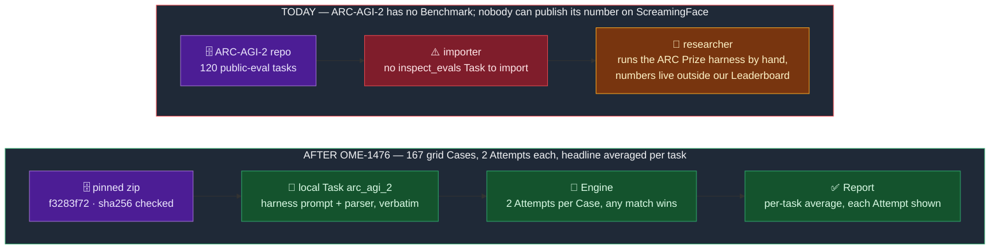
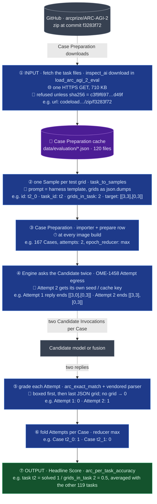
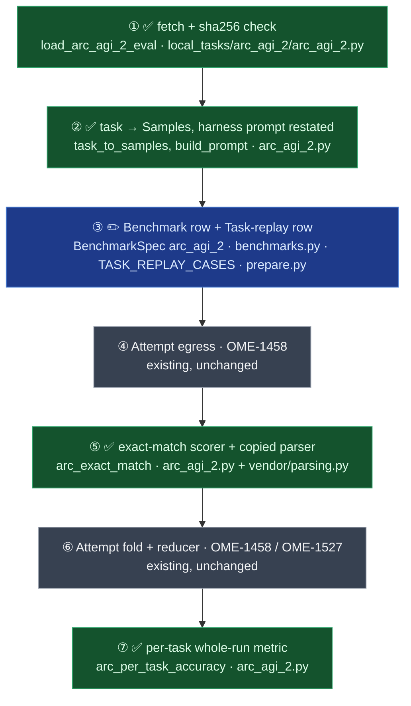

# Spec — ARC-AGI-2 runs as a local inspect Task: one Case per test grid, two Attempts, scored per task

- Status: approved by the owner, 2026-10-12. Decisions D1–D7 taken in session the same day (§1).
- Component: `apps/screamingface-engine` (`screamingface_engine_inspect`); the notebook lands in
  `packages/screamingface`.
- Ticket: [OME-1476](https://linear.app/openmined/issue/OME-1476/build-and-score-the-arc-agi-2-benchmark).
  Parent epic: OME-1457. Builds on OME-1458 (Attempts) and OME-1527 (whole-run metric), both on main.
- Ledger: `docs/work/2026-10-12-OME-1476-pr1-arc-agi-2-local-task.md`.

## TLDR

ARC-AGI-2 is a puzzle exam. Each **task** shows a model 2 to 6 example pairs of coloured grids
(a grid is a list of rows of the digits 0–9, up to 30×30) and asks for the output grid of one or
more new inputs, the **test grids**. The public evaluation set has 120 tasks and 167 test grids.
We run it as a **local Task**: an inspect Task file we write ourselves, because inspect_evals has
no ARC-AGI-2 (its `arc` is a different benchmark with the same name). The importer turns that
file into a Benchmark the way it turned MuSiQue's.

The rule that must hold: **our number is the one the ARC Prize scorer computes on the same
replies.** That scorer gives each test grid two tries, counts the grid solved if either try
matches exactly, and averages per task, so a task with two grids and one solved scores 0.5.

Before OME-1458 and OME-1527, the Engine could not compute that number:

- one answer per question, so the second try was impossible;
- the headline was a mean over questions, so tasks with two or three grids would count double or triple.

**The change:** one Case per test grid (167 Cases), two Attempts each (any match wins), and a
Headline Score that averages per task through the Task's own whole-run metric. The prompt and the
reply parser are copied byte-for-byte from the ARC Prize harness. Task files are fetched from the
official repo at a pinned commit and refused if their hash moves. It never publishes a number
computed under different rules without naming the difference on the Benchmark. Blast radius: one
new Benchmark (`arc_agi_2`) and one amended catalogue test; no existing Benchmark's Revision moves.

## 1. Decisions

| # | Decision | Why |
|---|---|---|
| D1 | **One Case = one test grid.** 167 Cases over 120 tasks; Sample metadata carries the task id. | The harness sends one prompt per test grid; same prompt, same reply. One task as one Case would need a multi-grid prompt the harness never sends. |
| D2 | **Two Attempts per Case, any match wins:** the Task declares `epochs=Epochs(2, "max")`. | The harness's `--num_attempts` default is 2. `max`, not `pass_at_2`: with `pass_at_2` a Case whose second Attempt failed reduces to nan and the tally refuses it (`test_whole_run_metric.py`). |
| D3 | **The Headline Score averages per task:** the Task's metric `arc_per_task_accuracy` groups Case scores by `task_id`, imported with `--whole-run-metric honour`. | The harness's `score_task` divides matched grids by grids in the task, then averages tasks. A per-Case mean over-weights the 45 tasks with more than one grid. |
| D4 | **The harness's prompt and parser** from `arcprize/arc-agi-benchmarking@9e2828fb` (MIT): `parse_and_validate_json` (`\boxed{}` first, then the last JSON grid) copied verbatim; `system_prompt.txt` + `convert_task_pairs_to_prompt` restated byte-identical, pinned by the template's sha256 and a fixture prompt from the upstream builder (the repo's whitespace hooks would rewrite the copied template). | Same question, same reading; the only honest way to sit beside their numbers. |
| D5 | **Parse failure scores 0; no extraction call, no re-ask.** Declared as a Named Deviation on the row. | The harness then sends the reply back to the model to extract a grid (OpenAI-style and Anthropic models only) and re-asks up to 2 times. That is provider-dependent and adds hidden calls; we keep one rule for every Candidate. |
| D6 | **Cases come from the official repo's zip at commit `f3283f72`**, fetched with `inspect_ai.util.download(url, sha256)` at Case Preparation. Nothing is committed. | One Case Source with one hash. The zip is 710 KB and was byte-identical across downloads (sha256 `c3f9f697…d49f`). Committing 1.36 MB of task JSON would bloat the repo. |
| D7 | **A partly failed task divides by all its grids.** Each Sample carries `grids_in_task`; the metric scores a task as grids solved ÷ `grids_in_task`, so a grid whose Attempts all failed counts 0, as in the harness. A task with every grid failed never reaches the metric and drops out. | The harness counts a failed Attempt as not solved. Matching it fully (a fully failed task as 0) needs the shared tally to pass failed Cases to the metric; out of scope (§5). |

The OME-1458 spec modelled an ARC task as one Case with one Check per grid (its D8). D1 + D3
give the same number by another route. Credit per grid and average per task are what the harness
computes either way, and the join fix's ARC test pins it (`test_an_arc_shaped_task_imports_with_honour_and_scores_per_task`).

## 2. Before / After

Today a researcher who wants a fusion's ARC-AGI-2 number has to run someone else's harness and
trust the bookkeeping. After this, it is one `sf.evaluate()`, priced per task, with both Attempts
of every grid in the Report.

### Don't regress

- No existing Benchmark's Revision moves: `test_published_revisions.py` stays green for every row
  but the new one.
- The catalogue-wide guard "no published row sets `whole_run_metric`"
  (`test_no_published_row_opts_in_so_no_revision_moves`) becomes "only `arc_agi_2` does", not
  deleted. That is a prior-test edit, pinned in `.claude/test-change-approvals/OME-1476.json`.

## 3. Architecture / Design

**How to read this section.** The circled numbers ① to ⑦ in every diagram below are the
Architecture map's box numbers, so "⑤" means the same code in Data Flow, the Failure-modes table
and the Review order. Read Data Flow first (one real test grid, end to end: *how*), then Failure
modes (rows F1–F6: *what breaks* and who notices), then the Architecture map (*where*: which files,
new vs existing). Read each diagram's key before its boxes, then follow the numbers top to bottom.

### Data Flow

Key: rectangles are steps, cylinders are where data rests, dashed arrows cross the network to the
named party. Colours here mean the kind of thing (blue step, purple stored data, green output),
not the change status the Architecture map uses. Tags inside boxes: ⏱ time · 💾 space ·
🌐 moving · 🔐 trust · 🧩 meaning. The example traced throughout is a two-grid task, invented for
illustration: task `t2`, grid 0 solved by Attempt 2, grid 1 unsolved.

- ① checks the zip hash, because a GitHub archive is regenerated on demand; a changed hash must
  stop the build, not silently change the Cases.
- ② writes grids with `json.dumps` default separators because the harness does; a different
  spacing is a different prompt.
- ⑤ scores a reply with no readable grid 0 rather than failing the Attempt (D5). A failed Attempt
  would be retried or shown as an error; an unparseable answer is a wrong answer.
- ⑦ needs the task id per Case, so the Task keeps Sample metadata. An honour import already
  forces `keep_sample_metadata`.

### Failure modes

| # | Fault | Box | Who notices | Outcome |
|---|---|---|---|---|
| F1 | GitHub serves a zip whose sha256 differs | ① | image build log | Download refuses; Case Preparation writes a SKIPPED marker; the Benchmark serves no Cases until re-pinned. No wrong Cases. |
| F2 | The zip downloads but `data/evaluation` holds ≠ 120 files or ≠ 167 grids | ② | unit test on the fixture; build log on real data | Loader raises naming the count; same SKIPPED outcome. |
| F3 | Reply has no `\boxed{}` and no JSON grid | ⑤ | Report: that Attempt shows score 0 and "no grid found" | Attempt scores 0 (D5); the other Attempt can still solve the Case. |
| F4 | Either Attempt's reply is cut off at the Candidate's token cap | ④ | Report: the Case failed, `model_token_cap` | A failed Candidate Invocation fails the **whole Case**, even when the other Attempt answered (OME-1458's Candidate-failure limitation, `test_attempt_fold.py`). Only a failed grading stays per Attempt. The Case then counts 0 in its task (D7, F5); the harness would still credit the other Attempt (§4). |
| F5 | A Case fails (F4) | ⑥→⑦ | Report: the Case listed as failed | The failed Case never reaches the metric (the Engine-wide rule; `single_shot.py`, tally Stage 1), but its task still divides by `grids_in_task`, so the grid counts 0, as in the harness (D7). A task with **every** grid failed drops out of the average; the ARC Prize scorer would count it 0 (§4). |
| F6 | A future edit swaps `max` for `pass_at_2` | ③ | `test_local_task_arc_agi_2.py` | Pinned: the row's `epoch_reducer` must be `max`. |

### Architecture

Key: ✅ green = new in this PR · ✏️ blue = changed · grey = existing, unchanged, shown for context.
Numbers are the ones every diagram above uses.

## 4. Known limitations of this design

- **Public eval only.** The ARC Prize Leaderboard scores the semi-private set, which we cannot
  get, so our number sits beside theirs, not on it. Accepted: cost per task and fusion-vs-solo
  are the story.
- **Messy replies score lower than in the harness** (D5): a reply the harness would rescue with an
  extraction call or a re-ask scores 0 here. Named on the row; revisit if a paid run shows many
  "no grid found" Attempts.
- **The Task cannot set the token cap.** The importer does not carry a Task's `GenerateConfig`;
  the Candidate's own parameters decide. Answers reach 2,760 characters (a 30×30 grid) before any
  reasoning, so a low cap fails Attempts (F4). The paid run must set `max_tokens` high; the
  paid panel's 32,768 suffices.
- **A task with every grid failed drops out instead of scoring 0** (F5). Example: task `t3` has
  one grid and both Attempts hit the token cap; the harness averages `t3` in as 0, we average over
  the other tasks. A partly failed task already matches the harness (D7). Fixing the fully
  failed case means the shared tally passing failed Cases to a whole-run metric, which every
  honour Benchmark would see; revisit if a paid run shows a fully failed task.
- **A Case-limited run can cut the last task in half.** Cases are ordered task by task, so a run
  over the first N Cases may include grid 0 of a two-grid task but not grid 1. The metric cannot
  tell an unasked grid from a failed one, so it scores the unasked grid 0 (D7). At most one task
  per run is affected, and a Case-limited run is never comparable to a full one anyway.
- **One failed Attempt fails the whole Case** (F4). Example: Attempt 1 on a grid hits the token
  cap, Attempt 2 answers it correctly. The harness counts the grid solved; the Engine fails the
  Case, so we count it 0. That is OME-1458's limitation for every Benchmark with Attempts, not
  ARC's to fix here; a high token cap keeps it rare.
- **When our number sits beside a harness public-eval number:** on a run whose Report shows no
  failed Case and no "no grid found" Attempt, scoring is the harness's, to the last digit. Answers still vary run to run, and the Candidate's settings (temperature,
  reasoning effort, token cap) must match. The row's description says so.
- **The public eval set has been on GitHub since March 2025** and may be in a model's training
  data, as with every public set.
- **GitHub can regenerate the archive** (F1). Fallback if it ever happens: per-file raw URLs at
  the same commit with a hash over the 120 files.

## 5. Scope

| | |
|---|---|
| **Now (PR 1)** | the local Task (loader, prompt, parser, scorer, metric), vendored harness files + MIT LICENSE, the Benchmark row with provenance and licence lines, the Task-replay row, the three catalogue table rows, the amended guard test, the two reproducibility pins from the ticket comment (ARC's url4 hash in `test_benchmark_protocol.py`; one known `derive_attempt_seed` value), README card, docs where the pattern is new |
| **Now (PR 1, also)** | the catalogue notebook (`build_notebooks.py` entry + generated `16_arc_agi_2.ipynb`, no outputs): the provenance conformance test requires the row's notebook to exist, so it cannot trail the row (owner, 2026-10-12) |
| **Later (PR 2)** | the golden recording, after the owner's paid run |
| **Out** | the training split (1,000 tasks) — it is for building solvers, not scoring them; the semi-private and private sets — not public; the harness's extraction call and re-ask — D5, revisit with paid-run numbers; a fully failed task scored 0 — needs the shared tally (§4); ARC-AGI-1 — a different, saturated benchmark |

## 6. Cost

167 grids × 2 Attempts = **334 Candidate Invocations per Candidate**. Harness prompts measured on
the pinned data: median 7,134 characters, max 25,495, total 1.32M characters per sweep, so
~2.6M characters of prompt per Candidate across both Attempts, before reasoning tokens.
No Cost Estimate exists in code (ADR 0003); the Report shows what was actually spent.

## 7. Acceptance

1. `arc_agi_2` registers from the local Task with **167 Cases**, `attempts=2`,
   `epoch_reducer="max"`, `whole_run_metric` set; prepare matches the Case Digest.
2. **Conservation:** for a fixture of 3 tasks with known replies, including one grid whose
   Attempts both fail, our headline equals the harness's `score_task` average on the same replies,
   to the last digit (the harness's scoring rule restated in the test as the oracle).
3. The prompt bytes for one pinned fixture task equal `convert_task_pairs_to_prompt` output.
4. Parser cases: `\boxed{}` grid, trailing JSON grid after prose, no grid (score 0), ragged rows,
   a grid of the right shape with one wrong cell (score 0).
5. The Report shows both Attempts per Case with their scores; with one Check per Case, the
   Attempt scored 1 is the one that matched (ticket acceptance 3).
6. Only the tests for the touched code run locally, plus ruff and pyright on touched files; CI
   runs the rest.

## 8. Open for the plan

- Provenance values (`frontier_score`, `human_baseline`, `difficulty`, citation) are taken from
  the paper and arcprize.org with links, and marked for the owner's check in the PR.
- Whether `test_benchmark_protocol.py`'s url4 pin list accepts an imported Benchmark as-is, or
  needs its imported counterpart.
