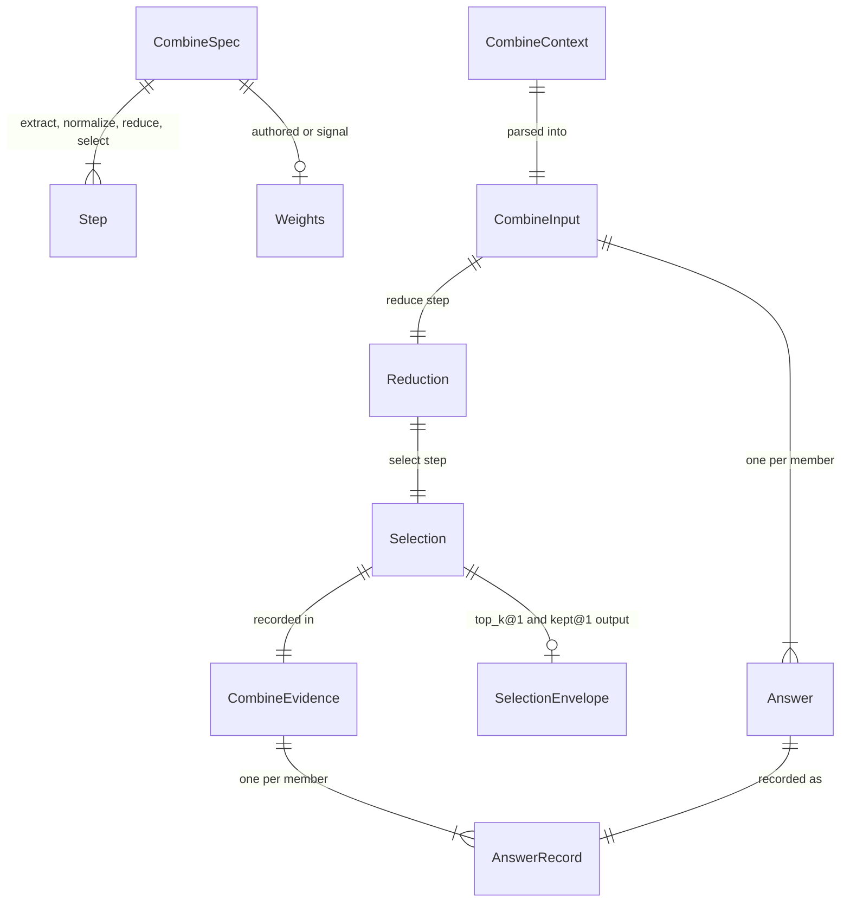

# ERD: E4b combine extensions (records, not tables)

E4b part 1 adds no store. It changes in-memory records of the combine endpoint and four wire
records that E4a freezes as v1 schemas. This document gives the record shapes, the invariants, and
the change to each record. Path prefixes are in [00-overview.md §1](00-overview.md#1-summary).

All wire records are unreleased (E4a is not merged). Each change is an additive edit in place, and
the v1 schema ids stay the same. [stated ans:Q5]

## 1. Diagram

## 2. CombineSpec (`screamingface.combine-spec.v1`)

**Purpose.** The rules of one combine call, sent as data in the url4 intent: `schema`, `reducer`,
`members`, `extract`, `normalize`, `reduce`, `select`, `weights`.
[existing E/combine/spec.py:117-134] The per-reducer presence rules are `REDUCER_RULES`.
[existing E/combine/spec.py:76-88]

**Key.** None. One spec is one value.

**Changes.**

| Attribute | Today | E4b | Source |
|---|---|---|---|
| `reducer` (enum) | `vote, median, judge, pick, merge, project, rank, concat, filter` [existing E/combine/ports.py:44] | adds `mean` | [stated ans:Q1] |
| `REDUCER_RULES["mean"]` | absent | `ReducerRule("answer", "required", "required", "optional", "numeric")` | [proposed] |
| `REDUCER_RULES["median"].weights` | `forbidden` [existing E/combine/spec.py:79] | `optional` | [stated ans:Q9] |
| `reduce.op` for `mean` | — | `mean@1` or `weighted_mean@1` | [stated ans:Q1] |
| `reduce.op` for `median` | `median@1` | `median@1` or `weighted_median@1` | [stated ans:Q9] |
| `select.op` for `mean` | — | `value@1` or `nearest@1` | [stated ans:Q9] |
| `select.args` of `by_field@1` and `best_holder@1` | `{order…}` | adds optional `output` (a field name) | [stated ans:Q9] |

**Invariants.**

- **CS-I1** The weight check lives in the operators, as for Vote, not in a new spec rule (the
  `ReducerRule` docstring says later units add no per-reducer operator rule).
  `weighted_mean@1` and `weighted_median@1` reuse the `weighted_mode@1` helper: no weight and no
  signals on an answer means the spec has no weights, which is `combine_spec_invalid`. `mean@1` and
  `median@1` ignore weights, as `mode@1` does. The SDK always pairs the op with the weights.
  [proposed — gap §per-element/store] [existing E/combine/spec.py:62-63]
  [existing E/combine/operators/reduce.py:62-66]
- **CS-I2** The `weights` rules do not change: an authored weight is `> 0` and `<= MAX_WEIGHT`, and a
  signal weight names one known signal key. [existing E/combine/spec.py:104-114,144-150]
- **CS-I3** `output` is a top-level field name that matches the Pick field rule
  `[A-Za-z_][A-Za-z0-9_]{0,63}`. [existing S/fields.py:50]

## 3. CombineContext and CombineInput (in memory)

**Purpose.** `CombineContext` is the parsed url4 context. `CombineInput` is what an operator sees.
[existing E/combine/spec.py:209-216] [existing E/combine/ports.py:216]

**Change.** `CombineInput` gets `input: str | None = None`. The endpoint always sets it from
`CombineContext.input`. The default keeps the test helpers that build a `CombineInput` working.
Today the operators cannot see the Case input. [stated ans:Q7]

**Invariant.** **CI-I1** When the endpoint builds `CombineInput`, `input` is the exact `input` text
of the context, with no change. [proposed]

## 4. Answer (in memory; `screamingface.answer.v1` on the wire)

**Purpose.** One member's read result: `member_id, text, raw, value, status, reason, signals,
weight`. [existing E/combine/ports.py:183-197]

**Rules that E4b depends on (no change).**

- `value` is the normalized text. For `mean` and `median` it is a canonical decimal.
  [existing E/combine/operators/reduce.py:77-80]
- `weight` is `None` when a signal weight is absent, `<= 0`, or over `MAX_WEIGHT`.
  [existing E/combine/endpoint.py:407-413]

**Change.** The abstain reason set grows from `no_votes, cut_not_met` to
`no_votes, cut_not_met, output_missing`. [stated ans:Q12]
Places that list the set: [existing E/combine/ports.py:51,61,64] (`NoVotes` refuses any other
reason [existing E/combine/ports.py:104-112]), [existing S/answer.py:22,32],
`ST/data/schemas/screamingface.answer.v1.json`, and
`ET/data/combine_contract/schemas/screamingface.combine-evidence.v1.json:33,204`.

## 5. Reduction (in memory)

**Purpose.** The output of the reduce step: `tally, statistic, scores, judge, fields, text,
separator_collision`. [existing E/combine/ports.py:272-288]

**Rule for E4b.** `mean@1`, `weighted_mean@1` and `weighted_median@1` fill `statistic`, the same as
`median@1`. `value@1` and `nearest@1` read `statistic`. [existing E/combine/operators/select.py:85-107]

**Change.** `Reduction` gets `participants: tuple[str, ...] | None = None`. The weighted operators
set it to the members with a usable weight. `nearest@1` picks only from `participants` when it is
set, and from all voters when it is `None` (today's behavior, kept for `median@1` and `mean@1`).
Without this, a member dropped for its weight could still win `nearest`.
[stated ans:Q2] [existing E/combine/operators/select.py:81-102]

**Numeric rules [proposed — gap §cross-cutting/performance].**

- The sums are computed in `DECIMAL_CONTEXT` (precision 1000, `ROUND_HALF_EVEN`), so they are exact
  for at most 256 members with 64-character values. [existing E/combine/ports.py:74]
- The one division of a mean is rounded to **34 significant digits** (`ROUND_HALF_EVEN`), then
  `canonical_decimal` removes trailing zeros. Without this cap, a mean such as 4/3 has 1000 digits.
- An authored weight becomes `Decimal(str(weight))`, the same as today. [existing E/combine/endpoint.py:413]

## 6. Selection and SelectionEnvelope

**Purpose.** `Selection` is `chosen, output, tie, agreement`. [existing E/combine/ports.py:292-303]
`SelectionEnvelope` is the output text of `top_k@1` and `kept@1`.
[existing E/combine/operators/selection.py:49-52]

**Change to the envelope.** Today: `{"selected":[{"id","text"}]}`. E4b:
`{"input":"<Case input>","selected":[{"id","text"}]}`, in canonical JSON with sorted keys.
`top_k@1` and `kept@1` change in place under ans:Q5 (overview §6, P4). The envelope stays inside
the 8 MiB result cap. [stated ans:Q7] [existing E/combine/ports.py:540-544]
[existing E/combine/endpoint.py:95-97,475]
`join@1` and `all@1` (Concat) do not change. [stated ans:Q13]

**Change to Selection.output.** When `by_field@1` or `best_holder@1` has an `output` arg, `output`
is the chosen member's field value as text: a JSON string as it is, any other JSON value as
canonical JSON. [stated ans:Q9]

## 7. CombineEvidence (`screamingface.combine-evidence.v1`)

**Purpose.** The record of one combine call. Engine: [existing E/combine/evidence.py:110-127].
SDK mirror: [existing S/combine_evidence.py:213-227].

**Changes.**

| Attribute | Change | Source |
|---|---|---|
| `reducer` (enum, schema :409-420) | adds `mean` | [stated ans:Q1] |
| `mean: str \| None` | new. The canonical decimal of the mean, only for the `mean` reducer. | [proposed] |
| `median` | also set by `weighted_median@1`; `null` for the `mean` reducer (today `_evidence` sets it from `statistic` for every reducer [existing E/combine/endpoint.py:549]) | [proposed] |
| `result.reason` (enum) | adds `output_missing` | [stated ans:Q12] |
| member `weight` | no change. A dropped member has `weight: null`. | [existing E/combine/evidence.py:40-50] |

## 8. Operator catalog (`GET /v1/operators`)

| Id | Stage | Status | Source |
|---|---|---|---|
| `mean@1` | reduce | new | [stated ans:Q1] |
| `weighted_mean@1` | reduce | new | [stated ans:Q1] |
| `weighted_median@1` | reduce | new | [stated ans:Q9] |
| `by_field@1` | select | adds optional arg `output` | [stated ans:Q9] |
| `best_holder@1` | select | adds optional arg `output` | [stated ans:Q9] |
| `top_k@1`, `kept@1` | select | output envelope adds `input` | [stated ans:Q7] |

**Invariant.** **OC-I1** The SDK list `FLOW_OPERATOR_IDS` is equal to the engine builtins.
[existing ST/_combine_flow_fixtures.py:19] [existing ET/test_sdk_flow_catalog_fixture.py:37]

## 9. SDK records

| Record | Change | Source |
|---|---|---|
| `sf.Mean(*, extract="last_number", select="value", weights=None)` | new | [stated ans:Q1] [stated ans:Q9] |
| `sf.Median(..., weights=None)` | `weights` is accepted (today it raises `TypeError`) | [stated ans:Q9] [existing S/reducer.py:523-527] |
| `sf.Reduce("median" \| "mean", ..., select=...)` | `select="nearest" \| "value"` is a second name for `mode="select" \| "compute"`; the block stores only the mode, so the url4 does not change | [playground fix 2026-10-14] |
| `sf.Judge(..., order="max")` | new `order: "max" \| "min"` | [stated prompt] [stated ans:Q11] |
| `sf.Filter(..., judge=None)` | new `judge` | [stated ans:Q9] |
| `sf.Pick(..., output=None)` | new `output` | [stated ans:Q9] |
| `REDUCER_NAMES` | adds `mean` | [existing S/reducer.py:19-24] |
| `judge-template@1` first line | adds ` order=min` when `order="min"` | [stated ans:Q11] |

## 10. Migrations

- No stored data changes. A combine call is stateless. [existing E/combine/endpoint.py:161-188]
- The frozen v1 snapshots (`combine-spec.v1`, `combine-evidence.v1`, `answer.v1`) keep their ids.
  The freeze check never overwrites an existing file, so each changed snapshot is deleted, the
  freeze test runs once with `UPDATE_SCHEMA_SNAPSHOT=1` (it writes the file and fails once), and
  then it runs again and passes. [stated ans:Q5] [existing ET/test_wire_schema_freeze.py:29-71]
- The changed pinned tests need an owner approval manifest in `.claude/test-change-approvals/`.
  [existing .claude/scripts/run_gates.py:382-498]
- `report.v1` and `report-trace.v1` do not list reducer names. They do not change.
  [existing ST/data/schemas/screamingface.report-trace.v1.json]
