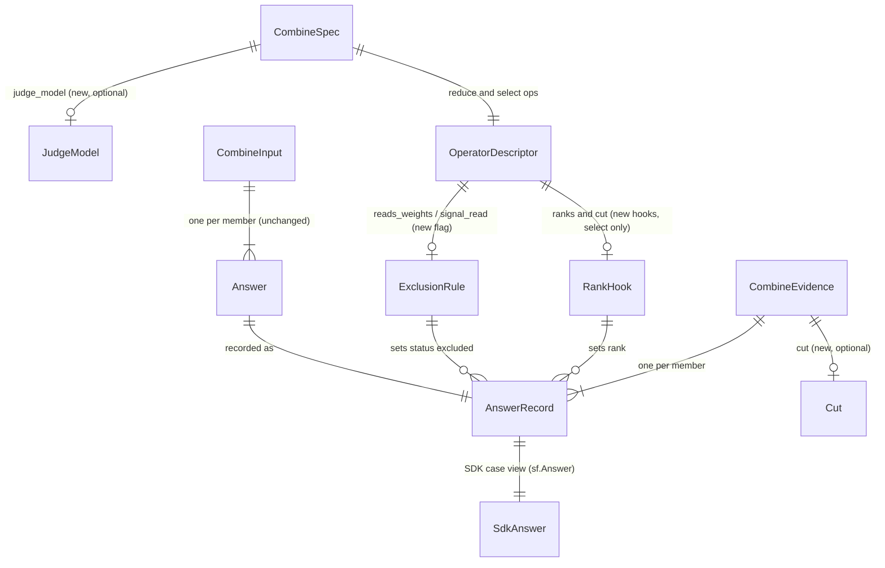

# ERD: E4b part 2 — evidence completeness (records, not tables)

E4b part 2 adds no store. It changes the in-memory evidence that the combine endpoint builds, and
four wire records that E4a froze as v1 schemas. This document gives the record shapes, the
invariants, and the change to each record. Path prefixes are in
[00-overview.md §1](00-overview.md#1-summary).

Each wire change is an additive edit in place, and the v1 schema ids stay the same. This follows
the E4b part 1 rule (part 1 ans:Q5: "additive edit, no need to care abour versions for now").
[existing docs/spec/2026-10-13-e4b-combine-extensions/00-overview.md:86]

## 1. Diagram

## 2. AnswerRecord (one member in `screamingface.combine-evidence.v1`)

**Purpose.** What the combine step read for one member, in author order: `member_id`, `raw`,
`value`, `status`, `reason`, `signals`, `weight`, `score`.
[existing E/combine/evidence.py:41-51]

**Key.** `member_id`, unique within one evidence. [existing E/combine/evidence.py:141-143]

**Changes.**

| Attribute | Today | Part 2 | Source |
|---|---|---|---|
| `status` | `"answered" \| "fail"` (`MemberStatus`) [existing E/combine/ports.py:52] | `"answered" \| "fail" \| "excluded"` (new `RecordStatus`) | [stated ans:Q3] |
| `reason` | `AnswerReason \| None` [existing E/combine/evidence.py:48] | `AnswerReason \| ExcludeReason \| None`; `ExcludeReason = "no_signal" \| "no_weight"` | [stated ans:Q3] |
| `rank` | absent | optional `int`, written only when set (top_k@1 steps) | [stated ans:Q1] (epic E3) |

**Invariants.**

- **AR-I1** `reason` is `None` exactly when `status == "answered"`. [existing E/combine/evidence.py:55-56]
- **AR-I2** A `"fail"` record has no `value`, and its reason is an `AnswerReason`.
  [existing E/combine/evidence.py:57-58]
- **AR-I3** An `"excluded"` record has a reason in `ExcludeReason`, and it keeps its `raw`, `value`,
  `signals`, `weight` and `score`. The member answered. A rule left it out. [stated ans:Q3]
- **AR-I4** `rank`, when present, is an integer from 1 to the number of members.
  [proposed — gap §boundary]
- **AR-I5** The core `Answer` that the operators read keeps `status ∈ {"answered", "fail"}`
  (I-A3). `"excluded"` exists only in the record. So no operator result changes.
  [existing E/combine/ports.py:188-216] [proposed — gap §per-element/store]

## 3. CombineEvidence (`screamingface.combine-evidence.v1`)

**Purpose.** Everything one combine step decided, minus the answer text.
[existing E/combine/evidence.py:111-137]

**Changes.**

| Attribute | Today | Part 2 | Source |
|---|---|---|---|
| `cut` | absent | optional `{"k": int, "order": "max" \| "min"}`, written only for a `top_k@1` step | [stated ans:Q1] (epic E3) |
| `judge_model` | absent | optional `str` (the judge route), written only when the spec carries `judge_model` | [stated ans:Q2] |
| `dropped` | counts `status == "fail"` [existing E/combine/evidence.py:146-147] | unchanged: an excluded member is not dropped | [proposed] |

Both new keys follow the `mean` precedent: they are absent when not set, so every other evidence
keeps its v1 bytes. [existing E/combine/evidence.py:129-131]

**Invariants.**

- **CE-I1** `cut.k` equals the `k` arg of the `top_k@1` step, and `cut.order` is its `order`
  arg, or `"max"` when the arg is absent. [existing E/combine/operators/selection.py:55-67]
- **CE-I2** In a `top_k@1` step that answered, the chosen members are exactly the members with
  `rank <= cut.k`, and `chosen` lists them in rank order. [implied]
- **CE-I3** `judge_model` is present only when the step reads a judge: the `judge` reducer, or the
  signal `score:judge`. [stated ans:Q2]

## 4. CombineSpec (`screamingface.combine-spec.v1`)

**Purpose.** The rules of one combine call, sent in the url4 intent.
[existing E/combine/spec.py:116-133]

**Changes.**

| Attribute | Today | Part 2 | Source |
|---|---|---|---|
| `judge_model` | absent | optional `str`: the canonical judge route, as `sf.Judge` stores it | [stated ans:Q2] |

**Invariants.**

- **CS-I1** The SDK writes `judge_model` exactly when the reducer plan has a judge model call
  (`_ModelSignal` with key `"judge"`). [existing S/reducer.py:53-61] [existing S/judge.py:190-196]
- **CS-I2** The engine refuses a spec with `judge_model` that reads no judge
  (`combine_spec_invalid`). It accepts a judge spec without `judge_model` (a candidate compiled
  before part 2), and then the evidence has no `judge_model`. [proposed — gap §per-connection/sync]
- **CS-I3** `judge_model` is display data. The engine never calls it, never routes by it, and
  never logs it. It is a non-empty string of at most 256 characters with no control character.
  [proposed — gap §security]

## 5. OperatorDescriptor (in-memory, engine)

**Purpose.** One registered operator and its hooks. [existing E/combine/ports.py:355-384]

**Changes.**

| Attribute | Today | Part 2 | Source |
|---|---|---|---|
| `reads_weights` | absent | `bool`, reduce only: the operator counts the member weight | [proposed] |
| `ranks` | absent | `Callable[[Reduction, CombineInput, OpArgs], Mapping[str, int]] \| None`, select only | [proposed] |
| `cut` | absent | `Callable[[OpArgs], Cut] \| None`, select only | [proposed] |

None of these is published in the catalog, as for `signal_read` and `envelope`.
[existing E/combine/ports.py:360-362]

## 6. The exclusion rule (decision table)

The endpoint computes the exclusion before the reduce step, from the plan and the answers. So an
abstain still shows which members a rule left out. [proposed — gap §per-flow/failure]

| # | The step reads … | Member status | Its value of the read | Record status | Reason |
|---|---|---|---|---|---|
| X1 | a signal weight, and the reduce op has `reads_weights` | answered | weight `None` (signal missing, `<= 0` or above the cap) | excluded | `no_weight` |
| X2 | a signal from the reduce args (`by_signal@1`, `filter@1` threshold form) | answered | signal `None` | excluded | `no_signal` |
| X3 | any | fail | any | fail | its failure reason (unchanged) |
| X4 | authored (constant) weights | answered | always usable (CS check) | answered | — |
| X5 | a signal weight, op without `reads_weights` (`mode@1`, `median@1`, `mean@1`) | answered | any | answered | — |
| X6 | no signal and no weight | answered | — | answered | — |

[existing E/combine/endpoint.py:422-428] [existing E/combine/operators/reduce.py:66-78]
[existing E/combine/operators/signals.py:67-81,132-157] [existing E/combine/spec.py:145-151]

## 7. SDK records (`S/`)

| Record | Change | Source |
|---|---|---|
| `answer.py` vocabulary | `MemberStatus` and `AnswerStatus` add `"excluded"`; `AnswerReason` adds `no_signal`, `no_weight` | [stated ans:Q3] |
| `sf.Answer` | a value is allowed when `status ∈ {"answered", "excluded"}`; an excluded Answer has its `member_id` and an exclude reason | [stated ans:Q3] [existing S/answer.py:125-142] |
| `CombineAnswerRow` | `status` may be `"excluded"`; new optional `rank: int \| None = None` | [stated ans:Q3] [existing S/combine_evidence.py:46-80] |
| `CombineEvidence` | new optional `cut: CombineCut \| None = None` and `judge_model: str \| None = None` | [stated ans:Q1] [stated ans:Q2] |
| decoder key sets | `rank` joins the optional member keys; `cut` and `judge_model` join `_OPTIONAL_EVIDENCE_KEYS` | [existing S/_evaluation/combine_evidence.py:39,60-63] |

## 8. Migrations

- All records are unreleased beyond the E4a and E4b branches. The edits are in place, under the
  same v1 ids. [existing docs/spec/2026-10-13-e4b-combine-extensions/00-overview.md:86]
- An evidence from before part 2 decodes in the new SDK: the new keys are optional, and the old
  status values stay valid. [implied]
- An evidence from part 2 does NOT decode in an SDK from before part 2 when it has an `"excluded"`
  row or a new key, because the decoder is strict. The engine and the SDK ship together.
  [existing S/_evaluation/combine_evidence.py:70-80] [implied]
- A judge spec without `judge_model` stays valid (CS-I2), so a url4 compiled before part 2 still
  runs. [proposed]
