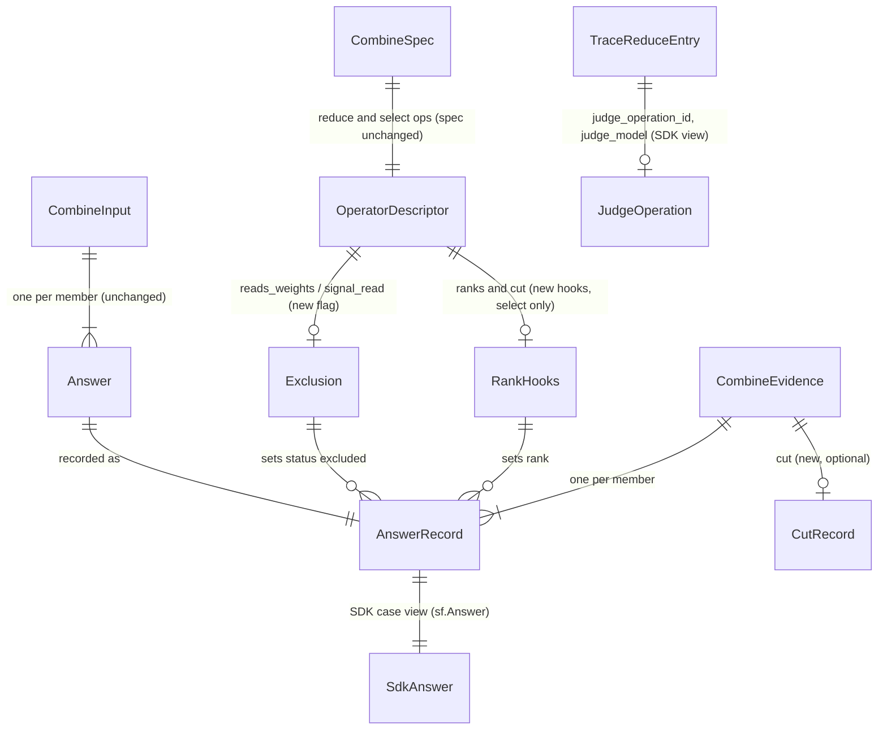

# ERD: E4b part 2 — evidence completeness (records, not tables)

E4b part 2 adds no store. It changes the in-memory evidence that the combine endpoint builds, three
wire or view records that E4a froze as v1 snapshots, and the SDK trace. This document gives the
record shapes, the invariants, and the change to each record. Path prefixes are in
[00-overview.md §1](00-overview.md#1-summary).

Each wire change is an additive edit in place, and the v1 schema ids stay the same. This follows
the E4b part 1 rule (part 1 ans:Q5: "additive edit, no need to care abour versions for now").
[existing docs/spec/2026-10-13-e4b-combine-extensions/00-overview.md:86]

The combine spec and every url4 file do not change. [stated ans:Q4]

## 1. Diagram

## 2. AnswerRecord (one member in `screamingface.combine-evidence.v1`)

**Purpose.** What the combine step read for one member, in author order: `member_id`, `raw`,
`value`, `status`, `reason`, `signals`, `weight`, `score`.
[existing E/combine/evidence.py:41-51]

**Key.** `member_id`, unique within one evidence. [existing E/combine/evidence.py:141-143]

**Changes.**

| Attribute | Today | Part 2 | Source |
|---|---|---|---|
| `status` | `"answered" \| "fail"` (`MemberStatus`) [existing E/combine/ports.py:52] | `"answered" \| "fail" \| "excluded"` (new `RecordStatus`) | [stated ans:Q3] |
| `reason` | `AnswerReason \| None` [existing E/combine/evidence.py:48] | `AnswerReason \| ExcludeReason \| None`; `ExcludeReason = "no_signal" \| "no_weight"` | [stated ans:Q3] |
| `rank` | absent | optional `int`, written only when set (top_k@1 steps) | [stated prompt] (epic E3) |

**Invariants.**

- **AR-I1** `reason` is `None` exactly when `status == "answered"`. [existing E/combine/evidence.py:55-56]
- **AR-I2** A `"fail"` record has no `value`, and its reason is an `AnswerReason`.
  [existing E/combine/evidence.py:57-58]
- **AR-I3** An `"excluded"` record has a reason in `ExcludeReason`, and it keeps its `raw`, `value`,
  `signals`, `weight` and `score`. The member answered. A rule left it out. [stated ans:Q3]
- **AR-I4** `rank`, when present, is on a member with a score. The ranks of one evidence are the
  integers 1..n, each once, where n is the number of members that have a score (review m13).
  [implied]
- **AR-I5** The core `Answer` that the operators read keeps `status ∈ {"answered", "fail"}`
  (I-A3). `"excluded"` exists only in the record. So no operator result changes.
  [existing E/combine/ports.py:188-216] [proposed — gap §per-element/store]

## 3. CombineEvidence (`screamingface.combine-evidence.v1`)

**Purpose.** Everything one combine step decided, minus the answer text.
[existing E/combine/evidence.py:111-137]

**Changes.**

| Attribute | Today | Part 2 | Source |
|---|---|---|---|
| `cut` | absent | optional `CutRecord = {"k": int, "order": "max" \| "min"}`, written only for a `top_k@1` step | [stated prompt] (epic E3) |
| `dropped` | counts `status == "fail"` [existing E/combine/evidence.py:146-147] | unchanged: an excluded member is not dropped | [proposed] |
| judge model | absent | stays absent: the SDK view shows it ([§7](#7-sdk-records-s)) | [stated ans:Q4] |

`cut` follows the `mean` precedent: it is absent when not set, so every other evidence keeps its
v1 bytes. [existing E/combine/evidence.py:129-131]

**Invariants.**

- **CE-I1** `cut.k` equals the `k` arg of the `top_k@1` step, and `cut.order` is its `order`
  arg, or `"max"` when the arg is absent. [existing E/combine/operators/selection.py:55-67]
- **CE-I2** In a `top_k@1` step that answered, the chosen members are exactly the members with
  `rank <= cut.k`, and `chosen` lists them in rank order. [implied]
- **CE-I3** No member in `chosen` (and no result member) has `status: "excluded"`. [implied]

## 4. CombineSpec (`screamingface.combine-spec.v1`) — no change

The spec keys, `decode_combine_spec` and its `_SPEC_KEYS` do not change, so the url4 rebuild paths
that decode a spec still accept every url4 compiled before part 2. [stated ans:Q4]
[existing E/combine/spec.py:116-133] [existing S/_evaluation/combine_spec.py:19,143]
[existing S/url4.py:210,488,510,519]

## 5. OperatorDescriptor and the cut type (in-memory, engine)

**Purpose.** One registered operator and its hooks. [existing E/combine/ports.py:355-384]

**Changes.**

| Attribute | Today | Part 2 | Source |
|---|---|---|---|
| `reads_weights` | absent | `bool`, reduce only: the operator counts the member weight | [proposed] |
| `ranks` | absent | `Callable[[Reduction, CombineInput, OpArgs], Mapping[str, int]] \| None`, select only | [proposed] |
| `cut` | absent | `Callable[[OpArgs], Cut] \| None`, select only | [proposed] |

None of these is published in the catalog, as for `signal_read` and `envelope`.
[existing E/combine/ports.py:360-362]

**The cut type (review m10).** One name and one home per side:

| Side | Name | Home | Role |
|---|---|---|---|
| engine core | `Cut` (frozen dataclass: `k: int`, `order: SignalOrder`) | `E/combine/ports.py`, next to `SignalRead` | what the `cut` hook returns |
| engine wire | `CutRecord` (pydantic) | `E/combine/evidence.py` (imports `ports`) | the `cut` key of the evidence |
| SDK | `CombineCut` (public, `sf.report`) | `S/combine_evidence.py` | the decoded `cut` |

`ports.py` cannot import the evidence models, so the operator returns `Cut`, and the endpoint builds
`CutRecord` from it. [existing E/combine/evidence.py:10-12]

## 6. The exclusion rule (decision table)

`_plan` decides once which exclusion the step can make (`_Plan.excludes: _Exclusion | None`), and
`_member_record` applies it to each member when `_evidence` runs, also on an abstain.
[member-exclusion §2.1](prd/member-exclusion.md) gives the signatures. [proposed — gap §per-flow/failure]

| # | The step reads … (how `_exclusion` tells) | Member status | Its value of the read | Record status | Reason |
|---|---|---|---|---|---|
| X1 | a signal weight: `spec.weights` is `SignalWeights` and the reduce op has `reads_weights` | answered | weight `None` (signal missing, `<= 0` or above the cap) | excluded | `no_weight` |
| X2 | a signal from the reduce args: the reduce op's `signal_read` returns a read (`by_signal@1`, `filter@1` threshold form) | answered | signal `None` | excluded | `no_signal` |
| X3 | any | fail | any | fail | its failure reason (unchanged) |
| X4 | authored (constant) weights | answered | always usable (CS check) | answered | — |
| X5 | a signal weight, op without `reads_weights` (`mode@1`, `median@1`, `mean@1`) | answered | any | answered | — |
| X6 | no signal and no weight | answered | — | answered | — |

X1 and X2 never both hold: `_signal_read` refuses a step that reads two signals.
[existing E/combine/endpoint.py:381-397,422-428] [existing E/combine/operators/reduce.py:66-78]
[existing E/combine/operators/signals.py:67-81,132-157] [existing E/combine/spec.py:145-151]

## 7. SDK records (`S/`)

| Record | Change | Source |
|---|---|---|
| `answer.py` vocabulary | `MemberStatus` and `AnswerStatus` add `"excluded"`; `AnswerReason` adds `no_signal`, `no_weight`; the docstring states the mapping to the engine words (review m8) | [stated ans:Q3] [existing S/answer.py:1-6] |
| `sf.Answer` | a value is allowed when `status ∈ {"answered", "excluded"}`; an excluded Answer has its `member_id` and an exclude reason | [stated ans:Q3] [existing S/answer.py:125-142] |
| `CombineAnswerRow` | `status` may be `"excluded"`; new optional `rank: int \| None = None` | [stated ans:Q3] [existing S/combine_evidence.py:46-80] |
| `CombineEvidence` | new optional `cut: CombineCut \| None = None` | [stated prompt] |
| decoder key sets | `rank` joins the optional member keys; `cut` joins `_OPTIONAL_EVIDENCE_KEYS` | [existing S/_evaluation/combine_evidence.py:39,60-63] |
| trace `reduce` entry | new keys `judge_operation_id` and `judge_model` (null when the step reads no judge), from the graph and the judge's own operation | [stated ans:Q4] [existing S/report_trace.py:18-40] |

**Word mapping (review m8).**

| SDK (`S/answer.py`) | Engine (`E/combine/ports.py`) |
|---|---|
| `MemberStatus` | `RecordStatus` (evidence record), not `MemberStatus` (core `Answer`) |
| `AnswerReason` | `AnswerReason` ∪ `ExcludeReason` |
| `AnswerStatus` | `AnswerStatus` ∪ `{"excluded"}` |
| `AbstainReason`, `SignalOrder` | equal |

## 8. Migrations

- All records are unreleased beyond the E4a and E4b branches. The edits are in place, under the
  same v1 ids. [existing docs/spec/2026-10-13-e4b-combine-extensions/00-overview.md:86]
- An evidence from before part 2 decodes in the new SDK: the new keys are optional, and the old
  status values stay valid. [implied]
- An evidence from part 2 does NOT decode in an SDK from before part 2 when it has an `"excluded"`
  row or a new key, because the decoder is strict. The engine and the SDK ship together.
  [existing S/_evaluation/combine_evidence.py:70-80] [implied]
- Every url4 compiled before part 2, judge recipes included, rebuilds and runs unchanged: the spec
  does not change. [stated ans:Q4]
