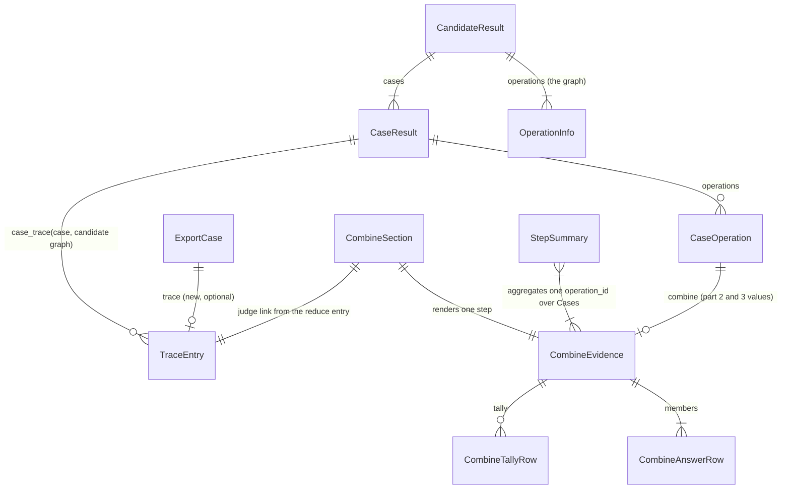

# ERD: E4b part 4 — show signals (records and views, not tables)

E4b part 4 adds no store, no wire record and no schema id. It adds one optional key to the
exported Case object of `screamingface.report.v1`, and two HTML views that read records that
already exist. This document gives the shapes, the show rules and the invariants. Path prefixes
are in [00-overview.md §1](00-overview.md#1-summary).

## 1. Diagram

## 2. Export Case object (`screamingface.report.v1`, one item of `candidates[].cases`)

**Purpose.** One Case in the exported report JSON (`report.to_dict()`, `report.to_json()`,
`report.export()`, the download link). Today it is exactly `case.to_dict()`.
[existing S/report.py:483-484] [existing S/_report_export.py:16-21]

**Change.**

| Attribute | Today | Part 4 | Source |
|---|---|---|---|
| `trace` | absent | optional list of `TraceEntry.to_dict()` (report-trace.v1 entries), last key; present only when at least one item of `case.operations` has `combine` | [stated ans:Q1]; shape [proposed] P1 |
| every other key | `case.to_dict()` | unchanged, same order | [existing S/case_result.py:580-604] |

**Invariants.**

- **EC-I1** The exported Case minus `trace` equals `case.to_dict()`. [proposed] P2
- **EC-I2** `trace` equals the `entries` of the same Case in `report.trace_dict()`.
  [existing S/report.py:643-649,966-979] [proposed]
- **EC-I3** `trace` holds no member output text (I-E1 of the trace). [existing S/report_trace.py:1-6]
- **EC-I4** `case.to_dict()` itself never has `trace`, so the Engine wire mirror and the strict
  decoder stay as they are. [existing S/_evaluation/results.py:360-383]
- **EC-I5** The report root keeps `"schema": "screamingface.report.v1"`. [existing S/report.py:626-634]

## 3. TraceEntry (`screamingface.report-trace.v1`) — no change

The kinds and their field sets do not change. The export reuses `TraceEntry.to_dict()`.
`ST/data/schemas/screamingface.report-trace.v1.json` keeps its bytes.
[existing S/report_trace.py:19-60]

## 4. Combine section (HTML view of one combine step in one Case)

**Purpose.** Show what one reducer step read and decided for one Case. [stated ans:Q1]

**Input.** One `CaseOperation` with `combine` (the `CombineEvidence`), the `reduce` entry of the same
`operation_id` in `case_trace(case, graph)`, and `graph = {op.id: op for op in candidate.operations}`.
[existing S/_case_views.py:105-116,157-171] [existing S/combine_evidence.py:259-389]

**Facts (chips, in this order).**

| # | Chip text | Shown when | Source field |
|---|---|---|---|
| F1 | `reducer · {reducer}` | always | `evidence.reducer` |
| F2 | `rule · {op1} → {op2} → …` | always | `evidence.operators` |
| F3 | `answered · {member_id}`, `answered · built`, or `abstain · {reason}` | always | `evidence.result` |
| F4 | `cut · top {k} · {order}` | `evidence.cut` is set | part 2 |
| F5 | `reads · {key}` or `reads · {key} · {order}` | `evidence.signal` is set | E4a, part 3 |
| F6 | `judge · {judge_model}` (em dash when the model is None) | the reduce entry has `judge_operation_id` | part 2 P8 |
| F7 | `agreement · {number}` | `evidence.agreement` is not None | E4a |
| F8 | `tie · yes` or `tie · no` | always | `evidence.tie` |
| F9 | `dropped · {n}` | always | `evidence.dropped` |
| F10 | `median · {text}`, `mean · {text}` | the key is set | E4a, E4b part 1 |

**Member columns (in this order).**

| # | Header | Cell | Shown when |
|---|---|---|---|
| C1 | `member` | `member_id` | always |
| C2 | `status` | `answered`, or `{status} · {reason}` | always |
| C3 | `value` | the value text (DF text rule) | always |
| C4 | `weight` | number | any row of the step has a weight |
| C5 | `score` | number | any row has a score |
| C6 | `rank` | integer | any row has a rank |
| C7 | one column per signal key | number | always for every key in any row's `signals` (first-seen order) |
| C8 | `chosen` | `&check;` or empty | always |

A C7 header has a title when it says something: `source: {source}` for a declared name, and
`read by the rule` for the key that `evidence.signal` reads (both, joined by `; `).

**Tally table** (only when `evidence.tally` is not None): columns `tally value`, `score`,
`holders`.

**Invariants.**

- **CS-I1** One section per combine operation of the Case, in operation order. [stated ans:Q2]
- **CS-I2** A Case with no combine evidence has no section and no `sf-cmb` markup. [proposed] P18
- **CS-I3** Every member row of the evidence has exactly one table row, in author order. [stated ans:Q1]
- **CS-I4** Every text from data is escaped. [proposed] P8

## 5. Step summary (HTML view, one combine `operation_id` over all Cases of one Candidate)

**Purpose.** The run-level view of a reducer step. [stated ans:Q1]

| Field | Meaning | Source |
|---|---|---|
| `operation_id` | the combine operation | `CaseOperation.operation_id` |
| `label` | the operation label in the Candidate graph, else the id | `OperationInfo.label` |
| `reducer` | from the first evidence seen | `evidence.reducer` |
| `cases` (N) | Cases with evidence for this operation | count |
| per member `chosen` | Cases where the member id is in `evidence.chosen` | [proposed] P13 |
| per member `excluded` | Cases where the member row has `status == "excluded"` | [proposed] P13 |
| per member, per declared name: `mean`, `n` | `fsum(values) / n` over the member's non-None values; `n` = their count | [stated ans:Q1]; [proposed] P13 |
| declared names | ordered union of `evidence.declared` keys | part 3 |

**Invariants.**

- **SS-I1** `0 <= chosen <= N` and `0 <= excluded <= N` for each member. [implied]
- **SS-I2** `n <=` the number of Cases where the member has a row. [implied]
- **SS-I3** A Candidate with no combine evidence in any Case has no summary block. [stated prompt]

## 6. Display rules (shared)

| Rule | Text | Source |
|---|---|---|
| a float | `format(v, ".4g")`, title `repr(v)` | [stated ans:Q3]; [proposed] P5 |
| an integer | `str(v)`, no title | [proposed] P5 |
| a missing value | `—` (U+2014) in `` | [stated ans:Q3] [existing S/_ui/report_view.py:370-375] |
| MR-1 | row `status == "fail"` → `member failed: {reason}` | [proposed] P6 |
| MR-2 | row `status == "excluded"` → `left out by the rule: {reason}` | [proposed] P6 |
| MR-3 | otherwise → `no {label} recorded` | [proposed] P6 |
| a member value text | first 80 characters, then `…` | [proposed] P7 |

## 7. Migrations

- report.v1 gets one optional key. A reader that ignores unknown keys reads the new export. A
  reader with a closed key set for the Case object must add `trace`. The SDK itself does not read
  report.v1 back (checked: no decoder of `screamingface.report.v1` in `S/`). [proposed] P1
- The e2e report readers read Case keys with `.get` and stay compatible
  (`ST/e2e/fixtures/report_tape.py:227`, `ST/e2e/harness/reducer_golden.py:226,294`). [existing]
- No Engine, wire, url4 or schema id change, so no Engine migration.
