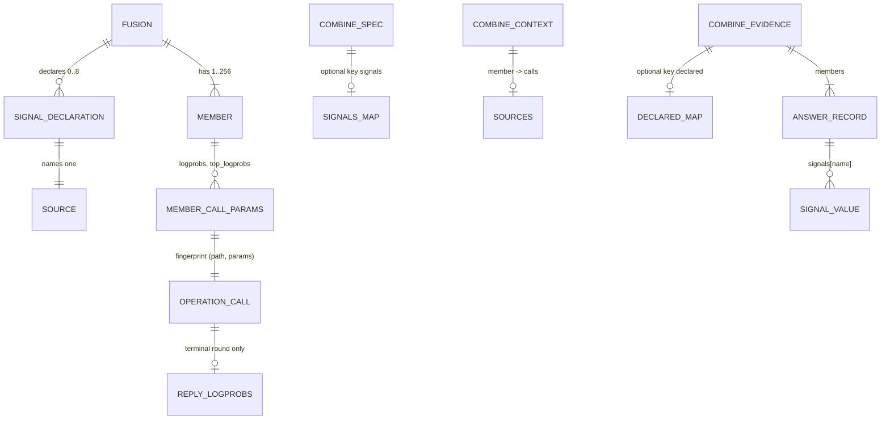

# ERD: E4b part 3, signal sources v1

Path prefixes: `E/` = `apps/screamingface-engine/src/screamingface_engine/`,
`S/` = `packages/screamingface/src/screamingface/`, `G/` = `apps/aigateway/src/aigateway/`,
`ET/` = `apps/screamingface-engine/tests/unit/`, `ST/` = `packages/screamingface/tests/`.
Line numbers are on base `0f4b9e292` (the tip of E4b part 1, PR #1409).

This part adds no database table. The "stores" are wire records (the combine spec, the combine
evidence, the member call params) and in-process records (the operation call). Each one gets the
entity treatment below.



## 1. Signal declaration (SDK object, wire `signals` map)

Purpose: name a number that each member answer carries, and say how the engine computes it.
[stated ans:Q1]

| Attribute | Type | Rule | Source |
|---|---|---|---|
| name | str | `^[a-z][a-z0-9_]{0,31}$` | [proposed] |
| name | — | not an E4a key (`cost_usd`, `latency_ms`, `tokens_in`, `tokens_out`) | [implied] — a name must not hide a built-in key |
| name | — | does not start with `logprob`, `entropy`, `verbalized` or `consistency` | [proposed] — keeps the E4a refusal pins for `logprob_mean` true, and keeps the words free for later built-in keys |
| source | enum | `logprob`, `entropy`, `verbalized` | [stated ans:Q1] |
| form | enum (logprob only) | `mean`, `sum`, `prob` | [stated ans:Q11] |
| top_logprobs | int (entropy only) | 1..20, default 5 | [stated ans:Q8] |
| pattern | str (verbalized only) | RE2, 1..256 characters, at least one capture group | [stated ans:Q9]; [existing E/combine/operators/extract.py:141-142] |

Invariants:

- **DS-I1** A Fusion declares at most 8 names. [proposed]
- **DS-I2** A Fusion declares at most one `entropy` source, so that one `top_logprobs` value goes on
  each member call. [proposed]
- **DS-I3** A declaration is valid only on a Fusion that ends in a reducer (a combine step). A
  Fusion with a model synthesizer has no combine evidence to record the values in. [proposed]
- **DS-I4** `logprob` and `entropy` need each member to be ONE model call on an OpenRouter route.
  A Recipe member (a nested Fusion or Pipeline) or another provider is refused at construction.
  [stated ans:Q2]; [proposed] for the Recipe rule

Wire shape in `screamingface.combine-spec.v1` (optional top-level key, additive):

```json
"signals": {
  "lp":   {"source": "logprob", "form": "prob"},
  "ent":  {"source": "entropy", "top_logprobs": 5},
  "conf": {"source": "verbalized", "pattern": "Confidence: ([0-9]+)"}
}
```

When a Fusion declares nothing, the key is absent, and the compiled bytes do not change. [implied]

## 2. Member call params

Purpose: ask the provider for the token log-probabilities.

| Param | Value | When | Source |
|---|---|---|---|
| `logprobs` | `true` | the Fusion declares `logprob` or `entropy` | [stated ans:Q1] |
| `top_logprobs` | k of the `entropy` source | the Fusion declares `entropy` | [stated ans:Q8] |

- The params are ordinary url4 member params. The SDK renders a boolean as `"true"`
  [existing S/_evaluation/policy.py:26-29]. The engine passes any param that it does not
  interpret to the gateway body, after `json.loads` [existing E/world/request_parameters.py:172-189].
  No url4 grammar change. [implied]
- The gateway keys its cache on both params [existing G/plugins/openrouter_provider/parameters.py:241-256],
  so a Fusion with a declaration never shares a cache entry with one without it. [implied]

## 3. Reply logprobs (engine, in process)

Purpose: the numbers of the reply that the member returned, computed once at the call.
[stated ans:Q6]

| Attribute | Type | Meaning |
|---|---|---|
| tokens | int ≥ 0 | count of `choices[0].logprobs.content` entries |
| logprob_sum | float ≤ 0, or None | sum of the token `logprob` values |
| top_k | int or None | the `top_logprobs` the call asked for |
| entropy_mean | float ≥ 0, or None | mean per-position entropy, see [entropy](prd/entropy.md) §3 |

- It rides on `OperationCall` as a new optional field `reply_logprobs`, next to
  `signal_accounting`. It is in process only and never on the wire, as `SignalAccounting` is.
  [existing E/operation_calls.py:24-47]; [proposed]
- It comes from the TERMINAL round of a call (the round that has no `tool_calls`). A tool round
  has no reply text. [existing E/world/connector.py:1314-1325]; [proposed]
- Token strings and bytes are never kept and never logged (OME-990: no response text in logs).
  [existing E/world/connector.py:214-219]; [implied]
- On a gateway cache hit, the body is the cached body, so the numbers are the same.
  [existing G/core/request_cache/store.py:269-274]; [implied]
- The token values and the top lists are validated apart: a bad or positive token value makes
  `logprob_sum` None; a bad top entry makes only `entropy_mean` None. The chosen token can be absent
  from its top-k list. [proposed] (review m8)
- The combine step gets it from the EXISTING member reader (`_read_member_accounting`), which returns
  the accounting numbers and the reply logprobs of each member from one fingerprint index. No second
  port. [existing E/world/combine.py:73-124]; [proposed] (review m7)

## 4. Combine context `sources`

Today the SDK writes `sources` (member → its model calls by fingerprint) only when the reducer
reads an accounting key [existing S/_evaluation/candidate.py:650-658], and the engine expects them
exactly then [existing E/combine/endpoint.py:206-210]; [existing E/combine/spec.py:259-263].

**Delta.** `sources` are also written and expected when the spec declares `logprob` or `entropy`.
[implied]

## 5. Combine evidence

| Field | Change | Source |
|---|---|---|
| `declared` (top level) | new optional map, the same shape as the spec `signals`. Absent when nothing is declared. | [stated ans:Q7]; [proposed] shape, after the `mean` precedent [existing E/combine/evidence.py:129-131] |
| `members[].signals` | also holds each declared name, read by a rule or not | [stated ans:Q7] |
| `signal` | unchanged: the one key a rule reads | [existing E/combine/endpoint.py:381-397] |

- **EV-I1** A declared value is a finite float or None (I-S2). [existing docs/spec/2026-10-02-e4a-gap-closure/erd.md:160-161]
- **EV-I2** E4a I-S3 ("the core writes only the keys the spec reads") changes: the core writes the
  keys the spec reads AND every declared name. [stated ans:Q7]

## 6. Failure code

A new declared failure code `logprobs_unsupported` (permanent, not retried). [stated ans:Q5]
It goes into `DECLARED_FAILURE_CODES` [existing E/benchmarks/contract.py:55], the SDK mirror
[existing S/_report_primitives.py:22] and `ENGINE_ERROR_CODES` [existing E/error_text.py:63-96], so
that no upstream can send it as its own code (OME-941). [proposed] The mapping lives in
`_observed_round_trip`, the only place that holds the request body; its message is fixed engine
text. [existing E/world/connector.py:201-258]
This is the only new failure code. Part 1 had none (P7). [existing ET/test_e4b_catalog_pins.py:13-20]

## 7. Migrations

- All wire changes are additive optional keys in the v1 schemas (the part 1 precedent ans:Q5 of
  part 1). No schema id changes. [proposed]
- A spec or an evidence without the new keys has the same bytes as before. A golden fixture,
  a recorded replay and a frozen copy of an existing recipe do not change, because the request
  digest is over the request body and the body changes only when a Fusion declares `logprob` or
  `entropy`. [existing E/capture_outcomes.py:93-96]; [implied]
- The SDK url4 → Python rebuild accepts the optional spec key `signals` (today it needs exactly the
  eight E4a keys) and drops the injected member params. [existing S/_evaluation/combine_spec.py:19-21,143];
  [existing S/url4.py:97]
- A frozen-copy entry of a declared recipe is larger. Over 2,000,000 bytes (request plus reply) it is
  not stored, and the capture reports `failed`. [existing G/config.py:158-162]
- An old SDK cannot decode evidence with `declared` (strict key sets
  [existing S/_evaluation/combine_evidence.py:39-80]). The SDK and the engine ship together, as in
  part 1. [implied]
