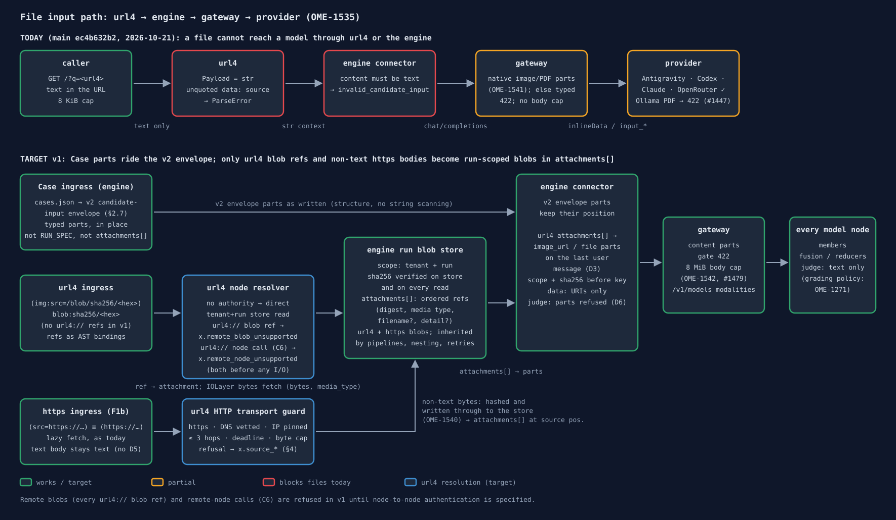

# Spec — file input across url4, engine and gateway (`OME-1535`)

Epic `OME-1529`. Status: **draft for review** (url4: Kevin; gateway: Dmitry; architecture: HupBaHa).
Owner decisions F1–F4 locked by Sergey on 2026-10-21 (§2); his follow-up decisions D1–D6 of the
same day are folded into F1 and F2.

**Snapshot.** Every "today" claim and every `file:line` citation is pinned to `main` at
[`ec4b632b2`][snap] (2026-10-21, after #1447). Citations are commit-qualified links, so they stay
valid when the files move. Short prefixes: `U/` = `packages/url4/src/url4/`,
`E/` = `apps/screamingface-engine/src/screamingface_engine/`,
`I/` = `apps/screamingface-engine/src/screamingface_engine_inspect/`,
`P/` = `packages/screamingface/src/screamingface/`, `G/` = `apps/aigateway/src/aigateway/`.

**Evidence classes.** *Code* claims are reproducible at the snapshot. *Live* claims (provider
behaviour, token counts) are **dated observations** from manual runs on 2026-10-16/17 with no
durable fixture in this PR; they inform design and are not guarantees.

## 1. Findings per layer (today, at `ec4b632b2`)

### url4 — strings end to end

| Choke point | Evidence |
|---|---|
| The only content leaf is a string | [`U/core/nodes.py:63-66`][u-text] (`Text.value: str`) |
| Payloads are strings | [`U/dag/node.py:23`][u-node23] ("Payloads are strings"), [`:70`][u-node70] (`Payload = str \| list[str] \| SourceFailure`), [`:79`][u-node79] (`ProcessFn` returns `str`) |
| Fetch returns text | [`U/io/layer.py:81-85`][u-fetch] (`FetchResult.body: str`, `media_type` kept); [`U/io/http.py:74,80`][u-http] (`response.text`, so binary is decoded as text) |
| HTTP sources follow redirects | [`U/io/http.py:66-69`][u-redirect] (`follow_redirects=True`): one reason remote blobs are deferred (F1) |
| Peer replies are text | [`U/peer/_http.py:109`][u-peer] (`text/plain; charset=utf-8`) |
| Collections take a closed set of text types | [`U/dag/semantics/collection.py:140-142`][u-coll] |
| `;accept=` is carried but no adapter honours it | [`U/io/layer.py:69-77`][u-accept] |

Parser behaviour, reproduced with `url4.core.grammar.parse`:

- `(img:src=data:image/png;base64,AAAA)!'d'` → `ParseError` ("invalid execution-annotation key 'base64'").
- `('data:image/png;base64,AAAA')!'d'` → `Text` (a literal; never resolved).
- `(img:src=blob:sha256/ab)!'d'` → `Binding(value=Text('blob:sha256/ab'))`. It parses, but nothing resolves it yet (`OME-1539`).
- `(blob:sha256/ab)!'d'` → `ParseError` ("bare-token data binding requires 'src='"). Matches C7.

Reusable: `FetchResult.media_type`, the `;accept=` annotation, and the claim-ticket pattern of
[`ResultArtifact`][u-artifact] (`id` + `size_bytes` + `sha256`, verified before trust). `ResultArtifact`
carries **no media type**; the media type lives on the enclosing [`ResultData.media_type`][u-resultdata].

### Engine — text only, non-text content refused

| Choke point | Evidence |
|---|---|
| Sync surface: 8 KiB target cap | [`E/rest/mounts.py:277`][e-414] (414 `uri_too_long`), [`E/job_env.py:208`][e-8k] (`MAX_DIRECT_TARGET_BYTES = 8 * 1024`) |
| Run spec: 1 MiB cap | [`E/child_protocol.py:26`][e-spec26], [`:103-104`][e-spec103] (`MAX_SPEC_BYTES`, `spec_too_large`) |
| Case input becomes a string | [`E/benchmarks/case_request.py:13-31`][e-case] (dict → `json.dumps`) |
| Chat envelope refuses non-text content | [`E/world/connector.py:1535`][e-text] (`invalid_candidate_input`, "content must be text") |
| Messages are built from strings | [`E/world/connector.py:1478`][e-msgs] (`_messages(context: str \| None, intent: str \| None)`) |
| Fusion gets the Case re-serialised as text | [`P/_evaluation/candidate.py:358`][p-fusion] (`struct({"input": …, "outputs": …})`), [`:769-787`][p-fctx] |
| Request identity hashes a string context | [`E/request_identity.py:13-33`][e-key] (`path`, `params`, `context`, `intent`) |
| Judge sees text only | [`I/judge_provider.py:432`][i-judge] (`{"role": role, "content": message.text}`) |
| Inspect capture refuses images and audio | [`I/capture.py:513`][i-cap513], [`:529`][i-cap529] ("non-text content") |
| Benchmark assets are built into the image; Runner Jobs have no egress | [`I/prepare.py:8`][i-prep8] ("Run at IMAGE BUILD time"); [`E/benchmarks/nltk_data.py:38`][e-nltk] ("read-only rootfs and no network egress"). These are code comments that state the deployment intent, not an enforcement point. |
| Non-text `sample.input` refused | [`I/prepare.py:2097-2101`][i-prepin] (`PrepareError`) |

### Gateway — native media for the custom adapters (`OME-1541` #1431, `OME-1641` #1447)

- [`G/core/content_parts.py`][g-parts] parses OpenAI `content` into text, inline media (`MediaPart`) and
  `RemoteImagePart`. Anything a provider cannot carry is refused before dispatch with a typed
  **422 `unsupported_content_part`** ([`:66-83`][g-422], "not retryable"), raised by `check_messages` in the
  `prepare_chat_body` of four plugins: [gemini][g-gem], [antigravity][g-ag], [codex][g-codex], [ollama][g-oll].
- Accepted: `image_url` must be `image/*` ([`:181-197`][g-img]), with `detail` limited to `auto|low|high`
  ([`:27-29`][g-detail], [`:200-209`][g-detail2]); `file` must be `application/pdf` ([`:32`][g-pdf], [`:211-232`][g-file]). Untyped non-text parts are refused.
- Gemini and Antigravity: `inlineData`; remote image URLs are refused with `reason: remote_url` (the gateway never fetches).
- Codex: `input_text` / `input_image` / `input_file`; https image URLs are passed through, since OpenAI fetches them.
- **Ollama, at this snapshot:** the plugin runs the same gate with `allow_files=False`,
  `allow_remote_images=False` ([`G/plugins/ollama_provider/plugin.py:90-99`][g-oll]): a PDF or a remote image URL
  gets 422 `unsupported_content_part`; data-URI images are unchanged. *History:* before #1447 (e.g. at
  `637594595`) LiteLLM's `ollama_chat` conversion **silently dropped** `file` parts (observed 2026-10-16:
  PDF answered 200 with +7 prompt tokens and an unrelated answer). PDF-to-text for Ollama stays with `OME-1550`.
- Anthropic, OpenRouter and OpenAI (API key) do not call `check_messages`; their parts go through LiteLLM as sent.
- Still open:
  - **No request body cap** anywhere in the gateway (the only size checks under `G/` are on responses or object-store uploads). → `OME-1542`
  - **Anthropic OAuth drops non-text system parts:** [`G/plugins/anthropic_provider/chat_handler.py:180-197`][g-anth] keeps only `type == "text"`. → `OME-1542`
  - **`/v1/models` carries no input-modality field.** Only HuggingFace discovery parses `input_modalities` ([`:74`][g-hf74], [`:129`][g-hf129]), and nothing exposes it. → `OME-1537`
  - **SSRF:** LiteLLM may fetch caller `http(s)` image URLs for the pass-through providers (Anthropic, OpenRouter). **UNVERIFIED**; from the 2026-10-07 research. → `OME-1542`

## 2. Normative decisions (owner, locked 2026-10-21)

### F1 — Remote blobs are deferred from v1

**Decision.** v1 supports exactly two blob sources: **local, run-scoped blobs** and **inline `data:` at
Case ingress**. **Every** `url4://<authority>/blob/...` ref is remote in v1, whatever its authority:
there is no self-recognition, so a ref naming the evaluating node itself is remote too. It fails with
the typed, permanent **`x.remote_blob_unsupported`** at resolution, **before any network I/O** (no DNS
lookup, no connection). Only an authority-less ref is local: the bare path `/blob/sha256/<hex>` (C1) and
the bare token `blob:sha256/<hex>` (C3), which names that same path on the evaluating node. There is no
"fetch once and pin" for remote sources in v1.

**Rationale.** A remote fetch is an SSRF/egress boundary. url4 HTTP sources follow redirects to
arbitrary translated targets ([`U/io/http.py:66-69`][u-redirect]), and "no egress" for Runner Jobs is a
code comment, not an enforced policy. Shipping remote blobs without a normative policy would open that
boundary by default; refusing them keeps v1 closed while the local path proves the content-part model.

**Bar for the follow-up remote-blob spec** (its own ticket; must be normative before implementation):
allowed schemes and authority allow-list; authentication of the fetching node to the remote node; DNS
resolution with refusal of private, loopback, link-local and cloud-metadata addresses, re-checked on
every redirect hop; a redirect-count limit; connect and total deadlines; a streaming byte limit (abort
on overflow, not after download); media-type validation against the declared type and sniffed bytes;
per-run file count and aggregate byte limits; and the typed failures for each (blocked destination,
auth failure, timeout, too large). Alternatively it may delegate ingestion to a constrained fetch
service that owns this policy.

### F1b — `https://` file sources stay in v1, behind one destination guard (`OME-1544`)

**Decision** (owner, 2026-10-21, after F1). F1 defers **`url4://` remote blobs**, meaning node-to-node
blob transfer. It does **not** remove plain `https://` sources such as `(img:src=https://…/a.png)`. In v1
these are fetched by the evaluating node through **one destination guard in the url4 HTTP transport**.
Every source fetch passes through that guard: today's text path and #1478's `fetch_bytes` alike. The
guard also fixes bug `OME-1704`, where text sources fetch any URL on main today.

**Guard rules (normative):**
- **Schemes:** `https` only by default; `http` is a configuration switch, off by default.
- **Address check:** DNS is resolved first. Loopback, private (RFC 1918, `fc00::/7`), link-local
  (`169.254/16` including metadata `169.254.169.254`, `fe80::/10`), CGNAT `100.64/10`, unspecified,
  multicast and reserved ranges are refused, as are IPv4-mapped IPv6 forms of any of these.
- **Pinning:** the connection goes to the vetted IP, keeping SNI and `Host`, so a second DNS answer
  cannot redirect it (no rebinding).
- **Redirects:** every hop is re-checked against the same rules. At most 3 hops (configurable). A hop
  from `https` to `http` is refused.
- **Time:** a connect timeout plus one **total** deadline for the whole fetch, redirects included.
- **Size:** a streaming byte cap that aborts mid-stream. The cap counts decoded bytes.
- **Escape hatch:** loopback may be allowed only through explicit configuration for tests and dev; off
  by default.
- **Errors and logs:** each refusal raises a typed `x.` error (see §4). Response bodies are never logged.
- **Remote-node calls:** the same guard covers `url4://` remote-node calls, which `HttpIOLayer` rewrites to
  `https://`, for example a nested remote expression (C6). The address rules apply, and only hosts on an
  operator-configured **peer allowlist** may be called (default: empty, so no remote-node calls). Anything
  else fails `x.source_destination_blocked`. This is separate from F1: blob transfer between nodes stays
  deferred.
- **Scope of attachments:** only an `https://` value in a `src=` binding is fetched at run start and
  attached; other `https://` sources stay lazy text fetches. Attached bytes are also written through to
  the tenant+run store (`OME-1540`). "Fetched once per run" belongs to the per-run cache in `OME-1543`;
  `OME-1544` is the guard only. (Owner, 2026-10-21.)

**Where it runs.** Fetches happen on the node that evaluates the expression (the engine's serve path).
Benchmark Runner Jobs keep their no-egress intent, because benchmark assets are pinned at image build
time (`OME-1271`) and never fetched at run time. Media-type validation and per-run file-count and byte
limits follow the attachment rules in F2/F3. Node-to-node authentication applies only to F1's deferred
remote blobs.

### F2 — Attachments are a side-channel; the payload stays `str`

**Decision.** The run context carries an ordered **`attachments[]`** of blob refs:

| Field | Required | Meaning |
|---|---|---|
| `digest` | yes | `sha256:<hex>` of the bytes |
| `media_type` | yes | e.g. `image/png`, `application/pdf` |
| `filename` | no | carried to `file` parts |
| `detail` | no | `auto` \| `low` \| `high`, carried to `image_url` parts |

`Payload` stays `str` ([`U/dag/node.py:70`][u-node70]). **Nothing scans strings for blob-looking text**: a ref
becomes an attachment only from structure (a `src=` binding in the parsed AST, or a typed part in a
Case envelope), never from the contents of a payload, a member output or a JSON value.

**Content layout.** Every model-calling node — ensemble members, model and recipe synthesizers
(fusion), reducers, and the judge — builds the OpenAI `content` of its user message as
`[attachment parts in attachments[] order…, then the text]`. When url4 `attachments[]` are merged into
a multi-message candidate envelope, their parts go on the **last user message** only; earlier messages
keep their text content unchanged (D3). D3 covers only those url4 attachments: parts already written in a
v2 Case envelope (§2.7) keep their position. Each attachment becomes `image_url` (for
`image/*`) or `file` (otherwise) with a `data:` URI built from the verified bytes. A node with no
attachments sends `content` as a plain string, exactly as today.

**Fusion.** The fusion text is unchanged: the existing `{input, outputs}` rendering
([`P/_evaluation/candidate.py:769-787`][p-fctx]) is the trailing text part; the attachments precede it.
Attachments are never inlined into, or referenced from, that JSON. Member outputs are text and add no
attachments.

**Text blobs in collections (D4).** A blob read in collection position whose media type is in the
collection text set ([`U/dag/semantics/collection.py:140-142`][u-coll]) is used as text and is **not**
added to `attachments[]`. Any other type there stays `unsupported_content_type` (C8).

**Propagation (v1).** Attachments are fixed at run start (the url4 refs resolved for that run; Case
parts travel in the v2 envelope instead, §2.7) and are **inherited unchanged** by every node: pipelines, nested local sub-expressions,
reducers and retries see the same ordered list. A node cannot add, drop or reorder attachments in v1. Because the list is fixed before execution, a
blob source marked `;optional` that fails to resolve **fails the whole run** with its own code (§4); it
is never dropped from the list (D5).
A nested expression evaluated by a **remote** node (C6) resolves its own sources against its own store;
the outer run's attachments are not shipped to it, because that would be a remote blob transfer (F1).

**Judge.** The judge uses the same builder. Which attachments a grading call receives is the
benchmark's grading policy: under `OME-1271` v1 the grader receives none, so grading stays text-only.

**Rationale.** A side-channel keeps every string boundary (url4 `Payload`, peer replies, request
contexts) byte-identical for text-only runs and removes any ambiguity between data and refs.

### F3 — Canonical part identity and run scope

**Decision.** The model request key ([`E/request_identity.py:13-33`][e-key]) hashes, in addition to today's
fields, the **canonical ordered content-part list**: for each part `kind` (`text` \| `image` \| `file`),
`digest` (none for text, whose bytes are already in `context`/`intent`), `media_type`, `role`,
`position`, `detail`, `filename`; plus the model, the params and the **adapter revision** of the
connector that builds the parts. The digest alone is not the identity: equal bytes with a different type,
role, position, detail or filename are a different model request. A request with no attachments hashes
exactly as today, so existing keys are unchanged.

**Authorization.** A digest is **not a bearer capability**. A blob read is scoped to *tenant + run*: a
node may read a digest only if it was ingested into the same run of the same tenant. A digest from
another run or tenant is `source_not_found`, indistinguishable from a missing blob.

**Integrity.** sha256 is verified against the ref **before storing** (ingress) and **before use** (every
read that builds a part). A mismatch is `x.blob_digest_mismatch`, permanent.

### F4 — "Today" is the stated snapshot

**Decision.** Section 1 and the TODAY row of the diagram describe `main` at `ec4b632b2`, where Ollama
returns 422 for file parts. Earlier behaviour (the silent drop at `637594595`) appears only as dated
history.

### 2.7 Case ingress: the v2 candidate-input envelope (`OME-1678`, #1507)

**Decision.** Adopted from khoaguin's proposal on #1450 ([comment 6286823021][khoa-v2]) and accepted in
Sergey's review of #1507 at [`29c99a31`][pr1507]. On the benchmark path a Case's pictures and PDFs are
**typed content parts inside the candidate-input envelope** `screamingface.candidate-input.v2`
([`E/benchmarks/candidate_input.py`][pr-cin] in #1507):

- Parts are only `text`, `image_url` (`url`, optional `detail` of `auto` \| `low` \| `high`) and `file`
  (`file_data`, optional `filename`, `application/pdf` only): the set the gateway already accepts
  ([`G/core/content_parts.py`][g-parts]), so nothing in between translates.
- Picture and file parts go in **user** messages only (Anthropic OAuth drops non-text parts from system
  messages, §1). Text-only Cases stay v1, and a v2 envelope holds at least one non-text part, so every
  Case has exactly one valid encoding.
- **Structure, not scanning.** The connector reads parts from the typed envelope, never from string
  contents, so F2's no-scanning rule holds.
- **Position.** Parts keep the position the importer wrote them in; D3 does not move them (F2).
- **Identity.** `model_request_key` hashes the raw `context` string
  ([`E/request_identity.py:13-33`][e-key]), which carries the envelope verbatim, so a v2 Case's parts and
  their order are in the key and F3 holds without a separate part list.
- **Only `data:` URIs.** Media parts carry inline `data:` URIs and nothing else; the gateway refuses
  any other form before its cache stage (`OME-1542`, #1479, open at this revision).
- **Limits.** The gateway's 8 MiB request-body cap (#1479) bounds one request: a larger body gets 413
  `request_too_large`, permanent, before any upstream spend. Per-Case limits (5 MB per picture after
  base64, 8 MB per Case, at most 20 pictures) belong to the `OME-1271` importer, which refuses an
  oversized Case by name; the values are confirmed per route there.

**v1 gates before any v2 board ships** (from the #1507 review; read from code, not end-to-end runs):

1. **Fusion and inspect never re-serialise a v2 envelope as text.** Today a Fusion synthesizer gets
   `{"input": <v2 envelope string>, …}` ([`P/_evaluation/candidate.py:769-787`][p-fctx]), which
   `_native_messages` ([`E/world/connector.py:1495`][pr-native]) does not read as an envelope, and
   `conversation_messages` ([`I/conversation_input.py:62`][pr-conv]) re-wraps a v2 Case as v1 text; both
   would send the base64 as prompt tokens. Either `OME-1679` and `OME-1271` PR1 block the v2 importer
   (`OME-1271` PR2), or Fusion candidates on v2 Cases are refused at admission.
2. **The judge is text-only by an explicit refusal, not by accident (D6).** `_messages`
   ([`E/world/connector.py:1481`][pr-msgs]) builds parts for any v2 context; pictures are dropped today
   only because [`I/judge_provider.py:432`][i-judge] writes v1 from `message.text`. A parts message under
   `current_grading_case()` ([`E/grading_call_scope.py:43`][pr-grade]) raises `invalid_candidate_input`,
   pinned by a test.
3. **Reports show a placeholder, never base64** (`OME-1680`). `_decode_candidate_envelope`
   ([`P/case_result.py:653-680`][pr-report]) accepts only v1; the SDK `CaseResult.conversation` and the
   Report show each part as one placeholder line (type, size, sha256, filename when present). A
   placeholder never reaches a model or a scorer.
4. **One `data:` URI pattern.** A conformance test, in both projects, pins the engine's `_DATA_URI_RE`
   ([`E/benchmarks/candidate_input.py:40-42`][pr-dre]) to the gateway's
   ([`G/core/content_parts.py:23-25`][g-dre]).

## 3. Execution contract

1. **Two separate ingress paths, one representation out** (see the diagram).
   - **Case ingress (engine).** Benchmark Cases never travel in `RUN_SPEC`: it carries only `env` and
     `io_concurrency` ([`E/child_protocol.py:94-99`][e-spec94]), and the run reads Cases from the image's
     `cases.json` through the cases route ([`I/single_shot.py:799-818`][i-cases]). A Case's pictures and
     PDFs are typed parts of a v2 candidate-input envelope (§2.7) that reach the connector in place; they
     are not appended to `attachments[]`, never sit in the URL and never in a url4 expression. This path
     does not go through url4.
   - **url4 ingress.** A `src=` binding carrying `/blob/sha256/<hex>` or `blob:sha256/<hex>` is resolved
     at the evaluating node against the local run store (§5) and appended to `attachments[]`. Any
     `url4://…/blob/…` ref, the node's own authority included, is `x.remote_blob_unsupported` (F1).
     An `https://` source is fetched through the url4 transport's destination guard (F1b) and, when it
     returns a non-text type, is hashed into the run store and appended to `attachments[]` like a local blob.

   The engine connector turns `attachments[]` into OpenAI content parts (`image_url` / `file` with a
   `data:` URI); v2 envelope parts already have that shape. It is the only shape the gateway sees. The
   gateway never fetches.
2. **Run-scoped, verified bytes.** Every node, retry and nested local expression in the run reads the same
   stored bytes, verified on every read (F3).
3. **Who sees the file.** Every model-calling node, per F2. That replaces the text re-serialisation at
   [`P/_evaluation/candidate.py:358`][p-fusion] (`OME-1547`). The **grader stays text-only** (`OME-1271`); the
   Report and the SDK show a placeholder, never base64.
4. **Per-type policy** (`OME-1548`, `OME-1550`), decided per file before dispatch:
   - **native:** images and PDFs to models that accept them;
   - **convert to text:** office formats, reusing the GDPval readers;
   - **reject:** with a typed error (§4). A blind model is refused by name at admission (C9 `intent_error`), never degraded silently.
5. **Benchmarks pin files at build time.** Assets are baked into the benchmark image ([`I/prepare.py:8`][i-prep8]),
   so a Case never depends on a run-time fetch.
6. **Identity** is the canonical part list of F3, not a digest and never a URL.

## 4. Error ownership

Wrapping rule: the phase that detects a failure raises it with its own code; enclosing nodes wrap it as
a `SourceFailure` that **preserves the original code and permanence verbatim** and adds the node path. A
wrapper never turns a permanent failure into a retryable one, and only retryable failures are retried.
Codes not in url4 Spec C travel on the url4 wire with the `x.` implementation prefix (C §13.5.2) until
Kevin adopts them into the spec, as `x.admission_timeout` does today ([`U/core/errors.py:48`][u-xcode]).

| Code | Phase owner | Status | Class | Notes |
|---|---|---|---|---|
| `source_not_found` | url4 node resolver | per Spec C §13.2.5 | permanent | C5; also a digest outside the tenant + run scope (F3) |
| `x.remote_blob_unsupported` | url4 node resolver | 422 (proposed) | permanent | F1; every `url4://` blob ref; raised before any network I/O |
| `x.source_destination_blocked` | url4 HTTP transport guard | 422 (proposed) | permanent | F1b; disallowed scheme, refused address range on any hop, or `https`→`http` downgrade; `OME-1704` |
| `x.source_redirect_limit` | url4 HTTP transport guard | 422 (proposed) | permanent | F1b; more than the configured hop limit (default 3) |
| `x.source_too_large` | url4 HTTP transport guard | 413 (proposed) | permanent | F1b; streaming cap on decoded bytes, aborted mid-stream |
| `x.source_timeout` | url4 HTTP transport guard | 504 (proposed) | retryable | F1b; connect timeout or the total deadline across all hops |
| `x.blob_digest_mismatch` | engine blob store (ingest and read) | 422 at ingest (proposed); run failure at read | permanent | F3; a mismatch at read is store corruption and is logged as such |
| `unsupported_content_type` | engine connector (per-type policy) | per Spec C §13.5.2 | permanent | C8; type the node cannot carry or convert |
| `intent_error` | engine admission (model modality check) | 422 ([`U/peer/_http.py:52`][u-intent]) | permanent | C9; the source stays `resolved` |
| `unsupported_content_part` | gateway `check_messages` | 422 ([`G/core/content_parts.py:66-83`][g-422]) | permanent | backstop when admission misses; the connector wraps it as `intent_error` carrying the gateway `info` as `cause` |
| `timeout` | whichever phase owns the deadline (resolver, connector, gateway upstream) | url4 mapping, unchanged | retryable | retried with the same attachments and the same request key |
| `too_large` | engine ingress (per-blob and per-run limit); gateway body cap (`OME-1542`) | 413 (proposed) | permanent | `spec_too_large` (1 MiB `RUN_SPEC`, [`E/child_protocol.py:103-104`][e-spec103]) keeps its code; limit values are set in the implementation leaves |

Statuses marked *proposed* are new in this spec and need Kevin's sign-off for the url4 wire.
Blocked destination and remote auth failure have no v1 owner: no remote fetch exists (F1). They belong
to the remote-blob spec.

## 5. Boundary with `OME-1330` / `OME-1271`

| This epic (`OME-1529`): execution | `OME-1330` / `OME-1271`: benchmarks |
|---|---|
| url4 refs and their resolution; the engine run blob store, attachments and connector parts; gateway transport, the content-part gate and limits; the per-type policy; fusion receiving the parts; modality flags | Case envelope image kind; import and storage of benchmark files (inline v1, with a per-benchmark byte budget); serving; grading stays text; board choice and proofs (FigQA, TableQA, then MMMU) |

Shared representation: benchmark files use the same spec-native form. `sf-blob://` (an example in
`OME-1271`) is **not** part of url4. At most it can be an internal alias inside inspect's
`media_resolver`, mapped to `/blob/sha256/<hex>`, and it never appears in an expression or a contract.

## 6. url4 contract

Adopted **as signed off by Kevin (2026-10-13)** in `OME-1534`; the Parse column of C1 is corrected
(it is a relative URL, `RelUrl`, not a data URI), and the v1 note applies F1.

| # | Expression | Parse (B §5.2) | Resolution at the evaluating node |
| -- | -- | -- | -- |
| C1 | `(img:0.5:src=/blob/sha256/<hex>)!'Describe'` | relative URL (`RelUrl`) | `url4://<current_node>/blob/sha256/<hex>` with §5.4.2 policy, identity and attribution; bytes go to the model as a `data:` URI (§26.2.3) |
| C2 | `(img:src=url4://n2.example/blob/sha256/<hex>)!'Describe'` | remote URL4 reference | fetched from `n2` with `url4://` semantics (§3.5). **v1: `x.remote_blob_unsupported`** for any authority, `n2` or the evaluating node itself (F1) |
| C3 | `(img:src=blob:sha256/<hex>)!'Describe'` | bare token (identifier) | resolved from the evaluating node's own store |
| C4 | `(img:'blob:sha256/<hex>')!'Describe'` | quoted text | the literal string; not resolved |
| C5 | C3 where the node doesn't hold the bytes | bare token | `source_not_found`, permanent (C §13.2.5) |
| C6 | `(url4://n2.example/v1(img:src=blob:sha256/<hex>)!'Describe')!'Summarize'` | nested remote expression | the outer node forwards the inner sources unchanged; `n2` resolves C3 against its own store |
| C7 | `(blob:sha256/<hex>)!'Describe'` | ParseError | `blob` reads as a name with no value-shaped binding (§4.5 disambiguation), so `src=` is required |
| C8 | resolved bytes of a type the node can't handle | n/a | `unsupported_content_type` (C §13.5.2) |
| C9 | resolved image sent to a model that can't take images | n/a | `intent_error`; the source stays `resolved` (C §13.6) |

Further rules:
- **Resolution is node by node.** A node processing an outer expression must not modify sources in nested sub-expressions (C6).
- **Inline `data:` appears only in Case envelopes, never in expressions** (`OME-1597`). Unquoted, `;` and `,` split it; quoted, it is literal text. A binary needed deeper in the tree must be a retrievable ref.
- **Port.** The IOLayer gains a bytes fetch returning `(bytes, media_type)`. `Payload` stays `str`; resolved refs become attachments (F2), never payload text (`OME-1538`).

## 7. Open items and dated observations

All rows below are manual observations; none is a guarantee or a fixture.

| Item | State |
|---|---|
| Live native PNG + PDF (runner sends text, a PNG reading `4827`, a PDF reading `ZEBRA-4127`) | **Observed 2026-10-16:** both read correctly on Antigravity `gemini-3-flash` (`inlineData`, Code Assist wire); Codex `gpt-6-astra` on a ChatGPT plus sign-in (`input_image` / `input_file`); Anthropic OAuth `claude-haiku-4-5`; OpenRouter `google/gemini-2.5-flash` and `anthropic/claude-haiku-4.5`. OpenRouter `openai/gpt-4o-mini` read the PDF but misread the PNG (`4027`): a model-quality miss, not a transport drop. |
| Ollama with PDFs | **Observed 2026-10-16** at the pre-#1447 snapshot: silent drop (`qwen2.5vl:3b`, PDF 200 with +7 tokens). At `ec4b632b2`: 422 `part_type: file` by code (#1447); a PNG still read `4827` when #1447 was verified. |
| Image and PDF token reporting | **Observed 2026-10-16/17**, input for `OME-1546`: only `prompt_tokens` moved; `prompt_tokens_details` was `null` on Antigravity. Prompt-token delta vs the text case, PNG / PDF: Antigravity +1098 / +527; Codex `gpt-6-astra` +73 / +36; Anthropic `claude-haiku-4-5` +68 / +1585; OpenRouter `gemini-2.5-flash` +1038 / +1297; Ollama `qwen2.5vl:3b` +68 / n/a. Provider- and model-version-dependent. |
| Gemini CLI (Code Assist OAuth) | Not verified, and no longer pursued: the route is deprecated (I-26). Observed 2026-10-16: the test account's Code Assist setup returned no `cloudaicompanionProject` (text fails too). It shares `core.gemini_parts` with Antigravity. |
| Codex model catalog | Stale (`OME-1634`). Observed 2026-10-16: `gpt-5.4-mini` refused for a ChatGPT plus account while `gpt-6-astra` worked; a free-plan sign-in refused for every model. PR #1441 (open at the snapshot) types that as 403 `codex_plan_unsupported`. |
| OpenAI (API key) with PDFs | Not run (no profile signed in). **UNVERIFIED.** |
| Per-provider size and count limits | **UNVERIFIED**; not measured. Needed for the `too_large` limit values. |
| `inspect` `media_resolver` firing on our out-of-loop scorer path | **UNVERIFIED** (`OME-1271` caveat); needs a spike before the inline-to-reference step. |
| Remote blobs | Deferred (F1); needs its own spec and ticket. |

[snap]: https://github.com/ScreamingFace/screamingface/tree/ec4b632b2267212783ca932c93a6c7314256ef3a
[u-text]: https://github.com/ScreamingFace/screamingface/blob/ec4b632b2267212783ca932c93a6c7314256ef3a/packages/url4/src/url4/core/nodes.py#L63-L66
[u-node23]: https://github.com/ScreamingFace/screamingface/blob/ec4b632b2267212783ca932c93a6c7314256ef3a/packages/url4/src/url4/dag/node.py#L23
[u-node70]: https://github.com/ScreamingFace/screamingface/blob/ec4b632b2267212783ca932c93a6c7314256ef3a/packages/url4/src/url4/dag/node.py#L70
[u-node79]: https://github.com/ScreamingFace/screamingface/blob/ec4b632b2267212783ca932c93a6c7314256ef3a/packages/url4/src/url4/dag/node.py#L79
[u-fetch]: https://github.com/ScreamingFace/screamingface/blob/ec4b632b2267212783ca932c93a6c7314256ef3a/packages/url4/src/url4/io/layer.py#L81-L85
[u-accept]: https://github.com/ScreamingFace/screamingface/blob/ec4b632b2267212783ca932c93a6c7314256ef3a/packages/url4/src/url4/io/layer.py#L69-L77
[u-http]: https://github.com/ScreamingFace/screamingface/blob/ec4b632b2267212783ca932c93a6c7314256ef3a/packages/url4/src/url4/io/http.py#L74-L80
[u-redirect]: https://github.com/ScreamingFace/screamingface/blob/ec4b632b2267212783ca932c93a6c7314256ef3a/packages/url4/src/url4/io/http.py#L66-L69
[u-peer]: https://github.com/ScreamingFace/screamingface/blob/ec4b632b2267212783ca932c93a6c7314256ef3a/packages/url4/src/url4/peer/_http.py#L109
[u-xcode]: https://github.com/ScreamingFace/screamingface/blob/ec4b632b2267212783ca932c93a6c7314256ef3a/packages/url4/src/url4/core/errors.py#L48
[u-intent]: https://github.com/ScreamingFace/screamingface/blob/ec4b632b2267212783ca932c93a6c7314256ef3a/packages/url4/src/url4/peer/_http.py#L52
[u-coll]: https://github.com/ScreamingFace/screamingface/blob/ec4b632b2267212783ca932c93a6c7314256ef3a/packages/url4/src/url4/dag/semantics/collection.py#L140-L142
[u-artifact]: https://github.com/ScreamingFace/screamingface/blob/ec4b632b2267212783ca932c93a6c7314256ef3a/packages/url4/src/url4/streaming/protocol/signals.py#L174-L192
[u-resultdata]: https://github.com/ScreamingFace/screamingface/blob/ec4b632b2267212783ca932c93a6c7314256ef3a/packages/url4/src/url4/streaming/protocol/signals.py#L195-L205
[e-414]: https://github.com/ScreamingFace/screamingface/blob/ec4b632b2267212783ca932c93a6c7314256ef3a/apps/screamingface-engine/src/screamingface_engine/rest/mounts.py#L277
[e-8k]: https://github.com/ScreamingFace/screamingface/blob/ec4b632b2267212783ca932c93a6c7314256ef3a/apps/screamingface-engine/src/screamingface_engine/job_env.py#L208
[e-spec26]: https://github.com/ScreamingFace/screamingface/blob/ec4b632b2267212783ca932c93a6c7314256ef3a/apps/screamingface-engine/src/screamingface_engine/child_protocol.py#L26
[e-spec103]: https://github.com/ScreamingFace/screamingface/blob/ec4b632b2267212783ca932c93a6c7314256ef3a/apps/screamingface-engine/src/screamingface_engine/child_protocol.py#L103-L104
[e-case]: https://github.com/ScreamingFace/screamingface/blob/ec4b632b2267212783ca932c93a6c7314256ef3a/apps/screamingface-engine/src/screamingface_engine/benchmarks/case_request.py#L13-L31
[e-text]: https://github.com/ScreamingFace/screamingface/blob/ec4b632b2267212783ca932c93a6c7314256ef3a/apps/screamingface-engine/src/screamingface_engine/world/connector.py#L1535
[e-msgs]: https://github.com/ScreamingFace/screamingface/blob/ec4b632b2267212783ca932c93a6c7314256ef3a/apps/screamingface-engine/src/screamingface_engine/world/connector.py#L1478
[e-key]: https://github.com/ScreamingFace/screamingface/blob/ec4b632b2267212783ca932c93a6c7314256ef3a/apps/screamingface-engine/src/screamingface_engine/request_identity.py#L13-L33
[e-nltk]: https://github.com/ScreamingFace/screamingface/blob/ec4b632b2267212783ca932c93a6c7314256ef3a/apps/screamingface-engine/src/screamingface_engine/benchmarks/nltk_data.py#L38
[p-fusion]: https://github.com/ScreamingFace/screamingface/blob/ec4b632b2267212783ca932c93a6c7314256ef3a/packages/screamingface/src/screamingface/_evaluation/candidate.py#L358
[p-fctx]: https://github.com/ScreamingFace/screamingface/blob/ec4b632b2267212783ca932c93a6c7314256ef3a/packages/screamingface/src/screamingface/_evaluation/candidate.py#L769-L787
[i-judge]: https://github.com/ScreamingFace/screamingface/blob/ec4b632b2267212783ca932c93a6c7314256ef3a/apps/screamingface-engine/src/screamingface_engine_inspect/judge_provider.py#L432
[i-cap513]: https://github.com/ScreamingFace/screamingface/blob/ec4b632b2267212783ca932c93a6c7314256ef3a/apps/screamingface-engine/src/screamingface_engine_inspect/capture.py#L513
[i-cap529]: https://github.com/ScreamingFace/screamingface/blob/ec4b632b2267212783ca932c93a6c7314256ef3a/apps/screamingface-engine/src/screamingface_engine_inspect/capture.py#L529
[i-prep8]: https://github.com/ScreamingFace/screamingface/blob/ec4b632b2267212783ca932c93a6c7314256ef3a/apps/screamingface-engine/src/screamingface_engine_inspect/prepare.py#L8
[i-prepin]: https://github.com/ScreamingFace/screamingface/blob/ec4b632b2267212783ca932c93a6c7314256ef3a/apps/screamingface-engine/src/screamingface_engine_inspect/prepare.py#L2097-L2101
[g-parts]: https://github.com/ScreamingFace/screamingface/blob/ec4b632b2267212783ca932c93a6c7314256ef3a/apps/aigateway/src/aigateway/core/content_parts.py
[g-422]: https://github.com/ScreamingFace/screamingface/blob/ec4b632b2267212783ca932c93a6c7314256ef3a/apps/aigateway/src/aigateway/core/content_parts.py#L66-L83
[g-img]: https://github.com/ScreamingFace/screamingface/blob/ec4b632b2267212783ca932c93a6c7314256ef3a/apps/aigateway/src/aigateway/core/content_parts.py#L181-L197
[g-detail]: https://github.com/ScreamingFace/screamingface/blob/ec4b632b2267212783ca932c93a6c7314256ef3a/apps/aigateway/src/aigateway/core/content_parts.py#L27-L29
[g-detail2]: https://github.com/ScreamingFace/screamingface/blob/ec4b632b2267212783ca932c93a6c7314256ef3a/apps/aigateway/src/aigateway/core/content_parts.py#L200-L209
[g-pdf]: https://github.com/ScreamingFace/screamingface/blob/ec4b632b2267212783ca932c93a6c7314256ef3a/apps/aigateway/src/aigateway/core/content_parts.py#L32
[g-file]: https://github.com/ScreamingFace/screamingface/blob/ec4b632b2267212783ca932c93a6c7314256ef3a/apps/aigateway/src/aigateway/core/content_parts.py#L211-L232
[g-gem]: https://github.com/ScreamingFace/screamingface/blob/ec4b632b2267212783ca932c93a6c7314256ef3a/apps/aigateway/src/aigateway/plugins/gemini_provider/plugin.py#L299-L304
[g-ag]: https://github.com/ScreamingFace/screamingface/blob/ec4b632b2267212783ca932c93a6c7314256ef3a/apps/aigateway/src/aigateway/plugins/antigravity_provider/plugin.py#L210-L215
[g-codex]: https://github.com/ScreamingFace/screamingface/blob/ec4b632b2267212783ca932c93a6c7314256ef3a/apps/aigateway/src/aigateway/plugins/codex_provider/plugin.py#L129-L134
[g-oll]: https://github.com/ScreamingFace/screamingface/blob/ec4b632b2267212783ca932c93a6c7314256ef3a/apps/aigateway/src/aigateway/plugins/ollama_provider/plugin.py#L90-L99
[g-anth]: https://github.com/ScreamingFace/screamingface/blob/ec4b632b2267212783ca932c93a6c7314256ef3a/apps/aigateway/src/aigateway/plugins/anthropic_provider/chat_handler.py#L180-L197
[g-hf74]: https://github.com/ScreamingFace/screamingface/blob/ec4b632b2267212783ca932c93a6c7314256ef3a/apps/aigateway/src/aigateway/plugins/huggingface_provider/discovery.py#L74
[g-hf129]: https://github.com/ScreamingFace/screamingface/blob/ec4b632b2267212783ca932c93a6c7314256ef3a/apps/aigateway/src/aigateway/plugins/huggingface_provider/discovery.py#L129
[e-spec94]: https://github.com/ScreamingFace/screamingface/blob/ec4b632b2267212783ca932c93a6c7314256ef3a/apps/screamingface-engine/src/screamingface_engine/child_protocol.py#L94-L99
[i-cases]: https://github.com/ScreamingFace/screamingface/blob/ec4b632b2267212783ca932c93a6c7314256ef3a/apps/screamingface-engine/src/screamingface_engine_inspect/single_shot.py#L799-L818
[g-dre]: https://github.com/ScreamingFace/screamingface/blob/ec4b632b2267212783ca932c93a6c7314256ef3a/apps/aigateway/src/aigateway/core/content_parts.py#L23-L25
[khoa-v2]: https://github.com/ScreamingFace/screamingface/pull/1450#issuecomment-6286823021
[pr1507]: https://github.com/ScreamingFace/screamingface/pull/1507/commits/29c99a31ffacaa462ebedfdb04b5ad89844e1ac8
[pr-cin]: https://github.com/ScreamingFace/screamingface/blob/29c99a31ffacaa462ebedfdb04b5ad89844e1ac8/apps/screamingface-engine/src/screamingface_engine/benchmarks/candidate_input.py
[pr-dre]: https://github.com/ScreamingFace/screamingface/blob/29c99a31ffacaa462ebedfdb04b5ad89844e1ac8/apps/screamingface-engine/src/screamingface_engine/benchmarks/candidate_input.py#L40-L42
[pr-native]: https://github.com/ScreamingFace/screamingface/blob/29c99a31ffacaa462ebedfdb04b5ad89844e1ac8/apps/screamingface-engine/src/screamingface_engine/world/connector.py#L1495
[pr-msgs]: https://github.com/ScreamingFace/screamingface/blob/29c99a31ffacaa462ebedfdb04b5ad89844e1ac8/apps/screamingface-engine/src/screamingface_engine/world/connector.py#L1481
[pr-conv]: https://github.com/ScreamingFace/screamingface/blob/29c99a31ffacaa462ebedfdb04b5ad89844e1ac8/apps/screamingface-engine/src/screamingface_engine_inspect/conversation_input.py#L62
[pr-grade]: https://github.com/ScreamingFace/screamingface/blob/29c99a31ffacaa462ebedfdb04b5ad89844e1ac8/apps/screamingface-engine/src/screamingface_engine/grading_call_scope.py#L43
[pr-report]: https://github.com/ScreamingFace/screamingface/blob/29c99a31ffacaa462ebedfdb04b5ad89844e1ac8/packages/screamingface/src/screamingface/case_result.py#L653-L680
