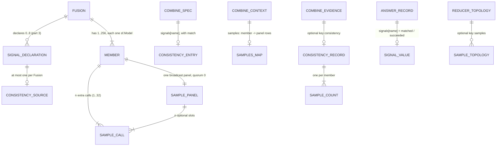

# ERD: E4b part 7, consistency@N

Path prefixes: `E/` = `apps/screamingface-engine/src/screamingface_engine/`,
`S/` = `packages/screamingface/src/screamingface/`, `ET/` = `apps/screamingface-engine/tests/unit/`,
`ST/` = `packages/screamingface/tests/`. Line numbers are on base `633fec3a1` (the tip of part 5).

This part adds no database table. The "stores" are wire records (the combine spec, the combine
context, the combine evidence, the url4 recipe rider `_sf_recipe`) and in-process objects (the SDK
`Consistency` source, the compiled sample calls). Each one gets the entity treatment below.



## 1. Consistency source (SDK object `sf.Consistency`, spec entry `signals[name]`)

Purpose: say how many extra calls each member makes, at which temperature, and how a sample is
compared with the member's answer. [stated epic "Call that member N more times with different
seeds"]; [stated ans:Q3]

| Attribute | Type | Rule | Source |
|---|---|---|---|
| source | `"consistency"` | the wire word; the name is already reserved as a prefix (S/_signals.py:23) | [existing S/_signals.py:23] |
| n | int | 1..32; a bool is refused; no default | [stated epic "N"]; [proposed] P2 range |
| temperature | float | finite, `>= 0`; an int is stored as a float; a bool is refused; default `1.0` | [stated ans:Q3]; [proposed] the bounds |
| match.extract | step `{"op", "args"}` | the step's own pinned extract when the step has one, else `last_line@1` | [stated epic "the same way as E4a"]; [proposed] P3 |
| match.normalize | step or null | the step's own pinned normalize when the step has an extract, else `text@1` | [proposed] P3 |

Invariants:

- **CN-I1** A Fusion declares at most one `sf.Consistency` (checked in `_declaration`, S/fusion.py,
  beside the one-`sf.Entropy` rule). [proposed] P4
- **CN-I2** Each member of a Fusion that declares `sf.Consistency` is ONE `sf.Model` (any
  provider). A nested Fusion or Pipeline member is refused at construction. [proposed] P4
- **CN-I3** `len(members) * n <= 1024`. [proposed] P4
- **CN-I4** The declaration needs a reducer synthesizer (part 3 DS-I3, unchanged).
  [existing S/fusion.py:108-121]
- **CN-I5** A member whose own `seed` param equals any derived sample seed of the Fusion (`s(k, j)`
  for every member k and every j in 1..n) is refused at construction. WHY every member, not only
  its own samples: a member of the same route with `temperature=t` and `seed=s(k, j)` sends the
  same gateway body as sample j of member k, so the two share one cached reply. [proposed] P5; the
  gap across two Fusions is overview N7
- **CN-I6** The source writes its full entry with `Consistency._entry(match)`; the compile
  (`combine_spec_text`) gives it `match`, because only the compile sees the step. `_spec()` is the
  entry without `match`; `_from_spec(source._entry(match)) == source`. [proposed] P3

Wire shape in `screamingface.combine-spec.v1` (an additive entry of the optional `signals` map;
canonical JSON sorts the keys):

```json
"signals": {
  "cons": {"match": {"extract": {"args": {}, "op": "last_line@1"},
                     "normalize": {"args": {}, "op": "text@1"}},
           "n": 5, "source": "consistency", "temperature": 1.0}
}
```

## 2. Sample call (url4 source, operation, topology node)

Purpose: one extra call of one member. It runs on every Case, in parallel with the members.
[stated epic]; [stated ans:Q3]

| Attribute | Value | Source |
|---|---|---|
| route | the member's route | [stated epic "Call that member"] |
| prompt | the member's prompt, or `DEFAULT_ANSWER_PROMPT` (the member rule, S/_evaluation/candidate.py:390-391) | [implied] |
| context | the member's input context (`$input`, or the earlier stage) | [implied] |
| params, in order | `binding=model_N`, then the member's author params without `seed` and `temperature` (author order), then `temperature=<t>`, then `seed=<s(k, j)>` | [stated ans:Q3 "the member's other params unchanged"]; [proposed] P5 order |
| injected logprob params | not sent (`logprobs`, `top_logprobs` stay on the member call only) | [proposed] P5 |
| seed `s(k, j)` | `int.from_bytes(sha256(f"consistency:{k}:{j}".encode()).digest()[:4], "big") >> 1`, with k the member position (1-based) and j the sample index (1..n) | [proposed] P5 (the idea of `derive_attempt_seed`, E/world/request_parameters.py:133-145, and of the `sf.samples()` seeds; not their code: overview P5 gives the reason) |
| binding | `model_N`, the next number of the compiler's model counter, after the members | [proposed] P6 |
| operation | id `op_model_N`, kind `sample`, label `"{member name} sample"`, `depends_on` = the Fusion's input dependencies | [proposed] P7 |
| claimant | never (not counted in the I-C2 claims) | [existing S/_evaluation/candidate.py:672-674 precedent] |
| topology node | `{"binding", "kind": "model", "name": <member name>, "named": false, "role": "sample"}` | [proposed] P8 |

Hand-computed seeds (oracles): s(1,1) = 2063835758, s(1,2) = 10968804, s(1,3) = 1079774124,
s(2,1) = 966517312, s(2,2) = 107840383, s(2,3) = 1732381022, s(3,1) = 1073252422,
s(3,2) = 137802004, s(3,3) = 992611152. For k in 1..256 and j in 1..32, the 8192 seeds are all
different, and the smallest is 134114, so a derived seed never equals a default `sf.samples()`
seed (0..255). [proposed] P5

Invariants:

- **SC-I1** The binding param is first. It makes the sample call's fingerprint different from
  every member call (a member call never carries `binding`), so the member reader
  (E/world/combine.py:82-120) never finds two matches for a member call because of a sample.
  [existing E/world/request_parameters.py:6-10]; [proposed] P6
- **SC-I2** The Engine strips `binding` before the gateway (E/world/request_parameters.py:26-28,
  :172-182). The gateway cache key is the request body, so each (route, prompt, context,
  temperature, seed) is one cache entry, and a replay returns the same samples. [existing];
  [implied]
- **SC-I3** A sample call never votes, never joins `outputs` or the member panel, and is never
  `chosen`. [proposed] P12

## 3. Sample panel (url4 source)

Purpose: gather the replies of one member's samples without letting a failed sample fail the Case.
[stated ans:Q4 "The Case does not fail"]

| Attribute | Value | Source |
|---|---|---|
| shape | `src(expr(*slots, intent=Text(""), broadcast=True, params={"quorum": 0}), name="panel_M", weight=0.0)` | [existing S/_evaluation/candidate.py:351-373 quorum panel] |
| slot j | `src(expr(<the sample call source>, intent=Text("$model_N")), name=f"sample_{j}", weight=1.0, required=False)` | [existing S/_evaluation/candidate.py:353-361] |
| name | `panel_M`, the next number of the compiler's panel counter | [proposed] P6 |
| value at run time | the url4 broadcast rows `[{"source_position": j, "source_name": "sample_j", "result": text}, ...]` of the samples that answered; `[]` when all failed | [existing packages/url4/src/url4/dag/nodes/broadcast_result.py:19-55] |
| failure | never: `quorum=0` always holds (packages/url4/src/url4/dag/nodes/_shared.py:256-262), and a failed optional slot is left out | [existing] |

## 4. Combine context `samples`

| Key | Value | When | Source |
|---|---|---|---|
| `samples` | wire: `{"member_1": "<rows text>", ...}`: every spec member, each value the text of its sample panel. Parsed: `CombineContext.samples: Mapping[str, tuple[str, ...]]`, the texts of the rows in j order | exactly when the spec declares a consistency source | [proposed] P9 |

- The SDK writes the key after `outputs` (or `panel`) and before `signals` and `sources`
  (`_fusion_context`, S/_evaluation/candidate.py:804-836). url4 `struct` keeps the insertion order,
  so the replay rule `_CONTEXT_SIGNALS` (S/url4.py:86) still finds `signals` at the end.
  [proposed]
- **CX-I1** The keys of `samples` are exactly the spec members. [proposed]
- **CX-I2** Each rows text is a JSON list. Each row has the keys `source_position`,
  `source_name`, `result`; `source_name` is `sample_j` with `1 <= j <= n` and
  `source_position == j`; no `j` twice; `result` is text. Any other shape is
  `combine_spec_invalid`. `parse_context` checks it with the row helper `_panel_rows`, which the
  quorum panel also uses (`_panel_outputs`, the OME-1557 rule: the same row keys, unique names, an
  int position equal to the name's index), so the row contract has one home. [proposed]

## 5. Sample count (engine, in process) and the value

Purpose: the numbers of one member's samples. [stated ans:Q4]

| Attribute | Type | Meaning |
|---|---|---|
| succeeded | int `0..n` | the count of rows (samples that returned a reply) |
| failed | int `0..n` | `n - succeeded` |
| matched | int or None | the count of rows whose match value equals the member's match value; None when the member has no match value (it failed, a quorum panel left it out, or nothing was extracted) or when `succeeded == 0` |
| value | float or None | `matched / succeeded` (Python float division); None exactly when `matched` is None |

- The member's match value: the member text through `match.extract`, then `match.normalize`
  (the E4a stages, E/combine/endpoint.py:827-856). A text over `MAX_OUTPUT_READ_BYTES`
  (E/combine/ports.py:93) has no match value. [existing]; [proposed] P10
- A sample matches when its match value is not None and is equal (text equality) to the member's
  match value. A sample with nothing extracted, or over the read cap, is a SUCCESSFUL sample that
  does not match. [proposed] P10
- The member's own answer is not a sample and is not in the denominator. [stated ans:Q4
  "matches / successful samples"]; [proposed] P11

## 6. Combine evidence: the `consistency` record

| Field | Type | Meaning | Source |
|---|---|---|---|
| `consistency` (top level) | `{name: [record, ...]}` or absent | one list for the one declared consistency name | [proposed] P13 |
| `consistency[name][i].member_id` | str | the spec member, in spec order | [proposed] |
| `consistency[name][i].matched` | int or null | §5 | [proposed] |
| `consistency[name][i].succeeded` | int | §5 | [stated ans:Q4] |
| `consistency[name][i].failed` | int | §5; "the count of failed samples is recorded" | [stated ans:Q4] |
| `members[i].signals[name]` | float or null | the value (§5) | [existing E4b part 3 EV-I2] |
| `declared[name]` | the spec entry as written, `match` included | [existing E/combine/endpoint.py:985-991] |

Key order of the evidence top level with every optional key present:
`... signal, cut, consistency, declared, gate, verifier, result, dropped, finish_reason`. The key is
written only when the spec declares a consistency source (`exclude_if`), so every existing
evidence keeps its v1 bytes. [existing E/combine/evidence.py:200-213 precedent]; [proposed] P13
WHY between `cut` and `declared`: ET/test_combine_gate_words.py:667 pins the fields from `declared`
to `result` as `[gate, verifier]`, and ET/test_combine_evidence_words.py:354 pins `cut` directly
after `signal`. This place keeps both green with no pinned edit.

Record key order: `member_id`, `matched`, `succeeded`, `failed`.

Invariants (checked by the Engine model and by the SDK `CombineEvidence`):

- **CS-I1** `consistency` is set exactly when `declared` has one entry with
  `source == "consistency"`, and its only key is that name. [proposed]
- **CS-I2** The list names every member of `members`, once each, in the same order. [proposed]
- **CS-I3** `succeeded + failed == declared[name]["n"]`, and both are `>= 0`. [stated ans:Q4]
- **CS-I4** `matched` is None, or `0 <= matched <= succeeded` and `succeeded >= 1`. [proposed]
- **CS-I5** For each member: `members[i].signals[name] == matched / succeeded` when `matched` is
  not None, and `members[i].signals[name] is None` when `matched` is None. [stated ans:Q4]

## 7. Topology `samples` (url4 rider `_sf_recipe`, schema `screamingface.recipe.v1`)

| Field | Shape | Source |
|---|---|---|
| reducer node `samples` | `[{"member": "member_k", "sources": [<sample node>, ...]}, ...]`, one entry per member in member order, each with n nodes in j order | [proposed] P8 |
| sample node | `{"binding": "model_N", "kind": "model", "name": <member name>, "named": false, "role": "sample"}` | [proposed] P8 |

- Written only when present (`_encode_reducer`, S/_evaluation/topology.py:365-370), so every
  existing url4 keeps its bytes. [existing precedent]
- The walker (`_topology_bindings`, S/_evaluation/topology.py:128-259): each sample node gets the
  Fusion's context and operation dependencies (as a member does). The reducer's context
  dependencies become `(*fusion_context, *sample_bindings, *signal_bindings)`; its operation
  dependencies become `(*member_bindings, *signal_bindings, *sample_bindings)`. The walker visits
  the samples before the signals, so the replayed operation order is the compile order.
  [proposed] P8
- WHY the two orders differ: the context dependencies follow the context keys (samples before
  signals, P9). The operation dependencies keep the members first, because `_operation_answers`
  and `_member_ids` (S/_case_views.py:41-45, :277) take `depends_on[:len(evidence.members)]` as
  the member producers; the signals keep their existing place, and the samples go last. A
  reorder of the operation dependencies would attach the wrong text to the member answers.

## 8. Display records (in process, no wire)

| Record | Text | Source |
|---|---|---|
| Case pane chip | `samples · {name} · {n} per member · failed {F} of {T}` | [proposed] P15 |
| member signal cell | the value, then ` {f} failed` when the member has failed samples; a dash with a reason when the value is None | [proposed] P15 |
| run summary line | `samples · {name} · failed {F} of {T}` (sums over the Cases of the step) | [proposed] P15 |
| export | `operations[].combine.consistency` (the evidence `to_dict`, no export change) | [existing S/case_result.py export] |

## 9. Migrations

- All wire changes are additive: a new source word in the optional `signals` map, a new optional
  context key, a new optional evidence key, a new optional topology key, a new operation kind
  (`sample`; no schema enumerates the operation kinds). No schema id changes. [proposed]
- A spec, context, evidence, url4 or report without consistency has the same bytes as before.
  Every golden, url4 fixture and recorded replay of an existing recipe stays the same. [implied]
- An old Engine refuses a spec with a consistency entry (`combine_spec_invalid`, the tagged union
  of E/combine/spec.py:167-169) at the combine call, AFTER the member and sample calls ran. The
  SDK and the Engine ship together (parts 1–5 precedent). [existing]; [implied]
- An old SDK cannot decode evidence with `consistency` (strict key sets,
  S/_evaluation/combine_evidence.py:69,92). [existing]; [implied]
