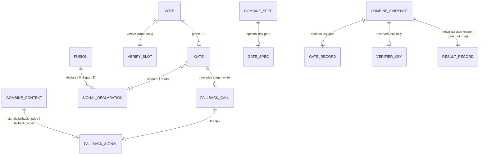

# ERD: E4b part 5, gate record and verifier slot

Path prefixes: `E/` = `apps/screamingface-engine/src/screamingface_engine/`,
`S/` = `packages/screamingface/src/screamingface/`, `ET/` = `apps/screamingface-engine/tests/unit/`,
`ST/` = `packages/screamingface/tests/`. Line numbers are on base `4e622af75`.

This part adds no database table. The "stores" are wire records (the combine spec, the combine
context, the combine evidence, the url4 recipe rider) and in-process objects (the SDK `Gate`, the
reducer plan). Each one gets the entity treatment below.



## 1. Gate (SDK object `sf.Gate`, spec key `gate`)

Purpose: say which number the vote compares, against which threshold, and what to do when the
comparison is false. [stated ans:Q1, ans:Q2]

| Attribute | Type | Rule | Source |
|---|---|---|---|
| observe | str | `"agreement"`, or `"chosen:" + name`, or `"mean:" + name` | [stated ans:Q2]; [proposed] text form |
| observe (name) | — | matches the declared-name rule `^[a-z][a-z0-9_]{0,31}$` and is declared by the Fusion | [stated ans:Q2]; [existing S/_signals.py `is_signal_name`] |
| cmp | enum | `>=`, `>`, `<=`, `<`; the PASS condition: true keeps the majority (E4c's "escalate when `agreement < 0.8`" is stored as `{agreement, >=, 0.8}`, P4) | [proposed] P4 |
| cmp (agreement) | — | only `>=` or `>` | [proposed] P4 |
| threshold | float | finite; int accepted and stored as float; bool refused | [stated epic "a number in the recipe"]; [proposed] rules |
| threshold (agreement) | — | `0 <= threshold <= 1` | [proposed] P4 |
| otherwise | `"abstain"` \| `sf.Judge` \| `sf.Model` | default `"abstain"` | [stated ans:Q3]; [proposed] default |
| otherwise (judge) | — | `returns="label"`, `order="max"` | [proposed] P6 |
| otherwise (model) | — | no `name=`, not `optional=True` | [proposed] P7 |

Invariants:

- **G-I1** A gate is valid only on `sf.Vote`. [proposed] P1
- **G-I2** A gate that reads `chosen:<name>` or `mean:<name>` needs `<name>` in the Fusion
  `signals=`. The Fusion constructor checks it, before any call. [stated ans:Q2]; [existing S/fusion.py:165-181 `_check_reads` precedent]
- **G-I3** A Vote without a gate compiles to the same bytes as today. [implied]

Wire shape in `screamingface.combine-spec.v1` (optional top-level key, additive; canonical JSON
sorts the keys):

```json
"gate": {"cmp": ">=", "observe": "agreement", "otherwise": "judge", "threshold": 0.7}
```

`otherwise` on the wire is `"abstain"`, `"judge"` or `"writer"`. The fallback model, its prompt and
its params are in the url4 fallback call (§2), not in the spec: the judge template precedent
(S/judge.py:36-39). [existing]; [proposed]

## 2. Fallback call (url4 source, operation, topology signal)

Purpose: the one model call that gives the fallback answer. It runs on every Case in this part
(ans:Q1). [stated ans:Q1, ans:Q3]

| Attribute | Judge fallback | Writer fallback | Source |
|---|---|---|---|
| reducer signal key | `fallback_judge` | `fallback_writer` | [proposed] P5 |
| role and binding | `judge`, `judge_N` | `writer`, `writer_N` | [existing S/_evaluation/topology.py:26-29]; [proposed] |
| operation kind | `judge` | `writer` | [existing S/_evaluation/topology.py:91-105] |
| operation label | `{fusion} fallback judge` | `{fusion} fallback write` | [proposed] |
| context | the Fusion context (`input` + `outputs`, or the quorum `panel`) | the same | [existing S/_evaluation/reducer_signals.py:130] |
| intent | `judge_intent("label", rubric)` (`judge-template@1 returns=label`) | the Model prompt, or `DEFAULT_SYNTHESIS_PROMPT` | [existing S/judge.py:129-138]; [existing S/_evaluation/candidate.py:502] |
| params | the binding param first, then the judge params | the binding param first, then the Model params | [existing S/_evaluation/reducer_signals.py:228-239] |
| projection | none | none (a writer for a Merge field has one; this writer does not) | [proposed] |
| topology entry | `{"key": "fallback_judge", "source": {...role: "judge"}}` | `{"key": "fallback_writer", "source": {...role: "writer"}}` | [existing S/_evaluation/topology.py:511-525]; [proposed] |

Invariants:

- **FC-I1** A gated Vote has at most one fallback call. A judge-weighted Vote keeps its own `judge`
  call; the two keys differ. [proposed]
- **FC-I2** The combine call depends on the fallback operation (`depends_on`), as on a judge.
  [existing S/_evaluation/candidate.py `_reducer_synthesizer` `depends_on=(*dependencies, *signals.operation_ids)`]
- **FC-I3** A projection exists exactly for a `writer_<field>` key, never for `fallback_writer`.
  [proposed]

## 3. Combine context `signals`

| Key | Value | When | Source |
|---|---|---|---|
| `judge` | the scores judge reply | judge-weighted vote (unchanged) | [existing] |
| `fallback_judge` | the label judge reply | gate `otherwise: "judge"` | [proposed] P18 |
| `fallback_writer` | the writer reply | gate `otherwise: "writer"` | [proposed] P18 |

- **CX-I1** A `fallback_*` key is in the context only when the spec gate names that fallback.
  Otherwise `combine_spec_invalid`. [proposed]
- **CX-I2** On the fallback branch, the needed key must be present; otherwise
  `combine_spec_invalid`. On the majority branch it is never read (FB-I1). [proposed] P8

## 4. Combine evidence: `gate` record and the reserved `verifier`

| Field | Type | Meaning | Source |
|---|---|---|---|
| `gate.observe` | str | the spec `observe` | [stated ans:Q1] "records the comparison" |
| `gate.observed` | float \| null | the number compared; null when it is missing or when the gate did not run | [stated ans:Q1]; [proposed] P10 |
| `gate.cmp` | enum | the spec `cmp` | [stated ans:Q1] |
| `gate.threshold` | float | the spec `threshold` | [stated ans:Q1] |
| `gate.passed` | bool \| null | the comparison result; null when the gate did not run | [stated ans:Q1]; [proposed] P10 |
| `gate.branch` | `"majority"` \| `"fallback"` \| null | the branch the step took; null when the gate did not run | [stated ans:Q1] "records ... the branch" |
| `gate.otherwise` | `"abstain"` \| `"judge"` \| `"writer"` | the spec `otherwise` | [proposed] |
| `verifier` (top level) | null | reserved; never written in this part | [stated ans:Q4] |

Key order of the evidence top level with all optional keys present:
`... signal, cut, declared, gate, verifier, result, dropped, finish_reason`. Each optional key is
written only when set (`exclude_if`), so an evidence with none of them keeps its v1 bytes.
[existing E/combine/evidence.py:153-163 precedent]; [proposed] P9

Invariants (checked by the Engine model and by the SDK `CombineEvidence`):

- **GR-I1** `passed is None` ⇔ `branch is None`. Then `observed is None` and the result is an
  abstain with a reason other than `gate_not_met`. [proposed] P10
- **GR-I2** `passed is True` ⇔ `branch == "majority"`; `passed is False` ⇔ `branch == "fallback"`.
  [proposed]
- **GR-I3** `result.reason == "gate_not_met"` ⇔ `gate` is set, `branch == "fallback"` and
  `otherwise == "abstain"`. [proposed] P13
- **GR-I4** `observe == "agreement"` and `passed is not None` ⇒ `observed == agreement` (the same
  float). [proposed] P11
- **GR-I5** Two rules, each only on the fallback branch: [proposed] P14
  - (a) `branch == "fallback"` and `otherwise == "writer"` ⇒ `built is True`, `chosen == []`,
    `result.member_id is None`.
  - (b) `branch == "fallback"` and `otherwise == "judge"` ⇒ `judge is not None`,
    `judge.returns == "label"`, `chosen == [result.member_id]`, and that member's row is not
    `excluded` (GD-E6; the Engine also has CE-I3).
  On the majority branch GR-I5 says nothing: `judge` is null (or the weights judge, GD-D10) and the
  result is the chosen member.
- **GR-I6** `verifier` is absent or null. [stated ans:Q4]

## 5. Abstain reason `gate_not_met`

| Side | Change | Source |
|---|---|---|
| Engine `AbstainReason`, `ABSTAIN_REASONS` (E/combine/ports.py:53,67) | append `gate_not_met` (build unit 2, with the scenario that uses it) | [proposed] P13 |
| Engine `AnswerReason` (E/combine/ports.py:54-66) | append `gate_not_met` | [existing E4a precedent `output_missing`] |
| SDK `AbstainReason`, `AnswerReason` (S/answer.py:29-45) | add `gate_not_met` | [existing ST/test_evidence_words.py:372 binds the two sides] |
| `NoVotes` (E/combine/ports.py:115-123) | no change: the gate does not raise it; the gate branch builds the abstain result itself | [proposed] |

A Case whose final operation abstains with `gate_not_met` is `candidate_abstained` through the
existing rule `final_operation_abstained` (E/benchmarks/operation_outputs.py:94-111). Coverage
counts it with the other abstains. No change. [existing]

## 6. Display records (in process, no wire)

| Record | Field | Source |
|---|---|---|
| Case pane chip | `gate · {observe} {cmp} {threshold} · observed {observed} · {verdict}` | [proposed] P16 |
| Run summary line | `gate · majority {m} of {N} · fallback {f} of {N}` (+ ` · not run {r} of {N}`) | [proposed] P16 |
| Trace `reduce` entry | field set unchanged; `judge_operation_id`, `judge_model` set by rule J4 | [existing S/_case_views.py:157-215]; [proposed] |

## 7. Migrations

- All wire changes are additive optional keys or new enum words in the v1 schemas. No schema id
  changes (the part 1–3 precedent). [proposed]
- A spec, a context or an evidence without the new keys has the same bytes as before. Every golden,
  every url4 fixture and every recorded replay of an existing recipe stays the same. [implied]
- The SDK url4 rebuild accepts the optional spec key `gate` (S/_evaluation/combine_spec.py:23,
  `_OPTIONAL_SPEC_KEYS`) and the two topology keys. [existing]; [proposed]
- An old SDK cannot decode evidence with `gate` (strict key sets, S/_evaluation/combine_evidence.py:64,86).
  The SDK and the Engine ship together, as in parts 1–4. [implied]
- An old Engine refuses a spec with `gate` (`extra="forbid"`, E/combine/spec.py:106) with
  `combine_spec_invalid` at the combine call, after the member calls ran. The SDK refuses a gate
  before any spend only when the Engine operator catalog lacks an operator; a gate needs no new
  operator, so the only guard is "ship the SDK and the Engine together". [existing]; [implied]
