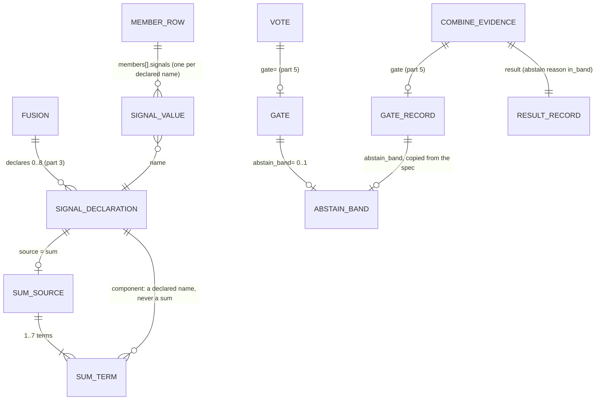

# ERD: E4b part 6, signal sums and the abstain band

Path prefixes: `E/` = `apps/screamingface-engine/src/screamingface_engine/`,
`S/` = `packages/screamingface/src/screamingface/`, `ET/` = `apps/screamingface-engine/tests/unit/`,
`ST/` = `packages/screamingface/tests/`. Line numbers are on base `633fec3a1`.

This part adds no database table. The "stores" are wire records (the combine spec, the combine
evidence, the url4 recipe) and in-process objects (the SDK `Sum`, the SDK `Gate`). Each one gets
the entity treatment below.



## 1. Sum source (SDK object `sf.Sum`, spec `signals` entry `{"source": "sum"}`)

Purpose: give each member one number that is a fixed linear sum of other declared numbers of the
same member. Rules and gates read it by name, as any declared signal. [stated ans:Q1]

| Attribute | Type | Rule | Source |
|---|---|---|---|
| name | str | a declared name (`^[a-z][a-z0-9_]{0,31}$`, not an E4a key, no reserved prefix); counts toward the 8 names of a Fusion | [existing S/_signals.py:22-46, E/combine/ports.py:490-515]; [proposed] P3 |
| source | `"sum"` | the wire word | [proposed] P1 |
| coefficients | map name → float | 1 to 7 entries; each key is a name that the same Fusion declares and that is not a sum; each value is a finite, non-zero number (int stored as float, bool refused); sorted by name | [stated ans:Q1] "fixed coefficients"; [proposed] P2, P3, P4 |

Wire shape in `screamingface.combine-spec.v1` (one entry of the optional `signals` map; canonical
JSON sorts the keys):

```json
"signals": {
  "risk":  {"coefficients": {"sev_a": 0.5, "sev_b": 0.3}, "source": "sum"},
  "sev_a": {"pattern": "A: ([0-9]+)", "source": "verbalized"},
  "sev_b": {"pattern": "B: ([0-9]+)", "source": "verbalized"}
}
```

Invariants:

- **SU-I1** Every component of a sum is a key of the same `signals` map. [proposed] P3
- **SU-I2** No component is a sum (no sum of sums, so no cycle). [proposed] P3
- **SU-I3** The value is missing (None) when any component value is missing. [stated ans:Q1, part 3 "Missing is not zero"]; [proposed] P5
- **SU-I4** The value is the exact rational sum of `coefficient × value` over the components,
  rounded once to the nearest float. A result outside the float range is missing (None). [proposed] P5
- **SU-I5** A Fusion with no sum compiles to the same bytes as today. [implied]

## 2. Member signal value of a sum (evidence `members[].signals[<name>]`)

| Attribute | Type | Rule | Source |
|---|---|---|---|
| `members[i].signals[<sum name>]` | float \| null | SU-I3, SU-I4; computed after the component values exist | [proposed] P5 |
| order of keys | — | unchanged rule: the read key first, then every declared name in spec order (E/combine/endpoint.py:354-356) | [existing] |

The evidence `declared` map holds the sum entry as the spec has it:
`"risk": {"source": "sum", "coefficients": {"sev_a": 0.5, "sev_b": 0.3}}` (E/combine/endpoint.py:985-991
writes `model_dump(mode="json", exclude_unset=True)`). The evidence schema does not change for this:
`declared` is `dict[str, dict[str, JsonValue]]` (E/combine/evidence.py:205). [existing]

## 3. Abstain band (SDK `sf.Gate(..., abstain_band=(lo, hi))`, spec `gate.abstain_band`)

Purpose: say which numbers are too close to call. Inside the band the Case abstains; outside it the
gate compares as in part 5. [stated ans:Q2]

| Attribute | Type | Rule | Source |
|---|---|---|---|
| abstain_band | `[lo, hi]` (two floats) \| absent | closed interval; `lo <= hi`; both finite; for `observe == "agreement"`, `0 <= lo <= hi <= 1` | [stated ans:Q2] "inside [lo, hi]"; [proposed] P7 |
| relation to `threshold` | — | none required; the band is checked first, the comparison only outside it | [stated ans:Q2] "outside the band the gate compares as today"; [proposed] P8 |
| relation to `otherwise` | — | the band abstains for every `otherwise` (abstain, judge, writer) | [proposed] P9 |

Wire shape (optional key of the part 5 `gate` object; additive, no new schema id):

```json
"gate": {"abstain_band": [0.6, 0.7], "cmp": ">=", "observe": "agreement", "otherwise": "abstain", "threshold": 0.7}
```

Invariants:

- **BD-I1** A gate without a band compiles to the same bytes as in part 5. [implied]
- **BD-I2** An explicit `"abstain_band": null` is refused (one spelling, the `signals` and `gate`
  precedent, E/combine/spec.py:231-244). [proposed]

## 4. Gate record (part 5 `gate` evidence record): band additions

| Field | Type | Meaning | Source |
|---|---|---|---|
| `gate.branch` | `"majority"` \| `"fallback"` \| `"band"` \| null | `"band"`: the observed number was inside the band, so the step abstained | [stated ans:Q2] "recorded in the gate record"; [proposed] P10 |
| `gate.passed` | bool \| null | null on the `"band"` branch: the comparison was not made | [proposed] P10 |
| `gate.observed` | float \| null | on the `"band"` branch, the number that was inside the band | [proposed] P10 |
| `gate.abstain_band` | `[lo, hi]` \| absent | the spec band; written only when the spec has one, after `otherwise` | [proposed] P11 |

Key order of a record with a band: `observe`, `observed`, `cmp`, `threshold`, `passed`, `branch`,
`otherwise`, `abstain_band`. A record without a band keeps its part 5 bytes. [proposed] P11

Invariants (checked by the Engine model and by the SDK `CombineGate` / `CombineEvidence`). GR-I1
and GR-I4 of part 5 are restated; their old cases keep their messages:

- **GR-I1'** `passed is None` ⇔ `branch is None` or `branch == "band"`. `branch is None` ⇒
  `observed is None`. [existing part 5 GR-I1]; [proposed] P10
- **GR-I4'** `observe == "agreement"` and `branch is not None` ⇒ `observed == agreement`.
  [existing part 5 GR-I4]; [proposed]
- **GB-I1** `abstain_band` is absent or `[lo, hi]` with finite `lo <= hi`. [proposed] P7
- **GB-I2** `branch == "band"` ⇒ `abstain_band` is set, `observed` is a number and
  `lo <= observed <= hi`. [proposed] P10
- **GB-I3** `abstain_band` is set, `branch` is `"majority"` or `"fallback"` and `observed` is a
  number ⇒ `observed < lo` or `observed > hi`. WHY: a reader can replay the decision from the
  record alone. [proposed] P10
- **GB-I4** `result.reason == "in_band"` ⇔ `gate` is set and `branch == "band"`. [proposed] P12
- **GB-I5** `branch == "band"` ⇒ `result.status == "abstain"`, `chosen == []`, `built` is false.
  [implied by GB-I4 and the existing abstain rule E/combine/evidence.py]

## 5. Abstain reason `in_band`

| Side | Change | Source |
|---|---|---|
| Engine `AbstainReason`, `ABSTAIN_REASONS` (E/combine/ports.py:55, :70-75) | append `in_band` after `gate_not_met` | [proposed] P12 |
| Engine `AnswerReason` (E/combine/ports.py:56-69) | append `in_band` after `gate_not_met` | [existing part 5 precedent P13] |
| Engine `GateBranch` (E/combine/ports.py:80) | append `band` | [proposed] P10 |
| SDK `AbstainReason`, `AnswerReason` (S/answer.py:29-46) | add `in_band` after `gate_not_met` (before the exclude words) | [existing ST/test_evidence_words.py:373 binds the two sides] |
| SDK `GateBranch` (S/combine_evidence.py:41) | append `band` | [proposed] P10 |

A Case whose final operation abstains with `in_band` is `candidate_abstained` through the existing
rule `final_operation_abstained` (E/benchmarks/operation_outputs.py:94-111, it reads only
`combine.result.status`). Coverage counts it with the other abstains. `in_band` is a scored decline,
not a failure code, so it never shares a status code with E4c's `fail_closed`. [existing]; [stated epic]

## 6. Display records (in process, no wire)

| Record | Field | Source |
|---|---|---|
| Case pane member table | the sum is one more signal column (no change); its header title is `source: sum of {c1!r} × {n1} + {c2!r} × {n2}` | [existing S/_ui/combine_view.py:240-250]; [proposed] P14 |
| Case pane gate chip | `gate · {observe} {cmp} {threshold} · band [{lo}, {hi}] · observed {observed} · {verdict}`; the verdict of the band branch is `in band · abstain` | [proposed] P14 |
| Run summary gate line | `gate · majority {m} of {N} · fallback {f} of {N}` + ` · in band {b} of {N}` when `b > 0` + ` · not run {r} of {N}` when `r > 0` | [proposed] P14 |
| Run summary mean header | the title of the `<sum> mean` header is the same `source: sum of ...` text | [proposed] P14 |

## 7. Migrations

- All wire changes are an additive union member (`SumSource`), an optional key (`abstain_band` on
  the spec gate and on the record) and new enum words (`in_band`, `band`) in the v1 schemas. No
  schema id changes (the part 1–5 precedent). [proposed]
- A spec, a context or an evidence without the new keys has the same bytes as before. Every golden,
  every url4 fixture and every recorded replay of an existing recipe stays the same. [implied]
- An old Engine refuses a spec with a sum or a band (`extra="forbid"`, strict union) with
  `combine_spec_invalid` at the combine call, after the member calls ran. An old SDK refuses an
  evidence with `branch: "band"`, `abstain_band` or `in_band` (strict decoder). The SDK and the
  Engine ship together, as in parts 1–5. [existing]; [implied]
