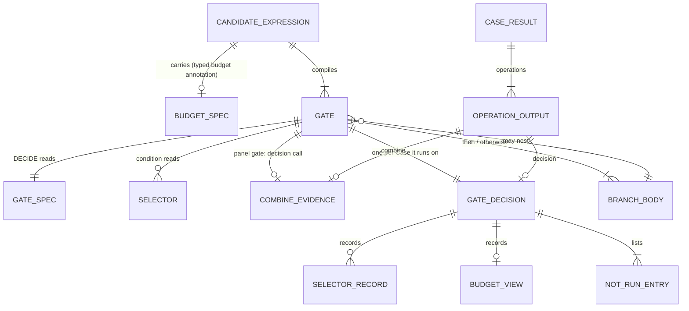

# ERD: E4c records — gate decisions, selectors, budget, outcomes

E4c adds no database table. Its "stores" are wire records: the url4 expression that a candidate
compiles to, the JSON values that flow between url4 nodes in one Case, and the per-Case
operation records that the Engine attaches to the Case result and that the SDK report exports.
This document models each record, its key, its invariants and how it evolves.

Path prefixes: `E/` = `apps/screamingface-engine/src/screamingface_engine/`, `S/` =
`packages/screamingface/src/screamingface/`, `U/` = `packages/url4/src/url4/`. Line numbers are on
base `e4b-integrated` (`031780873`). The interview ledger is in [00-overview](00-overview.md) §5.



## 1. GATE_SPEC — the condition as data (url4, in the DECIDE context)

Purpose: the one comparison a Gate makes, written into the url4 expression so that any node can
replay it. The epic requires data, not a Python function: "It is data. It is not a Python
function that only runs on the author's laptop" [stated epic].

Canonical JSON (keys sorted, `S/_evaluation/combine_spec.py` canonical writer rules) [proposed]:

```json
{"schema": "screamingface.gate-spec.v1",
 "kind": "input" | "panel",
 "when": {"observe": "<ref>", "cmp": ">=" | ">" | "<=" | "<" | "eq" | "ne" | "has" | "empty", "value": <number | label | true | null>},
 "then": "recipe" | "step" | "abstain" | "fail_closed",
 "otherwise": "recipe" | "step" | "abstain" | "fail_closed" | "skip",
 "estimate": {"then": {"usd": <n>, "tokens": <n>} | null, "otherwise": {...} | null},
 "ancestors": [["<path>", [["<param>", "<value>"], ...]], ...],
 "terminal": {"then": "<binding>" | null, "otherwise": "<binding>" | null}}
```

- `observe` for an input gate: `label:<selector id>`, `labels:<selector id>` or
  `budget.remaining:<unit>` (`usd` | `tokens`); for a panel gate: `agreement`, `chosen:<name>`,
  `mean:<name>` (the E4b part 5 forms, `E/combine/spec.py` `GateSpec`) or `answered` (the stage's
  reducer answered; `sf.answered()`, [cascade](prd/cascade.md)) [implied — ans:Q6, ans:Q12,
  ans:Q17, ans:Q19].
- Pairing [proposed]: `eq` and `ne` with `label:` (a label value; `ne` also holds for a null
  label, [guards](prd/guards.md)); `has` (a label value) and `empty` (value null) with `labels:`;
  `eq` with value `true` for `answered`; the numeric comparisons with numbers.
- `value` is a number for a numeric comparison, a label `[a-z][a-z0-9_]{0,31}`, `true`
  (`answered`) or null (`empty`) [proposed].
- `then`/`otherwise` name the body kind only; the body itself is url4 sources inside the gated
  iterate, never inside the spec [proposed]. `skip` is an internal spec word for a skip-Gate
  member only; it is not a public `otherwise=` value (a member Gate omits `otherwise`)
  [stated ans:Q16].
- `estimate` is the author's declared estimate for each recipe branch, or null [stated ans:Q3].
- `ancestors` lists the call fingerprints (path, sorted params) upstream of DECIDE whose charges
  the budget ledger counts (§5). Under `sf.Budgeted` every call carries the `binding` param, so a
  fingerprint has one claimant ([branch-core](prd/branch-core.md) D3, D7) [proposed].
- `terminal` names the terminal binding of each recipe body (its last source: a model call, a
  combine call, or an inner Gate's `gate_M`); a step slot's terminal is the decision call; a word
  body has null. JOIN copies that operation's recorded result into `decision.result`, so an
  abstain inside nested bodies reaches the root ([branch-core](prd/branch-core.md) D12)
  [proposed — review 3 F1].
- DECIDE learns its gate id from the call param `gate=gate_N`, not from the spec; it orders after
  the decision call, the Gate input and the selectors it reads through the Gate's AFTER source,
  whose instrumental slots carry no answer bytes ([branch-core](prd/branch-core.md) D10, D11)
  [proposed — review 2 F1, F6; review 3 F5].
- A panel gate's spec repeats the E4b `gate` object of its decision call; DECIDE checks that the
  two agree (key, cmp, threshold) [proposed].

Invariants: GS-I1 one comparison per spec. GS-I2 `kind` `panel` iff `observe` is a panel form.
GS-I3 a `fail_closed` or `abstain` word has no estimate. GS-I4 the spec bytes are a pure function
of the recipe (same recipe → same bytes), so replay re-keys nothing [implied].

## 2. SELECTOR spec and SELECTOR_RECORD

Two kinds [stated ans:Q8]; Clusters is deferred [stated ans:Q4].

**Keywords** (no model, deterministic) [stated epic]:

```json
{"schema": "screamingface.keywords.v1", "multi": false,
 "rules": [{"label": "math", "pattern": "(?i)\\bintegral\\b"}, ...]}
```

First match wins in declared order when `multi` is false; every matching label, in declared
order, when `multi` is true [stated epic]. Patterns are RE2
(`google-re2` already a dependency, `packages/screamingface/pyproject.toml:62-63`) [existing].
Window: the first 65,536 characters of the Case input (a new head-window helper; the existing
regex windows read the end of a text) [proposed]. 1–32 rules, labels unique; a pattern passes the
existing pre-spend check `check_regex` (`S/_regex_rule.py`, `MAX_PATTERN_CHARS = 256`)
[existing `S/_regex_rule.py`].

**LabelModel** (one model call):

```json
{"schema": "screamingface.label-model.v1", "multi": false, "labels": ["math", "code", "general"]}
```

The model, prompt and params live in the url4 model call, as the E4b fallback judge does
(`S/gate.py:91-107`) [existing]; the spec holds only what DECIDE needs to parse the reply. The
reply cap is 64 KiB, the judge reply cap (`E/combine/ports.py` `judge_reply`) [existing].

**SELECTOR_RECORD** (inside a GATE_DECISION):

| Field | Type | Note |
|---|---|---|
| `id` | `sel_<n>` | spec id, one per distinct selector spec per candidate; distinct from the LabelModel call's binding `selector_N`, and a Keywords selector has no binding [proposed] |
| `kind` | `keywords` \| `label_model` | |
| `status` | `computed` \| `not_run` \| `failed` | `not_run` only for a model selector an outer Gate skipped [stated ans:Q18]; `failed`: the LabelModel call failed (its source is `;optional`), every condition on it is False except `ne` [proposed] |
| `labels` | list of labels \| null | null when `not_run`; `[]` when nothing matched / parsed |
| `parse` | `ok` \| `no_match` \| `unrecognized` \| `unparsed` \| null | `unrecognized`: a token not in `labels`; `unparsed`: no token [stated epic] |
| `raw` | text ≤ 64 chars \| null | the first token of an unrecognized reply, for the report; never the whole reply [proposed] |
| `parse_error` | text \| null | null in v1: a failed `;optional` source leaves its `$name` unbound, so DECIDE sees the literal `$selector_N` and records `failed` without the code; the call's own failure code is in the activity view ([selectors](prd/selectors.md) SL-12) [proposed] |
| `input_chars` | int ≥ 0 | length of the Case input the selector saw: the epic's "selector input summary" without input text. Source: the `summary` of the Gate tree's KEYWORDS source, which is present in every Gate tree that reads a selector ([branch-core](prd/branch-core.md) D6); DECIDE copies it into every record (Keywords and LabelModel both read the Case input, P17) [proposed — review 2 F11] |
| `input_sha256` | 16 hex chars | first 16 hex digits of the SHA-256 of that input, from the same `summary` [proposed] |

Invariants: SR-I1 `status` `not_run` or `failed` ⇒ `labels`, `parse`, `raw` are null; `parse_error`
is null unless `failed`. SR-I2 `multi` false ⇒
`len(labels) ≤ 1`. SR-I3 every label in `labels` is a declared label. SR-I4 one selector id has
the same record in every GATE_DECISION of the same Case that reads it (one evaluation per Case,
[stated ans:Q12]).

## 3. GATE_DECISION — `screamingface.gate-decision.v1` (new evidence record)

Purpose: what one Gate decided on one Case and why, so that a reader can check the skip and a
replay can reproduce it [stated epic: "The report shows every stage that ran, the signal value,
the comparison, and the stages that did not run"]. Written by DECIDE, completed by JOIN, attached
to the Gate's JOIN operation `op_gate_<n>` (binding `gate_<n>`). Both endpoints publish it under
the JOIN fingerprint, so the last write wins: JOIN's record when JOIN ran (for an unselected
skip-Gate member JOIN runs too, returns `""`, and its record with `result` null wins), DECIDE's
record (result null) only after a failed body ([branch-core](prd/branch-core.md) D3, D8)
[proposed — review 3 F9].

| Field | Type | Note |
|---|---|---|
| `schema` | const | `screamingface.gate-decision.v1` |
| `gate_id` | `gate_<n>` | compile-order number inside the candidate [proposed] |
| `kind` | `input` \| `panel` | |
| `when` | object | copy of GATE_SPEC `when` |
| `observed` | number \| label \| list \| null | the value compared; null = missing |
| `passed` | bool \| null | null = no comparison (band, missing panel, guard upstream) |
| `wanted` | `then` \| `otherwise` \| null | the branch the condition chose; null when a panel decision call abstained before or at the gate and no branch is wanted (band hit; no voters with a step or word `otherwise`) ([branch-core](prd/branch-core.md) D4) |
| `branch` | `then` \| `otherwise` \| null | the branch that ran; null when the budget refused the wanted branch and the other branch also makes a call, or when `wanted` is null (D4, ans:Q25) |
| `selectors` | list of SELECTOR_RECORD | every selector the condition reads, plus every selector read inside a not-run body (Keywords `computed`, LabelModel `not_run`), so a fired guard still records the router's label (Q18) [proposed — reconciled with guards, selectors] |
| `not_run` | list of NOT_RUN_ENTRY | |
| `budget` | BUDGET_VIEW \| null | null when the candidate has no Budget |
| `result` | `{"status": "answered" \| "abstain" \| "fail_closed", "reason": <abstain reason> \| null}` \| null | written by JOIN; null when JOIN did not run, and for a skip-Gate member that was not selected (its JOIN returns `""`). On a step slot and on a null panel branch JOIN copies the status and reason of the decision call's combine result ([branch-core](prd/branch-core.md) D12) |
| `panel` | `{"operation_id": "op_<combine binding>", "branch": "majority" \| "fallback" \| "band" \| null}` \| null | panel gates only: the E4b gate record branch |

**NOT_RUN_ENTRY**: `{"branch": "then" | "otherwise", "reason": "not_selected" | "budget_refused",
"model_calls": {"min": <int ≥ 0>, "max": <int ≥ 0>}}`. `model_calls` = the model-call leaves on the
shortest and on the longest path through that body's topology (compile-time count, each nested
Gate counted per path) [stated ans:Q22]. It lets the run summary report calls avoided as a range
without a price table.

Invariants:
- GD-I1 exactly one of `then`/`otherwise` is in `not_run` when `branch` is set; both when
  `branch` is null (reason `budget_refused` for a refused `wanted`, `not_selected` otherwise)
  [implied].
- GD-I2 `branch` ≠ `wanted` with `wanted` set only with a `budget_refused` entry for `wanted`
  [stated ans:Q3]. `wanted` null ⇒ `branch` null and `result.status` = `abstain` with the decision
  call's reason (`in_band`, `no_votes`, `cut_not_met`, `output_missing`) [stated ans:Q25].
- GD-I3 `result.status` `fail_closed` ⇒ the taken branch body is the word `fail_closed`
  [stated epic: "`fail_closed` (return an error, call no model)"].
- GD-I4 `panel` set iff `kind` = `panel` [implied].
- GD-I5 the record never holds prompt text, reply text (except SELECTOR_RECORD `raw`) or member
  answers [proposed].
- GD-I6 the record bytes for a Case are the same live and on replay when every ancestor's
  reference cost is present on replay (budget uses reference costs, §5). When a priced live call
  comes back unpriced, Q14 counts it as $0, the budget view can differ, and the report flags that
  decision ([budget](prd/budget.md), [report](prd/report.md)) [stated ans:Q21].
- GD-I7 `model_calls.min ≤ model_calls.max` [implied].

## 4. BRANCH_BODY and the compiled expression shape

Not a stored record; the url4 sources of one branch ([contracts](contracts.md) C1, [branch-core](prd/branch-core.md) §2.2). Kinds: step, recipe, word,
absent (skip) [stated ans:Q6, ans:Q16]. A recipe body takes the Gate's input: the Case input at
the root, in the first Pipeline stage or the first block; the previous stage's answer in a later
Pipeline stage; Cascade stages take the Cascade's input [stated epic: "Each stage's prompt input
is the original user question"; implied — Pipeline semantics]. Body operations keep the attributed
binding kinds with one candidate-wide number; the JOIN is `gate_N` and a LabelModel call
`selector_N`. The pinned attribution pattern `^(model|synthesis|judge|writer)_\d+$`
(`E/benchmarks/operation_outputs.py:52`; the Engine-only fixture
`ET/data/combine_contract/binding_names.json`, which the SDK conformance test reads; the SDK copy
is `S/_operation_bindings.py:5-9`) gains `gate` and `selector`. Widening `_BODY` also widens the
SDK `OPERATION_REFERENCE`, `TOPOLOGY_BINDING` (`S/_evaluation/topology.py:24`) and the url4 decode
`_BINDING` / `_REFERENCE` (`S/url4.py:74-76`); `TOPOLOGY_BINDING` also gains the Gate block name
`gate_\d+_block` beside `loop_candidate` [existing `S/_operation_bindings.py:12-15`; proposed]. The combine call's own
`binding=synthesis_N` check is unchanged [proposed]. Calls inside gated bodies carry the `binding`
param, and bodies run inline in the Case scope ([branch-core](prd/branch-core.md) D1, D3)
[proposed]. Topology: a new recipe kind `gate` (`S/_evaluation/topology.py:25` `_TopologyKind`)
with two child slots; `sf.Cascade` has no own kind (it is nested Gates, [stated ans:Q6])
[proposed]. A LabelModel call has operation kind `selector`, accounted under the existing stage
`synthesis` like a judge (`S/accounting.py:44-52`), so the report's stage list does not change
[proposed].

## 5. BUDGET_SPEC and BUDGET_VIEW

**BUDGET_SPEC** — the url4 typed budget annotation on the candidate source (url4 Spec B §4.1:
`name:0.9:tokens=4000:<source>`; builder `U/core/builders.py:140-180` `src(budgets=)`)
[existing], written by `sf.Budgeted(recipe, usd=…, tokens=…)` ([budget](prd/budget.md)) with the
execution annotation `;budget_mode=advisory`, because the calls that always run may pass the cap
[proposed — url4 owner to confirm §24 conformance]. Keys `usd` and/or `tokens` [stated ans:Q3].
Written once, on the candidate [stated ans:Q19]. Scope: one Case [stated ans:Q13]. url4 parses the annotation today and enforces
nothing (no `budget` reader in `U/dag/`) [existing]. The E4a record types stay the model:
`Budget(unit, cap)` (`E/budget.py:53-62`), one per unit [existing].

**BUDGET_VIEW** (inside a GATE_DECISION): `{"unit": "usd" | "tokens", "cap": n, "spent": n,
"unpriced": int, "estimate": n | null, "refused": bool}` — one entry per declared unit, as a list
[proposed]. The fold is the E4a ledger (`E/budget.py:98-115` `_ledger`): an unknown amount adds
nothing to `spent` and one to `unpriced` [existing], which is the Q14 rule [stated ans:Q14].

Charge rule (`E/budget.py:185-206`) [existing]: usd charges `cost_usd`; tokens charges `tokens_in
+ tokens_out`; a cache hit charges its reference cost (source `cache_reference`). E4c depends on
the reference cost: a live run and its replay must take the same branch [implied — GD-I6].

Invariants: BV-I1 `refused` ⇒ `spent + estimate > cap` (estimate given) or `spent ≥ cap` (no
estimate). BV-I2 `spent` counts only the charges of the recorded calls whose fingerprint is in
`ancestors` (GATE_SPEC); pending combine records and combine records charge nothing [proposed].
BV-I3 parallel optional calls each fold only their own ancestors, so siblings can jointly pass the
cap; the report shows that overspend [stated ans:Q20]. The cap applies per Attempt of a Case
[proposed].

## 6. OPERATION_OUTPUT, CASE_RESULT and vocabularies (existing, extended)

- `OperationOutput` (`E/benchmarks/contract.py:356-378`) gains `decision: GateDecision | None`,
  left out of the wire when absent, the same rule as `combine` (`:373`) [proposed]. The SDK
  mirror and report.v1 export gain the same optional key (E4b part 4 added `trace` the same way)
  [proposed].
- `AbstainReason` (`E/combine/ports.py:56`, SDK `S/answer.py:29`) gains `budget_refused`
  [proposed]. A Gate word `abstain` reuses `gate_not_met` [proposed].
- `BudgetStage` (`E/budget.py:25`, SDK mirror) gains `selector`; a consistency `sample` call is
  charged as `model` (E4b D7) [proposed — [budget](prd/budget.md)].
- Combine route param `phase=decide` marks the E4b gate's decision call; with it, the fallback
  branch returns a pending outcome (output `""`, no evidence) [proposed —
  [lazy-fallback](prd/lazy-fallback.md)].
- Combine context gains an optional key `selection` (references to each skip-Gate member's
  decision record); combine-evidence.v1 gains an optional key `skipped` (member ids, last key, only
  when not empty); invariant NR-I4 (`E/combine/evidence.py:378-386`) widens to accept
  `not_selected` for a member in `skipped` [proposed — [skip-members](prd/skip-members.md)].
- `OperationCall` (`E/operation_calls.py:29-55`) gains `decision: GateDecision | None = None`
  (written by the new `record_gate_call`), `pending: bool = False` (a `phase=decide` pending
  outcome; skipped by the accounting index and the budget fold) and `gate_record: GateRecord |
  None = None` (the E4b gate record of a pending outcome, which DECIDE reads through
  `current_operation_calls()`; a complete decision call carries it in `combine.gate`)
  [proposed — [branch-core](prd/branch-core.md) D3, D11]. No failure code is published on a call:
  a selected skip-Gate member that fails under `quorum="all"` fails its required url4 slot with its
  own code ([skip-members](prd/skip-members.md), ans:Q23).
- Failure code `fail_closed`: permanent; added to `DECLARED_FAILURE_CODES`
  (`E/benchmarks/contract.py:58`), `ENGINE_ERROR_CODES` (`E/error_text.py:63-80`) and the SDK
  mirror (`S/_report_primitives.py:15-40`) in one PR, SDK released first (OME-1233)
  [stated epic: "Abstain is a scored decline. Fail-closed is an error. They must not share a status
  code."].
- `CaseStatus` stays `scored | failed` (`E/benchmarks/contract.py:47`) [existing]. An abstained Case
  stays the scored-0 shape (`S/case_result.py:695-707`) [existing].
- `final_operation_abstained` (`E/benchmarks/operation_outputs.py:94-111`) today recognises only an
  abstained combine operation named by a root intent `$name` [existing]; it follows `$name` through
  Gate block expressions (`gate_N_block`) to the outermost JOIN and accepts a JOIN operation whose
  `decision.result.status` is `abstain`; because JOIN copies the result of the branch that ran
  (its `terminal`, or the decision call on a step slot or a null branch, D12), an E4b vote that
  abstains under a lazy gate, a nested Cascade's last-tier abstain and a recipe body that ends in
  an abstaining Vote all mark the Case abstained [proposed — review 2 F3; review 3 F1].
- Failure code `quorum_not_met`: permanent, engine-authored; added to `DECLARED_FAILURE_CODES`,
  `ENGINE_ERROR_CODES` and the SDK mirror in PR-2, raised by the combine call when fewer selected
  skip-Gate members answered than a numeric quorum asks ([skip-members](prd/skip-members.md))
  [proposed — review 3 F4].

## 7. Migrations and versioning

- All new records carry a schema id (`gate-spec.v1`, `gate-decision.v1`, `keywords.v1`,
  `label-model.v1`). A later change adds optional keys only; a breaking change takes `.v2`
  [proposed].
- report.v1 and combine-evidence.v1 change additively only (optional keys, one abstain reason, one
  failure code), the E4b rule [existing `docs/spec/2026-10-16-e4b-gate-record/00-overview.md:37`].
- The E4b lazy-fallback change keeps combine-spec.v1 and combine-evidence.v1 bytes (E4b contract
  C8) [existing `docs/spec/2026-10-16-e4b-gate-record/contracts.md:124-136`].
- The SDK is experimental: the E4b `sf.Gate` signature widens with no alias concern
  [existing `docs/spec/2026-10-20-e4b-mapreduce-surface/00-overview.md:36`].
