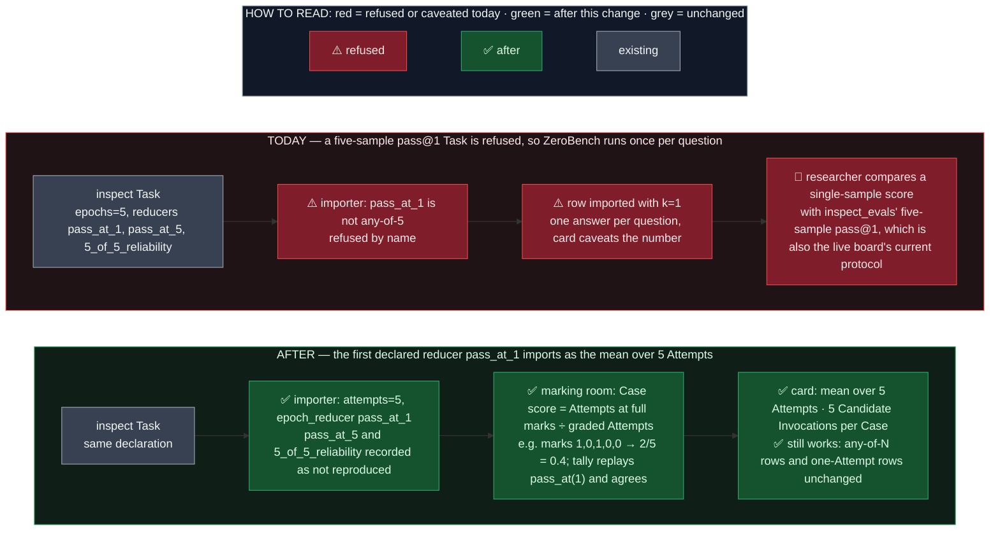

# Spec — a Benchmark may score a Case as the mean of its Attempts, as inspect's pass@1 does

- Status: amendment to `docs/spec/2026-10-07-OME-1458-attempts-per-case.md` (its D2 and D4);
  design approved by the owner on 2026-11-09 for a draft PR; built in one PR.
- Component: `apps/screamingface-engine` (the shared marking room's fold and
  `screamingface_engine_inspect`). The SDK is untouched (§5).
- Ticket: filed at PR-open under OME-1299 (the epic OME-1458 lives under).
- Ledger: `docs/work/2026-11-09-attempts-mean-fold.md`.

## TLDR

A Benchmark with **Attempts** asks each Case N times; the **fold** is the rule that turns the N
graded Attempts into the Case's one score. OME-1458 built one fold: a Check is met if any
Attempt met it ("any of N Attempts"). The **importer** reads an inspect Task's `epochs` and its
reducers (the functions inspect folds epoch scores with) and accepts the Task only when every
reducer computes that same any-of-N rule; everything else is refused by name.

The rule that must hold: the Case score we publish is the number the Task's own reducer
computes over the same Attempt marks, or the Task is refused.

The one gap: inspect_evals' ZeroBench Task asks each question five times and reports pass@1
as inspect's `pass_at(1)` over the five epochs (the live ZeroBench board scores its current
rows the same way, the mean of 5 samplings at default settings; the paper's Table 2 and the
board's release-era rows are one greedy sample, a different protocol). That is 1 − C(5−c, 1)/C(5, 1) = c/5, the mean
of the five marks, not any-of-5, so the importer refused it and ZeroBench was imported at one
sampling per question (OME-1855), a number the card has to caveat.

The change: a Task whose first declared reducer is inspect's own `pass_at(1)` over N > 1 epochs
imports as `attempts=N` with the row's `epoch_reducer="pass_at_1"`; its other reducers
(ZeroBench's `pass_at_5` and `5_of_5_reliability`) are recorded as not reproduced, like a dropped
scorer. On such a row the marking room folds by the mean: a Case scores the share of its graded
Attempts that got full marks, inspect's `pass_at(1)` exactly, and the tally replays that same
reducer and checks the two agree. The catalogue says "mean over N Attempts", never "pass@1".
Every row without Attempts and every any-of-N row is byte-identical: the new rule is read only
from a row that names `pass_at_1`.

## Before / After

## 1. Decisions

| # | Decision | Replaces |
|---|---|---|
| D2 | **Revised.** Two fold rules: any-of-N (OME-1458) and the **mean over Attempts**, taken when the Task's headline reducer is inspect's own `pass_at(1)` over N > 1 epochs. pass@1 estimated from N samples IS that mean (§2). All-must-match (ZeroBench's `5_of_5_reliability`, inspect's `pass_k`) still waits for a Benchmark that needs it as its headline. | OME-1458 D2 |
| D4 | **Extended.** The catalogue says "any of N Attempts" for the any-of-N rule and **"mean over N Attempts"** for the mean rule, never a bare "pass@N" or "pass@1": inspect's `pass_at(k)` names an estimator, and the card must say what the published number is. | OME-1458 D4 |
| D15 | **The mean counts full marks only, over the tries: graded Attempts plus empty answers.** inspect's `pass_at(1, value=1.0)` counts an epoch correct when its score is at least 1.0 and reduces over the epochs that have a Score. Which epochs have one is the point: inspect never errors on a textless refusal, a reasoning-only reply or a token budget spent before any text; its scorer sees an empty completion and files a 0. So the fold counts a failed Attempt whose leading failure is one of those three (`EMPTY_ANSWER_CODES`: `provider_refusal`, `model_empty_content`, `model_token_cap`) as a wrong try, and 1 right + 4 silent refusals is 1/5 = 0.2, as inspect_evals and the authors count it. Only an Attempt that never got an answer (the gateway family, a timeout, a grading failure) leaves the mean over the rest, as an errored epoch files no Score. A partial-credit Attempt counts as not right. Under the any-of-N rule a partial-credit Check still fails the Case by name (D7, §2.4 of OME-1458); under the mean rule it is a defined number, so no refusal. *Second pass, 2026-11-10: the first cut read "a failed Attempt leaves the mean" for every failure, so one lucky try among silent refusals scored the Case 1.0. Reach today: only a textless refusal arrives as a failed Attempt; a token cap, a reasoning-only reply or a gateway error is raised as a url4 error and fails the whole Case before the fold runs (OME-1458's accepted limitation). A follow-up unit collects a failed call per Attempt so those codes reach this rule.* | — |
| D16 | **The first declared reducer is the headline; the rest are recorded as not reproduced.** This is OUR convention: inspect publishes one set of metrics per declared reducer, side by side, with no headline of its own (`EvalScore.reducer` selects a view). The tally already replays the first declared one for an honoured whole-run metric. For ZeroBench that order comes from a Python set literal (`TOP_N = {1, 5}`), so `pass_at_1` is first by small-int hashing; a `top_n` override could reorder it, and the importer would then refuse by name. A `pass_at_1` headline imports and names the others as dropped; an any-of-N headline keeps OME-1458's rule that every declared reducer must be any-of-N, so `Epochs(2, ["max", "pass_at_1"])` is refused naming `pass_at_1` (two different published numbers, the row carries one). No new importer flag: the Task's own order decides. | OME-1458 D11 |
| D17 | **`epoch_reducer="pass_at_1"` is Benchmark identity and is admitted on a row with or without a whole-run metric.** The fold reads it, so it changes the published number on every Attempts row that names it; an any-of-N name is still admitted only beside an honoured whole-run metric (the fold does not read it, so on any other row it would move the revision while changing no number). | OME-1458 §2.6 |

## 2. What inspect computes, and what the fold computes

inspect's `pass_at(k)` over n scored epochs is 1 − C(n−c, k)/C(n, k), where c is the number of
epochs scoring at least `value` (1.0 by default). At k = 1 that is 1 − (n−c)/n = c/n: the share
of epochs at full marks. `pass_at(1)` reduces over the epochs that have a Score: an errored
epoch contributes none, but an empty completion is scored 0 and counts, so n is the number of
tries that got an answer, empty answers included (D15).

| Attempt marks | any-of-5 (OME-1458) | mean over Attempts (this spec) | inspect `pass_at(1)` |
|---|---|---|---|
| 1, 0, 1, 0, 0 | 1.0 | 2/5 = 0.4 | 0.4 |
| 0, 0, 0, 0, 0 | 0.0 | 0.0 | 0.0 |
| 1, 1, 1, 1, 1 | 1.0 | 1.0 | 1.0 |
| 0.5, 1.0 (partial scorer) | Case fails `attempt_grade_not_pass_fail` | 1/2 = 0.5 (0.5 is not full marks) | 0.5 |
| 1, errored, 0, 0 (the gateway failed one call) | 1.0 | 1/3 (over the three that got an answer) | 1/3 |
| 1, four silent refusals | 1.0 | 1/5 = 0.2 (an empty answer is a wrong try) | 0.2 |
| 1, 1, three silent refusals | 1.0 | 2/5 = 0.4 | 0.4 |
| five silent refusals | Case fails `provider_refusal` | Case fails `provider_refusal` (scores 0 in the Benchmark mean) | 0.0 |

The fold (`fold_case_attempts`, the one site every Attempts Case passes through) takes the rule
as an argument, `any` or `mean`. Under `mean`:

- Case score = Attempts whose own Case score is 1.0 ÷ tries, where tries = graded Attempts +
  empty answers (D15), rounded to 4 places as every Case score is.
- Each folded Check carries the share of the tries that met it as its `score`, `MET` when
  all did, `UNMET` when none did, no outcome otherwise, and `met_by_attempts` as before. On a
  one-Check Case (every Imported Benchmark) the Check share equals the Case score.
- The shown answer is the first graded Attempt with the highest own score, as under any-of-N.

The tally (`_score_filer`) reduces the Case's filed Attempt Scores with the row's reducer; for
`pass_at_1` that is inspect's own `pass_at(1)`, and the existing agreement check refuses the run
by name if the two numbers differ. Both are inspect's formula, so they agree on 0/1 marks and on
partial marks; the test pins both.

## 3. The importer's acceptance rule

| inspect Task declares (N > 1) | Example | Imported as |
|---|---|---|
| every reducer `max`, `at_least(1)` or `pass_at(N)` | ARC-AGI-2's `Epochs(2, "max")` | `attempts=N`, any-of-N fold (unchanged) |
| first reducer inspect's own `pass_at(1)`, any others | ZeroBench's `Epochs(5, ["pass_at_1", "pass_at_5", "5_of_5_reliability"])` | `attempts=N`, `epoch_reducer="pass_at_1"`, the others recorded as not reproduced in the row's comment |
| `mean`, `median` or `mode` anywhere, or epochs with no reducer (inspect's default `mean`) | MBPP's `Epochs(5, ["mean", "pass_at_1", ...])` | refused, naming the reducer (unchanged) |
| an any-of-N headline beside `pass_at_1` | `Epochs(2, ["max", "pass_at_1"])` | refused, naming `pass_at_1` (D16) |
| `pass_at(k)` with 1 < k < N, `at_least(k > 1)`, `pass_k`, a custom reducer, with no `pass_at_1` headline | `Epochs(2, "at_least_2")` | refused, naming the reducer (unchanged) |
| a reducer named `pass_at_1` whose code is not inspect's own, or `pass_at(1, value=0.5)` | an eval's own first-epoch reducer registered as `pass_at` | refused, naming it (the existing code-identity and tuned-threshold checks) |

The generated row names the rule: `attempts=N`, `epoch_reducer="pass_at_1"`, a comment saying
the Case score is the share of Attempts fully right, a comment listing the reducers not
reproduced, and a review TODO that the description must say "mean over N Attempts".

## 4. Failure cases, and what never changes

- A mean row with a partial-credit scorer imports and runs: each Attempt is graded as its scorer
  grades it, and a mark below 1.0 counts as not right, inspect's rule (D15).
- A silent refusal, a reasoning-only reply or a spent token budget is a wrong try; a gateway
  failure or a timeout is no try (D15). All tries empty: the Case fails as Attempt 1 did, under
  both rules, unchanged.
- A Task declaring both an any-of-N reducer and `pass_at_1` takes the one declared first: a
  `pass_at_1` headline drops the rest as not reproduced; an any-of-N headline is refused naming
  `pass_at_1` (D16).
- A row naming `pass_at_1` with `attempts=1` is refused at assembly: there is nothing to fold.
- The tally's agreement check is unchanged and still fires if a future reducer disagrees with
  the fold.
- Rows with no Attempts and any-of-N rows are byte-identical: no published revision moves, the
  ARC-AGI-2 row's `epoch_reducer="max"` and the fold it gets are untouched, and the existing fold
  and importer tests stay as they were (one importer test changes meaning, recorded in
  `.claude/test-change-approvals/`).

## 5. Out of scope

- Importing ZeroBench at five samplings: a later unit under OME-1299, once this lands (it replaces
  the k=1 row of OME-1855 and moves that Benchmark's revision).
- The SDK's badge and card phrase ("any of N Attempts"): the catalogue entry carries `attempts`
  and no fold rule, so the SDK cannot word the mean rule yet; the wire gains the rule when the
  first mean Benchmark is published. Known limitation of this PR.
- All-must-match (`pass_k`, `5_of_5_reliability`) as a headline.
