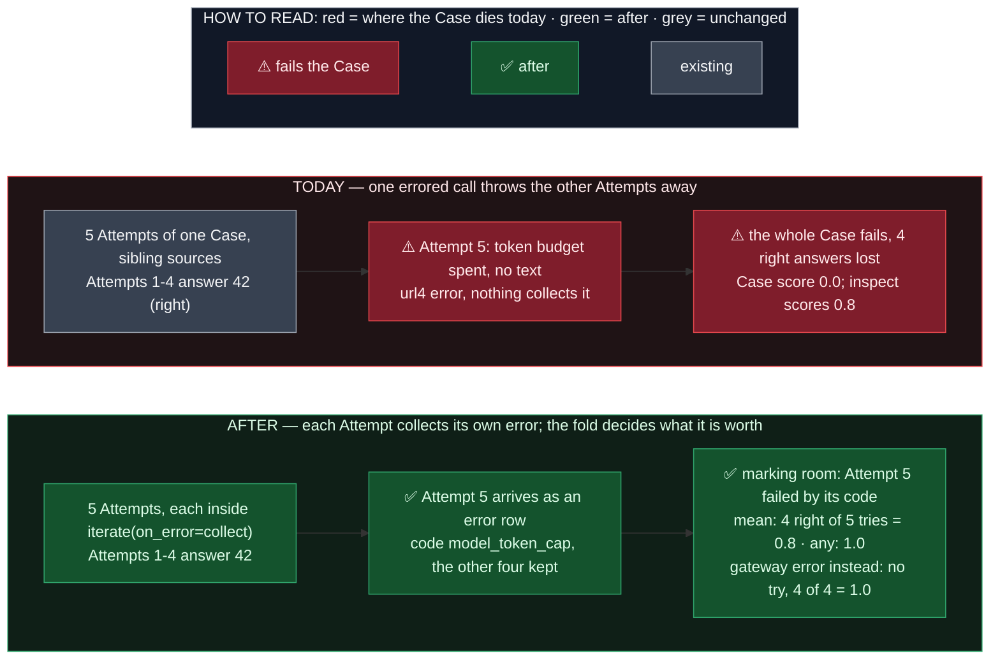

# A failed Candidate call fails only its own Attempt

**Amends** `docs/spec/2026-10-07-OME-1458-attempts-per-case.md` (§4, F4) and
`docs/spec/2026-11-09-attempts-mean-fold.md` (D15's reach).

## TLDR

A Benchmark with **Attempts** asks each Case N times; the **fold** turns the N Attempts into one
Case score (any-of-N for ARC-AGI-2, the mean for ZeroBench). Each Attempt is one url4 execution:
the **Candidate Invocation** (the model call), its Grading, and the envelope the marking room
reads. url4 keeps an error only inside an `iterate` with `on_error=collect`; anywhere else an
error ends the enclosing expression.

**The rule that must hold:** a Case scores what its tries earned, the way inspect counts them:
an answer that came back empty is a wrong try, a call that errored is no try.

Where it broke:
- The N Attempts were sibling sources of one expression, with no collection. One Attempt's
  Candidate call erroring (token budget spent before any text, a reasoning-only reply, a
  provider or gateway error) raised out of the whole Case; the Attempts that answered were lost
  and the Case scored 0. OME-1458 accepted this at one Attempt's cost; under the mean fold 4
  right + 1 token cap scores 0.0 where inspect_evals and the authors score 0.8.
- Only a textless refusal reached the fold, because the gateway reports it as data (status
  `refused`), not as an error. So OME-1856's "empty answer is a wrong try" rule could act on
  refusals alone.

The change: each Attempt's execution runs inside its own collecting `iterate`, so a failed call
becomes that Attempt's row, an error payload carrying the code (`model_token_cap`,
`gateway_internal_error`, ...). The join route accepts it; the marking room files it as a failed
Attempt with that code, exactly as it files a failed one-Attempt Case; the fold then counts an
empty answer as a wrong try and leaves any other error out. The Case's position (k of N, which
the Candidate is told) is bound once at Case level and read inside the wrapper, where url4's
own `$index` would be 0. Guarantee: a one-Attempt Benchmark's url4 is byte-identical; no
published revision moves (the expression is not part of the revision). Blast radius: the two
Attempts Benchmarks (ARC-AGI-2, ZeroBench once imported), the join route, no SDK change.

## Before / After

## Decisions

| # | Decision | Why |
|---|---|---|
| D1 | **Each Attempt's execution runs inside `iterate(["$item"], on_error="collect")`.** The one-element list is the Case row itself, so every `$item.<field>` the Benchmark reads keeps its value; the body is the unchanged one-Attempt execution. | url4 collects errors only inside an iteration (OME-1458 §4). A spike on 2026-11-10 confirmed the failed Attempt arrives as `[{"error": {"code": "model_token_cap", ...}}]` and the others are kept. |
| D2 | **The Case's position is bound once at Case level and read inside the wrapper.** `_attempted_case` adds a source `case_position` = `$index` beside the Attempts, and `_numbered` rewrites the Candidate Invocation's `case_index: '$index'` to `'$case_position'`. Any other `$index` inside an Attempt reads 0; no Benchmark has one (pinned by test). | Inside an iteration `$index` is the row's own index, 0 for a one-row list; the Candidate is told "Case k of N" from it, and progress would read Case 0 for every Case. The spike measured positions (0, 1) with the binding, (0, 0) without. |
| D3 | **The join route unwraps each Attempt's one-row list and keeps an error row as the Attempt's row.** Exactly one row per Attempt, else the contract error the route already raises. | The wrapper's output is the iteration's row list. The marking room's reader already files an error row for a known Case as a failed Case carrying the error's code (the missing-case rung, OME-1390), so an Attempt built from one needs no new reader. |
| D4 | **Which errors mean what is the fold's decision, unchanged (OME-1856 D15).** An empty answer (`provider_refusal`, `model_empty_content`, `model_token_cap`) is a wrong try; every other code (gateway family, timeouts, a provider HTTP error such as prompt too long, grading failures) is no try. Under any-of-N a failed Attempt adds nothing either way. | inspect scores an empty completion 0 and raises on an HTTP error (the sample errors; `fail_on_error` fails the eval by default, or drops the sample when off). Owner decision 2026-11-10. |
| D5 | **All N calls failing is still a failed Case, led by Attempt 1's failure, every Attempt kept.** | Unchanged Stage 2 of the fold; matches today's Report shape. |
| D6 | **The one-Attempt expression does not change.** `attempts == 1` still returns `_preserved_case` untouched. | Every published one-Attempt Benchmark pins its url4 by hash (`test_benchmark_protocol.py`). |
| D7 | **ARC-AGI-2 keeps its published revision `4f831492ca42fdf4`: an accepted drift, not a fundamental change.** The same replies can now give a different ARC-AGI-2 number under the same revision, only on a Case where one Attempt's Candidate call errored (before: the Case counted 0; after: the other Attempt counts). The repo's pins rule says a different number for the same answers must never keep a revision; the owner's rule since 2026-10-22 says revisions are frozen and move only on a fundamental change. Ruling (owner, 2026-11-10): keep it. The change is a fix toward the ARC harness's own rule, its reach is bounded to Cases whose Report shows a failed Attempt, and the 13 scored entries at this revision stay comparable on every Case with no such failure. The row card, README, OME-1476 spec and the Fidelity Record say so. | OME-1476, OME-1610 |

## Failure cases, and what never changes

- Attempt k's Candidate call errors with an empty-answer code → that Attempt is failed by the
  code; `mean` counts it a wrong try, `any` ignores it. 4 right + 1 `model_token_cap`: 0.8 / 1.0.
- Attempt k's call errors with any other code (gateway, timeout, provider HTTP error) → failed
  by the code, no try: 4 right + 1 `gateway_internal_error`: 1.0 under both rules (4 of 4).
- Attempt k's Grading fails → per Attempt, as before (the protected grading's own iterate).
- Every Attempt errors → the Case fails as Attempt 1 did, all Attempts listed (D5).
- A one-Attempt Benchmark → byte-identical url4 (D6).
- The whole-run tally (`_check_scores_agree`) files no Score for a failed Attempt, so a mean row
  that also honours a whole-run metric would still fail such a Case by the metric's name; no row
  has both (OME-1856 known limitation, unchanged here).

## Acceptance

- A three-Attempt Case whose second call raises `model_token_cap` keeps Attempts 1 and 3 and
  files Attempt 2 failed with that code, end to end through the real url4 node and aggregate.
- 4 right + 1 token cap = 0.8 (`mean`) and 1.0 (`any`); 4 right + 1 gateway error = 1.0 (both).
- The Candidate's position header reads (0, 1) over two Cases with Attempts, as without.
- `test_benchmark_protocol.py`'s pinned hashes stay green, unmodified.
