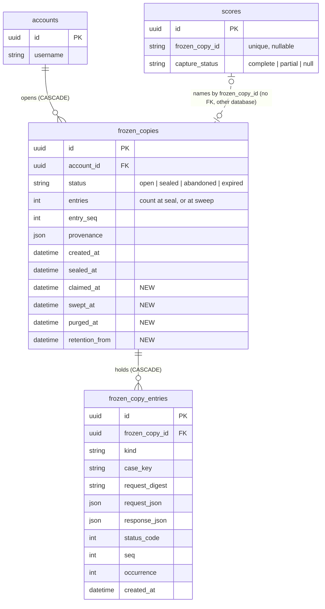

# ERD — frozen copy retention

**Base:** `origin/main` at `f683cd2e6` (before stack A). Paths are relative to the repo root.
Source tags are defined in `00-overview.md` §3.

This spec changes one table, `frozen_copies` (AI Gateway database). It adds no table. The
scoreboard database does not change.

## 1. Diagram

## 2. `frozen_copies` (AI Gateway) — existing, changed

**Purpose.** One row for each captured run. The row is the lock point and the state record of
the copy. `[existing apps/aigateway/src/aigateway/core/frozen_copy/models.py:25]`

### 2.1 New columns

| Column | Type | Null | Set by | Meaning |
|---|---|---|---|---|
| `claimed_at` | datetime | yes | the claim route | The time the scoreboard claimed the copy for a Score. `NULL` = no Score is known. A claimed copy never expires. `[stated ans:Q2]` |
| `swept_at` | datetime | yes | the sweep | The time the sweep moved the copy to `abandoned` or `expired`. `[proposed]` |
| `purged_at` | datetime | yes | the sweep | The time the sweep deleted the last entry of the copy. `NULL` on a swept copy means that entries can remain. `[proposed]` |
| `retention_from` | datetime | yes | migration 0019 only | The start of the 90-day clock for a copy that was `sealed` when the expiry rule was released. `NULL` = the clock starts at `sealed_at`. `[stated ans:Q24]` |

- This spec adds no "time of the last entry" column. The newest entry of a copy is the entry
  whose `seq` is equal to `frozen_copies.entry_seq`, and the unique index
  `(frozen_copy_id, seq)` finds it with one read
  `[existing apps/aigateway/src/aigateway/core/frozen_copy/models.py:59]`
  `[existing apps/aigateway/src/aigateway/core/frozen_copy/store.py:175-176]`. A column that
  only new code writes would be wrong after a rollback of the image. `[proposed]`
- The first three columns come with migration 0018. `retention_from` comes with migration 0019,
  which is released with the expiry rule (§5). `[proposed]`
- No setting stores the start of the 90-day clock. Migration 0019 writes the time of the
  release into `retention_from` for each copy that is `sealed` at that time. No code writes the
  column after that. A copy that is sealed later keeps `NULL`. Thus no person can set a wrong
  date. `[stated ans:Q24]`

### 2.2 Status values

| Status | Lifecycle | Entries | New |
|---|---|---|---|
| `open` | The run captures into the copy. | grow | no `[existing models.py:21]` |
| `sealed` | The run ended and the engine sealed the copy. Replay reads it. | fixed | no `[existing models.py:22]` |
| `abandoned` | The copy was `open` and got no entry for 24 hours. The sweep closed it. | deleted | yes `[stated ans:Q5]` |
| `expired` | The copy was `sealed`, had no claim, and its retention period ended. | deleted | yes `[stated ans:Q2]` |

`abandoned` and `expired` are final. The row stays as a small record (a tombstone), so a later
replay or claim gets a clear answer and not "unknown copy". The rows are not deleted.
`[stated ans:Q12]`

### 2.3 State table (every state × every event)

| Event ↓ / State → | `open` | `sealed`, no claim | `sealed`, claimed | `abandoned` | `expired` |
|---|---|---|---|---|---|
| Capture write (chat, tool) | insert | refused `[existing store.py:171]` | refused | refused | refused |
| Seal (owner) | → `sealed` | no change `[existing store.py:135]` | no change | 410, no change | 410, no change |
| Seal (not the owner) | 404 `[existing store.py:129]` | 404 | 404 | 404 | 404 |
| Claim (scoreboard) | 409 `frozen_copy_not_sealed` | set `claimed_at`; 200 | 200, no change | 410, `state: abandoned` | 410, `state: expired` |
| Replay read | 404 `frozen_copy_unavailable` `[existing routes/frozen_copies.py:108]` | served | served | 404 `frozen_copy_unavailable` | 410 `frozen_copy_expired` |
| Sweep, idle rule | idle ≥ limit → `abandoned` | — | — | — | — |
| Sweep, expiry rule | — | period ended → `expired` | never | — | — |
| Sweep, purge | — | — | — | delete entries; set `purged_at` | delete entries; set `purged_at` |
| Account delete | CASCADE `[existing models.py:34]` | CASCADE | CASCADE | CASCADE | CASCADE |

- No event moves a copy out of `abandoned` or `expired`. No event moves `sealed` to `open`.
  `[implied]`
- No event removes a claim. `[stated ans:Q11]`
- A caller that is not the owner always gets the 404 of today for a seal. It never gets the
  410, so it cannot learn the state of a copy of another account. `[implied]`

### 2.4 Rules that the sweep evaluates

- **Idle rule (open copies).** `idle_since` is the `created_at` of the newest entry (the entry
  with `seq = entry_seq`). If `entry_seq = 0`, `idle_since` is the `created_at` of the copy. The
  copy is abandoned when `now − idle_since ≥ open_idle_seconds` (default 86 400).
  `[stated ans:Q5]` `[proposed]`
  - The rule measures the time from the last entry, not the age of the copy. `[implied]`
  - If `entry_seq > 0` and no entry with that `seq` exists (this can occur only after a manual
    change of the data), the sweep skips the copy and reports it. `[proposed]`
  - An entry is written when a model call or a tool call ends. A live run can thus be silent
    for a long time. The rule is safe with the default because no run lives longer than the
    engine deadline of 16 hours
    `[existing apps/screamingface-engine/src/screamingface_engine/config.py:222]`, plus 90
    seconds until the supervisor stops the process
    `[existing apps/screamingface-engine/src/screamingface_engine/worker/supervisor.py:1072-1096]`.
  - The setting has no lower limit. `[stated ans:Q18]` A value below the engine deadline can
    abandon the copy of a run that is in progress. The operator must keep it above the
    deadline.
- **Expiry rule (sealed copies).** A copy expires when both conditions are true:
  1. `status = sealed` and `claimed_at IS NULL`.
  2. `now ≥ COALESCE(retention_from, sealed_at) + unclaimed_ttl_seconds` (default period
     7 776 000 = 90 days).

  `[stated ans:Q2]` `[stated ans:Q7]` `[stated ans:Q24]`
  - For a copy that was sealed before the release of the rule, the clock starts at the release
    (`retention_from`). For a copy that is sealed after it, the clock starts at the seal.
    `[stated ans:Q7]`
  - The sweep reads the candidates of this rule with one SQL filter: condition 1, and a clock
    start at or before `now − ttl`. The code passes that cutoff as a parameter. It does not
    read all sealed rows into memory. The filter only selects candidates. The mark evaluates
    both conditions again under the row lock, and that check decides. `[proposed]`
  - The rule has no switch and no date setting. It is active in each gateway that has the code
    of pull request C1. `[stated ans:Q22]` No person approves a list before the sweep deletes.
    `[stated ans:Q23]`
  - The rule trusts `claimed_at`. Two paths write `claimed_at`: the claim that the scoreboard
    sends at submit, and the claim pass that the scoreboard runs at each start for all stored
    Scores (also available as the command `claim_copies`). `[stated ans:Q25]` No job on a
    schedule, no table and no interlock exist. `[stated ans:Q17]` The cases in which a claim can
    be missing are in §2.8.

### 2.5 Invariants

- I1. A copy with `claimed_at` set is never `expired` and never loses an entry to the sweep.
  `[stated ans:Q2]` (A delete of its account still removes the copy and its entries by
  CASCADE, §2.3.)
- I2. The sweep changes `status` only while it holds the row lock of the copy, and only after it
  evaluated the rule again under that lock. `[proposed]`
- I3. The sweep sets `status` before it deletes an entry. A copy that lost one entry is thus
  never `open` or `sealed`. `[proposed]`
- I4. `purged_at` is set only when no entry of the copy remains, also when two purges run at
  the same time. `[proposed]`
- I5. A scoreboard that has a gateway URL stores a Score with a `frozen_copy_id` only after the
  gateway confirmed that the copy is `sealed` and set its claim. `[stated ans:Q9]`
  `[stated ans:Q10]`
- I6. F1 of the E14 design changes. Old text: "Rows are insert-only. A sealed copy accepts no
  insert." New text: "Capture only inserts rows; no code updates a row. Only an `open` copy
  accepts an insert. Only the retention sweep deletes rows, and only rows of a copy that is
  `abandoned` or `expired`." `[existing docs/spec/2026-10-06-e14-reproducible-submission/02-frozen-copy-design.md:89]`
- I7. F2 of the E14 design changes. Old text: "Copies and rows are kept forever (Q15)." (That
  is E14 Q15, not Q15 of this spec.) New
  text: "A copy that a Score claims is kept forever. Other copies follow the retention rules of
  `docs/spec/2026-11-16-frozen-copy-retention`. No list endpoint returns stored requests."
  `[stated ans:Q2]`

### 2.6 Index

- Add one index on `frozen_copies (status, purged_at)`. `[proposed]`
  - The purge reads swept copies with `purged_at IS NULL`. Swept rows stay forever, so this
    query must not read all of them. The index gives it only the rows that still have entries.
  - The idle rule reads `status = 'open'` (some hundreds of rows). The expiry rule reads
    `status = 'sealed'` and filters in SQL on `claimed_at`, `retention_from` and `sealed_at`,
    with the cutoff `now − ttl` as a parameter (at most about 130 000 rows
    at the current rate). The index prefix `status` is sufficient for both.
- The table is small (12 908 rows on 2026-11-16, about 1 400 new rows each day). Confirm the
  plans with `EXPLAIN` in the Postgres test lane. Do not add more indexes without a measured
  need. `[proposed]`

### 2.7 Clocks

- `created_at` and `sealed_at` come from the clock of the gateway pod
  `[existing apps/aigateway/src/aigateway/core/frozen_copy/store.py:140]`. The sweep reads the
  current time from the database. A difference of some minutes between the two clocks is
  accepted: the periods in the rules are 24 hours and 90 days. `[proposed]`
- Migration 0019 writes `retention_from` from one timezone-aware UTC time that its data step
  computes in Python (§5). It does not use `CURRENT_TIMESTAMP`. `[proposed]`

### 2.8 When a claim is missing

The scoreboard claims a copy at submit, and it claims the copies of all stored Scores at each
start `[stated ans:Q25]`. No other mechanism exists `[stated ans:Q17]`. This section states the
window that remains. It is the result of two final decisions: "accept the window"
`[stated ans:Q19]` and "no switch" `[stated ans:Q22]`. This spec adds no mechanism for it.

- A Score has its claim when the scoreboard stored it through the submit route with a gateway
  URL (I5), or when a claim pass ran after it was stored (`prd/score-claim.md` C18).
- A claim can be missing after one of these events:
  1. The scoreboard ran with no gateway URL when the Score was stored. With the new image and
     an empty URL, each such Score gets one WARNING record at submit (`prd/score-claim.md` C9).
     With an old image that was rolled back, no record is written, and the old image also
     stores a Score with no check of its copy.
  2. A restore of the gateway database to an earlier time removed claims that were made after
     that time.
  3. A downgrade of migration 0018 removed all claims. This case is safe: 0019 goes down with
     0018, and when 0019 is applied again it stamps each sealed copy with the new time (§5.1).
- **The window.** The clock of a copy (`COALESCE(retention_from, sealed_at)`) does not start
  again when a claim is lost. A copy with no claim thus has only the time that remains in its
  own period, and that time can be zero. Example: a saved result that was submitted on day 85
  after the seal has about 5 days. A copy that is past its period expires at the next run of
  the sweep.
- **The repair** is a claim pass: the next start of a scoreboard pod with a gateway URL, or one
  run of `python -m scoreboard.claim_copies` (`prd/score-claim.md` C4). It helps only for a
  copy that the sweep did not mark before the pass.
- **The worst case is a restore of the gateway database (case 2).** The gateway pod starts, and
  its sweep runs 1 to 5 minutes later. The scoreboard does not start again by itself. Thus the
  sweep usually runs before a repair, and it expires each copy that lost its claim and is past
  its period. Entries that the sweep deleted do not come back.
- Advice for the operator `[stated ans:Q21]`: after a restore of the gateway database, run
  `claim_copies` at once when the gateway is up. The first run of the sweep is not earlier than
  60 seconds after the start of the gateway. After the other events, start the scoreboard
  again or run `claim_copies`. The steps are in `test-plan.md` §5.4. The advice is not enforced
  by code.

### 2.9 Size and growth

- A swept row has no entries. It uses about 200 bytes. At 1 400 new copies each day, the rows
  add about 100 MB each year. `[stated ans:Q12]`

## 3. `frozen_copy_entries` (AI Gateway) — existing, not changed

- No schema change. The sweep deletes rows; it never updates one. `[implied]`
- The index `(frozen_copy_id, kind, case_key, request_digest, occurrence, seq)`
  `[existing apps/aigateway/src/aigateway/core/frozen_copy/models.py:56]` starts with
  `frozen_copy_id`. The purge uses it to find the entries of one copy.
- On 2026-11-16 the table held 2.24 million rows and 40.7 GB (38 GB in TOAST). The mean entry is
  about 18 KB.

## 4. `scores` (scoreboard) — existing, not changed

- `frozen_copy_id` and `capture_status` stay as they are
  `[existing apps/scoreboard/src/scoreboard/scores/models/score.py:82]`. One Score at most names
  one copy `[existing apps/scoreboard/src/scoreboard/scores/models/score.py:219]`.
- The link between a Score and a copy has no foreign key, because the two tables are in
  different databases. The scoreboard is the source of truth for "a Score names this copy". The
  gateway column `claimed_at` is a copy of that fact, written at submit and at each start of
  the scoreboard. `[proposed]`
- Divergence and repair: §2.8.

## 5. Migrations

Two migrations, because the expiry rule is released after the claim (`00-overview.md` §2).

**`0018_frozen_copy_retention.py` (pull request A1).**

- It depends on `("models", "0017_drop_migration_note")`.
  `[existing apps/aigateway/src/aigateway/migrations/0017_drop_migration_note.py]`
- Operations: three `AddField` on `FrozenCopy` (`claimed_at`, `swept_at`, `purged_at`; nullable
  datetimes, no default) and one `AddIndex`. No data change. All existing rows keep `NULL` in
  the new columns. `[proposed]`

**`0019_frozen_copy_retention_clock.py` (pull request C1).** `[stated ans:Q24]`

- It depends on `("models", "0018_frozen_copy_retention")`.
- Operations: one `AddField` (`retention_from`, nullable datetime, no default), then one data
  step that sets `retention_from` on each row with `status = 'sealed'`. Rows with another
  status keep `NULL`. `[proposed]`
- **The data step is a `RunPython` step.** It computes one timezone-aware UTC time in Python,
  and passes it as a parameter of one `UPDATE frozen_copies SET retention_from = <parameter>
  WHERE status = 'sealed'`. Each row gets the same value. Do not use `CURRENT_TIMESTAMP` or
  `now()` in the statement: on SQLite, Tortoise stores a datetime as ISO text with a zone and
  microseconds, and `CURRENT_TIMESTAMP` gives text with no zone. Such a value can read back as
  a naive datetime, or compare wrongly with `sealed_at`. `[proposed]`
- Bound the lock wait on Postgres, as 0017 does
  `[existing apps/aigateway/src/aigateway/migrations/0017_drop_migration_note.py:73]`. The
  table is small (§2.6), so the statement is short.
- The reverse of the data step does nothing. The downgrade drops the column (see below).

**Both migrations.**

- Exemplar for the file layout and the header text (UPGRADE, DOWNGRADE, AUTHORING NOTE):
  `apps/aigateway/src/aigateway/migrations/0015_cache_entry_write_order.py`.
- Generate each file with `tortoise makemigrations -n <name> models`, then edit it. The
  autodetector also emits an `AlterField` on `OAuthConnection.account`. Remove that operation,
  as 0014 and 0015 did
  `[existing apps/aigateway/src/aigateway/migrations/0015_cache_entry_write_order.py:11-15]`.
- **The downgrade drops each column with `RunSQL`.** The reverse of 0018 and of 0019 must be a
  plain `ALTER TABLE frozen_copies DROP COLUMN …` in a `RunSQL` step on both dialects, as 0017
  drops its column. It must not be the automatic reverse of `AddField` (`RemoveField`): on
  SQLite that operation builds the table again and loses its indexes
  `[existing apps/aigateway/src/aigateway/migrations/0017_drop_migration_note.py:19-24]`. In
  0018, the reverse drops the index on `(status, purged_at)` before the column `purged_at`.
  The migration test confirms that the other indexes and the foreign key of `frozen_copies`
  stay after a downgrade. `[proposed]`
- Gateway migrations run only in the Helm pre-install and pre-upgrade Job
  `[existing apps/aigateway/charts/aigateway/templates/job-migrate.yaml]`. The gateway process
  does not migrate at start.
- Tests: one migration test for each file in the style of
  `apps/aigateway/tests/unit/test_frozen_copy_migration.py` (dependencies, columns, index,
  downgrade, silent autodetector; for 0019 also the stamp and its time zone).
  `prd/copy-sweep.md` S-28, S-33.

### 5.1 Downgrade, rollback and restore

- **Downgrade of 0019:** drop `retention_from`. The code of C1 must be rolled back with it. If
  0019 is applied again later, it stamps the copies with the new time, so each clock starts
  again. That is the safe direction: no copy expires earlier.
- **Downgrade of 0018 (after 0019):** drop the index and the three columns. Entries that the
  sweep deleted do not come back. All claims are lost (§2.8, case 3).
- **Rollback of the gateway image with the new schema kept:** the old code does not know the
  states `abandoned` and `expired`. Its replay code refuses them as "not sealed", which is safe.
  Its seal code seals each copy that is not `sealed`
  `[existing apps/aigateway/src/aigateway/core/frozen_copy/store.py:135-141]`, so a seal for a
  swept copy would make an empty copy `sealed`. No run sends a seal 24 hours after its last
  entry, so this is accepted. The old image has no sweep, so nothing is deleted while it runs.
  The old image has no claim route, so each submit that carries a copy gets 503 until the new
  image is back (`prd/score-claim.md` C7). `[proposed]`
- **Restore of the gateway database to an earlier time:** claims made after that time are lost
  (§2.8, case 2). A copy that lost its claim and is past its period expires at the next run of
  the sweep, 1 to 5 minutes after the start of the gateway. Run `claim_copies` at once
  (`test-plan.md` §5.4).
- **Restore to a time before a migration of this spec:** the migration does not run by itself.
  The gateway migrates only in the Helm Job, and its start code does not migrate. Until the
  migrate Job runs, each query of the new code on `frozen_copies` selects a column that is not
  there, and fails (capture, replay, claim and sweep). The first step after such a restore is
  thus the migrate Job. When 0019 runs again, it stamps the sealed copies with the new time,
  which is the safe direction.
