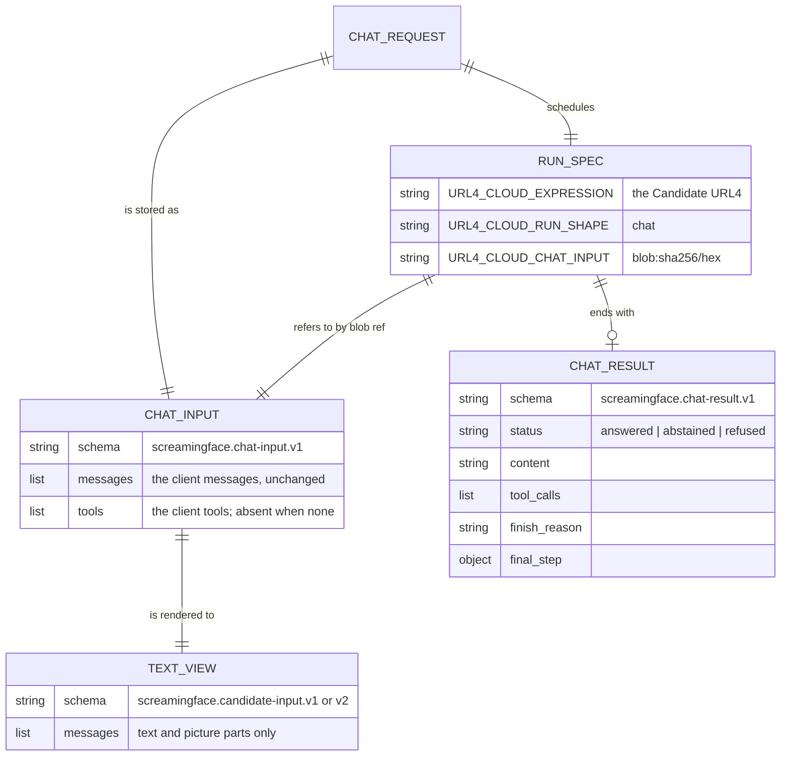

# OpenAI-compatible chat endpoint: data records (ERD)

**Scope.** This feature adds no database table. It adds three records that travel between the
App and the run, and it uses two stores that exist today. Path prefixes: `E/` =
`apps/screamingface-engine/src/screamingface_engine/`. Line numbers are on origin/main
`8530a9d75`.

## 1. Stores

### 1.1 Run blob store (existing)

- The run blob store keeps content-addressed files below `blobs/<tenant>/<run>/<hex>`
  `[existing E/artifacts/blobs.py:1]`.
- A read from a different tenant or run finds nothing `[existing E/artifacts/blobs.py:16]`.
- The store verifies the sha256 at ingest and at each read `[existing E/artifacts/blobs.py:20]`.
- One blob has a maximum size of 8,000,000 bytes `[existing E/artifacts/blob_schema.py:34]`.
- The store has a `sweep(ttl_seconds)` operation and no delete operation
  `[existing E/artifacts/blobs.py:212]`.
- With `URL4_CLOUD_BLOB_STORE` unset, there is no blob store `[existing E/artifacts/blobs.py:11]`.
- The App has one `BlobStore` with one policy, and the public `PUT /blob` route uses it
  `[existing E/app.py:423]`. The policy refuses a body that does not start with the signature of
  its media type `[existing E/artifacts/blob_schema.py:205]`, and a type with no reliable
  signature must not be added to it `[existing E/artifacts/blob_schema.py:46]`.
- The Runner builds its store with the default policy `[existing E/artifacts/wiring.py:98]`. It
  reads a blob of an unknown media type as store corruption
  `[existing E/artifacts/blob_schema.py:201]`.
- Thus this feature adds a second store, the **chat-input store** `[proposed — review 1]`:
  - It is a second `BlobStore` on the same objects, with its own policy.
  - Its policy admits only `application/vnd.screamingface.chat-input+json`.
  - In place of the signature check, it parses the body and validates the CHAT_INPUT schema.
  - The App and the Runner build it with one shared function, so the two halves agree.
  - The public `PUT /blob` route keeps the attachment store and refuses the chat media type.
  - `BlobPolicy` has only a signature switch today, so it gets a hook for a content check
    `[proposed — review 2]`.
- The local stack sets a filesystem blob store. Today the default is no store
  `[existing E/config.py:164]`.
- The feature stores one CHAT_INPUT blob for each request `[proposed]`.
- The feature adds a `delete(scope, sha256)` operation and deletes the blob when the request
  ends `[stated ans:Q17]`. The operation is new on the protocol that the blob store uses
  (`BoundedBlobObjects`) and on each backend: filesystem, S3, and the adapter for a backend
  with put and get only. That adapter forwards a delete when its inner backend has one, and
  does nothing if not. The source has no in-memory backend; CR-26 uses one that is local to
  the test `[proposed — build of U3]`. A delete removes the data object and the metadata
  object, and a missing object is not an error `[proposed — review 2]`. The sweep stays as the
  safety net. See overview OQ-1.

### 1.2 Events stream (existing)

- The run publishes its frames to the shared events stream. The App reads the terminal frame and
  the result frame from it `[existing E/rest/mounts.py:381]`.
- An inline result has a maximum size of 524,288 bytes `[existing E/job_env.py:584]`. A larger
  result goes to the artifact store `[existing E/runner/executor.py:660]`.
- A chat run deletes its stream subject 5 s after its terminal frame, as a direct run does
  `[proposed]` (`DIRECT_STREAM_GRACE_S`, `[existing E/job_env.py:222]`). The queue codec writes
  that grace only for the `direct` shape today `[existing E/runner_queue.py:276]`, so the codec
  gets the same rule for `chat`.
- A result in the artifact store stays there until the artifact sweep removes it. Fetching never
  deletes `[existing E/rest/artifacts.py:18]`. This is a known limit for answers above the
  inline cap `[proposed — review 1]`.

### 1.3 Stores that this feature does not use

- The Run registry tables `runs` and `run_candidates` get no row for a chat request `[proposed]`.
  A chat turn is not an Evaluation.
- The feature opens no frozen copy. Capture and replay are not available on this endpoint
  `[proposed]`.

## 2. Records

### 2.1 CHAT_INPUT (`screamingface.chat-input.v1`)

Purpose: carry the conversation and the tools from the App to the run without the 1 MiB limit of
the run spec `[existing E/child_protocol.py:33]`.

| Field | Type | Rule |
|---|---|---|
| `schema` | string | exactly `screamingface.chat-input.v1` `[proposed]` |
| `messages` | list | the validated client messages, in order, with no change `[implied]` |
| `tools` | list | the validated client function tools; the key is absent when the request has none `[implied]` |

- Media type: `application/vnd.screamingface.chat-input+json` `[proposed]`.
- Encoding: canonical JSON (sorted keys, no extra white space, no ASCII escapes), UTF-8
  `[proposed]`. Two size rules apply: the request body is at most 8,000,000 bytes, and the
  encoded record is at most 8,000,000 bytes. A request that breaks one of them gets 413
  `request_too_large` `[proposed — review 2]`.
- Scope: `(tenant, run)`, where run is the topic that the App makes for the request `[implied]`.
- The record does not hold sampling fields, because the endpoint ignores them
  `[stated ans:Q14]`.
- Invariant: the blob is written before the run is scheduled. A run never starts without its
  input `[proposed]`.
- Invariant: logs carry the digest and the size, never the content `[existing E/artifacts/blobs.py:23]`.

### 2.2 RUN_SPEC additions

The run spec is the JSON env mapping in the queue message `[existing E/runner_queue.py:225]`.

| Key | Value | Rule |
|---|---|---|
| `URL4_CLOUD_EXPRESSION` | the Candidate URL4 text | unchanged meaning `[existing E/job_env.py:42]` |
| `URL4_CLOUD_RUN_SHAPE` | `chat` | third value of `RunShape` `[proposed]`; today `expression` or `direct` `[existing E/job_env.py:232]` |
| `URL4_CLOUD_CHAT_INPUT` | `blob:sha256/<hex>` | required when the shape is `chat`; refused for other shapes `[proposed]` |

- The schedule port, the queue codec and the in-process adapter have no parameter for the input
  ref today `[existing E/ports.py:80]` `[existing E/runner_queue.py:225]`
  `[existing E/adapters/inprocess.py:282]`. Each gets one new keyword parameter, `chat_input`
  `[proposed — review 1]`.
- A chat run carries the run deadline, and each model call of the run stops at it. Today only a
  `direct` run sets that deadline `[existing E/runner/main.py:118]` `[proposed — review 1]`.
- For a `chat` run, the executor builds the target of the internal turn route from these keys:
  the context is the blob ref and the intent is the Candidate URL4. This is the shape of a
  Candidate route call `[existing E/world/candidate_adapter.py:45]`. The executor builds it with
  the url4 builders, so the quoting is correct `[proposed — review 2]`.
- An old worker that reads a `chat` message fails the run with a clear error, because
  `run_shape_from_env` raises on an unknown value `[existing E/job_env.py:235]`. Deploy order:
  workers first, then the App `[proposed]`.

### 2.3 TEXT_VIEW (existing schema, new producer)

Purpose: give each step that is not the final model step a conversation that the existing model
endpoint accepts with no change.

- The record is a `screamingface.candidate-input.v1` or `.v2` envelope
  `[existing E/benchmarks/contract.py:34]`. The allowed roles are `system`, `developer`, `user`
  and `assistant` `[existing E/benchmarks/contract.py:40]`.
- A conversation with no tool message and no tool call maps to the envelope with no change of
  text `[implied]`.
- A conversation with tools or tool history is rendered to text. The rules are in
  [prd/tool-calls.md](prd/tool-calls.md) §3.4.
- Picture and PDF parts stay as v2 parts on `user` messages
  `[existing E/benchmarks/candidate_input.py:8]`.
- The run binds the record to `$input` `[existing E/benchmarks/invocation.py:68]`. The record is
  never written into the URL4 text.

### 2.4 CHAT_RESULT (`screamingface.chat-result.v1`)

Purpose: the one result body of a chat run. The App changes it into the OpenAI response.

| Field | Type | Rule |
|---|---|---|
| `schema` | string | exactly `screamingface.chat-result.v1` `[proposed]` |
| `status` | string | `answered`, `abstained` or `refused` `[stated ans:Q10]` `[implied]` |
| `content` | string | the final answer text; empty when abstained or when only tool calls exist |
| `tool_calls` | list | the tool calls of the final model step, unchanged; empty when none `[stated ans:Q8]` |
| `finish_reason` | string | `stop`, `tool_calls`, `length` or `content_filter` `[implied]` |
| `refusal` | string or null | the provider refusal text when `status` is `refused` |
| `abstain_reason` | string or null | the Engine abstain reason when `status` is `abstained` |
| `final_step` | object or null | `binding`, `model`, `usage` of the final model step; null when no model step is final `[proposed]` |

The record does not hold the usage sum or the cost. The run builds its result body before it
folds its cost `[existing E/runner/executor.py:1113]`, so the handler cannot know them. The App
reads them from the root cost-usage frame of the run ([chat-completion](prd/chat-completion.md)
CC-S3) `[proposed — review 2]`. No record holds a call count: a run gives one usage frame for
the whole ensemble, not one for each call.

`final_step.usage` is the usage block of the gateway response of the final call. For a call
served from the cache it holds the stored counts `[proposed — review 2]`.

Where the facts of the final step come from `[proposed — build of U3]`:

- A request with tools: the collector of the final-step endpoint gives the tool calls, the
  provider `finish_reason` and the gateway usage block ([tool-calls](prd/tool-calls.md) §3.2).
- A request with no tools: the final step runs on the existing model endpoint. The handler reads
  the attributed operation of the final binding (`op_<final binding>`) in the Candidate
  Invocation envelope. `final_step` is `{binding, model, usage}`: `model` is the request model
  of that operation, and `usage` has `prompt_tokens`, `completion_tokens` and `total_tokens`
  from its accounting. `final_step` is null when that operation has no accounting or is a
  reducer.
- `finish_reason` is the `finish_reason` of that final operation, not the shared outcome of all
  model calls. So a truncated synthesizer gives `length` also when each member gave `stop`.
- `abstain_reason` is the reason of the combine result or of the Gate decision of the final
  operation.
- When the run has no single attributed final operation (for example a Gate whose taken branch
  is a constant outcome), `finish_reason` is `stop` and `final_step` is null.
- The Engine attributes an operation by its route and parameters. So with no tools, when a
  member and the final step use the same route with the same parameters, no single operation
  is attributed: `final_step` is null and `finish_reason` is `stop`
  `[existing — seen in the live check of 2026-11-18]`.

- Media type: `application/vnd.screamingface.chat-result+json` `[proposed]`.
- `finish_reason` is the value of the provider, with no change. One rule only: when the provider
  gives no value and `tool_calls` is not empty, the value is `tool_calls`
  `[proposed — review 2]`. A provider can return tool calls with `stop` or `length`. When the
  provider gives no value and no tool call exists, or when the answer comes from a reducer, the
  value is `stop` `[proposed — review 3]`.
- Invariant: `status` `abstained` has empty `content` and empty `tool_calls` `[stated ans:Q10]`.
- A failed run has no CHAT_RESULT. It ends with an error frame, and the App answers with an HTTP
  error `[stated ans:Q10]`.

## 3. Relationships

- One request makes one topic, one CHAT_INPUT blob and one run `[implied]`. Topics are single-shot
  `[existing E/rest/routes.py:371]`.
- One run makes zero or one CHAT_RESULT `[implied]`.
- The blob store and the events stream have no transaction between them. The blob is the source
  of the input, and the result frame is the source of the answer. If the schedule step fails
  after the blob write, the App deletes the blob `[proposed]`.

## 4. Versioning and migration

- Each new record carries a `schema` string with a version. A reader refuses an unknown schema by
  name and never guesses `[proposed]`, as the envelope reader does today
  `[existing E/benchmarks/candidate_input.py:168]`.
- A new field that changes meaning needs a new version (`.v2`). A new optional field does not
  `[proposed]`.
- No stored data exists before this feature, so no data migration is necessary.
