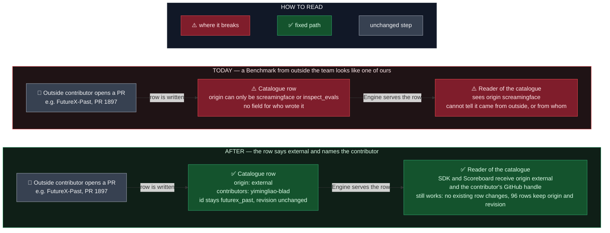

# Mark a Benchmark from an outside contributor as external

A **Benchmark** is an exam: questions, a model that answers them, and a grader. Each one has a
row in the Engine's catalogue, and the row says where the exam came from in a field called
**origin**. Until now origin had two values: `screamingface` (the team wrote it) and
`inspect_evals` (imported from the [inspect_evals](https://github.com/UKGovernmentBEIS/inspect_evals)
catalogue). The first Benchmark written by someone outside the team arrived as
[PR 1897](https://github.com/ScreamingFace/screamingface/pull/1897) (FutureX-Past), and it had
to call itself `screamingface`. This spec adds a third origin, `external`, and a
`contributors` field naming who wrote it, the way
[inspect_evals' own catalogue](https://ukgovernmentbeis.github.io/inspect_evals/) marks its
External shelf (link unverified).

## Before / After

## The rule

| Origin | Who wrote the Benchmark | Handle list it must carry | Handle list it may not carry | Public id |
|---|---|---|---|---|
| `screamingface` | the team | none | `inspect_contributors`, `contributors` | bare key, `musique` |
| `inspect_evals` | inspect_evals' porters | `inspect_contributors` | `contributors` | `inspect-<key>` |
| `external` | an outside contributor | `contributors` | `inspect_contributors` | bare key, `futurex_past` |

- A handle is a GitHub username, checked by the rule `inspect_contributors` already uses.
- A missing required list is a provenance gap (the registry-wide conformance test names it);
  a list on the wrong origin is refused when the row is built.
- `contributors` is served on the catalogue entry only when set. It never enters a Benchmark
  Revision, so no published id moves.

**This reverses one earlier decision for `external` rows only.** The provenance spec
(`docs/spec/2026-10-05-OME-1455-benchmark-provenance.md`, owner decision 2026-10-06) dropped
a `contributors` field because in a team-only registry it was one handle on 57 of 65 rows and
git already holds it. That still holds for a row the team wrote, so the field stays refused
there. An outside contributor is credit owed outside (owner decision, 2026-11-18).

## Scope

| Now | Later | Out |
|---|---|---|
| Engine: the third origin, the field, the rule, the bare id | A badge for external Benchmarks in the SDK listing and on the Scoreboard page | Marking a pull request itself (a GitHub label) |
| SDK: decode `contributors`, expose it on `BenchmarkProvenance` | Flipping FutureX-Past's two rows, in PR 1897 after this merges | A contributor's organisation or contact |
| Scoreboard: declare the key so the seed keeps it | | |

## Acceptance

1. A Benchmark built with `origin="external"` and one handle serves `origin: external` and
   `contributors: [handle]`; with another origin and a handle it is refused.
2. `imported_benchmark_id("futurex_past", "external")` is `futurex_past`.
3. Flipping an existing local Task row to `external` leaves its id and revision unchanged.
4. The SDK decodes the key onto `Benchmark.provenance.contributors`; the public-surface
   snapshot is unchanged.
5. No existing row's served entry changes: 0 of the 96 rows sets `contributors`.
